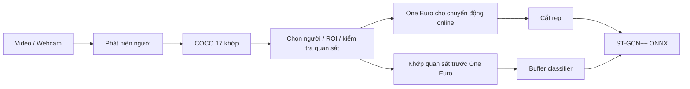

# Thiết kế nhận diện khớp

Phạm vi: cải thiện đầu vào khớp từ video/webcam, giữ nguyên trọng số
ST-GCN++, không train lại hoặc giải nén FIT. Cách khởi động ở
[README](../README.md); kết quả và lỗi còn lại ở [kiểm định](POSE_VALIDATION.md).

## Backend và cấu trúc

| Cờ `--pose-backend` | Luồng |
|---|---|
| `yolo` (mặc định) | YOLOv8n-Pose → tracking/lọc |
| `yolo-detect-rtmpose` | YOLOv8n Detect → RTMPose-m → tracking/lọc |
| `rtmpose` | Bí danh của `yolo-detect-rtmpose` |
| `yolo-pose-rtmpose` | Box từ YOLO-Pose → RTMPose, giữ để đối chứng |



| Thành phần | Mã nguồn |
|---|---|
| Cấu hình, kiểm tra tài nguyên, metadata phiên | [factory.py](../smart_gym_camera_app/pose_backends/factory.py) |
| Box người class 0; từ chối model pose ở luồng Detect | [person_detector.py](../smart_gym_camera_app/pose_backends/person_detector.py) |
| Ghép box với RTMPose, không dùng khớp YOLO | [yolo_rtmpose.py](../smart_gym_camera_app/pose_backends/yolo_rtmpose.py) |
| Crop, chuẩn hóa, giải mã SimCC về tọa độ ảnh gốc | [rtmpose_estimator.py](../smart_gym_camera_app/rtmpose_estimator.py) |
| Suy luận toàn ảnh và phục hồi ROI | [pose_detector.py](../smart_gym_camera_app/pose_detector.py) |
| Liên kết người, One Euro, mask quan sát, điều kiện khớp | [pose_tracking.py](../smart_gym_camera_app/pose_tracking.py) |
| Loại sentinel và dữ liệu không hữu hạn | [enhanced_pose_processor.py](../smart_gym_camera_app/enhanced_pose_processor.py) |

## Các quy tắc cần giữ

- Đầu ra dùng COCO-17, chuẩn hóa theo ảnh gốc. Loại tọa độ `(0,0)` thiếu
  dấu, điểm ngoài ảnh, box rỗng và dữ liệu không hữu hạn. Một trục bằng 0
  vẫn có thể là điểm thật ở biên ảnh.
- RTMPose đọc `pipeline.json` cạnh ONNX: crop đệm 1.25, giữ tỉ lệ theo
  input 192×256 của bản m/s hiện dùng, chuyển BGR→RGB và chuẩn hóa theo
  metadata. SimCC dùng argmax, split ratio 2; score không phải xác suất
  đã hiệu chuẩn và không so trực tiếp với confidence YOLO.
- Giữ mọi ứng viên người cho bộ chọn; không ghép khớp từ nhiều detection.
  Trường hợp mơ hồ bị giữ lại, không tự chấm rep.
- Liên kết dùng IoU, khoảng cách tâm/diện tích box và dịch chuyển khớp.
  Tỉ lệ diện tích hợp lệ `[0.3,3]`, IoU ít nhất 0.15 hoặc khoảng cách tâm
  không quá 0.3 đường chéo box cũ; hai điểm liên kết cách dưới 0.06 là mơ hồ.
- Lịch sử gián đoạn hơn 0.25 giây hủy rep dở; mất mục tiêu hơn 1 giây
  yêu cầu click chọn lại/reset. Số rep đã hoàn thành được giữ khi chỉ
  ngắt lịch sử; phím R reset thủ công cả bộ đếm.
- One Euro tính trên pixel theo timestamp nguồn: cutoff vận tốc 1 Hz,
  cutoff tọa độ `4 + 2 × vận tốc đã lọc / độ dài thân`. Điểm yếu dưới
  `ngưỡng khớp + 0.15` bị giữ lại khi nhảy quá 0.3 độ dài thân và vượt
  12 độ dài thân/giây. Đây là ngưỡng kỹ thuật, chưa tối ưu bằng nhãn độc lập.
- ROI đệm 30% mỗi phía, dùng lịch sử tối đa 0.6 giây, retry cách ít nhất
  0.1 giây nguồn. Chỉ nhận toàn bộ skeleton qua cổng liên kết/chất lượng,
  đổi tọa độ về ảnh gốc và loại điểm sát biên crop bên trong ảnh.
- Ngoại suy tối đa 0.15 giây chỉ phục vụ hiển thị. Mask `observed` phải
  được giữ khi ghi raw/model input; ngoại suy không làm frame đủ điều kiện.
- Đổi nguồn, kích thước, bài tập, phát lại hoặc chọn người phải reset
  lịch sử phù hợp. Không lọc online hai lần; analyzer còn tiền xử lý legacy.

## Cấu hình vận hành

Chạy từ `smart_gym_camera_app`:

```bash
python -m tools.fetch_pose_models
python -m tools.fetch_pose_models --rtmpose-size s
python -m tools.fetch_pose_models --detector-file /path/yolov8n.pt --rtmpose-archive /path/official_rtmpose_m.zip
```

| Tham số | Mặc định | Ý nghĩa |
|---|---|---|
| `--person-model` | `weights/detectors/yolov8n.pt` | Model Detect COCO cục bộ |
| `--rtmpose-model` | `weights/rtmpose/m/end2end.onnx` | ONNX kèm metadata |
| `--person-conf` / `--person-iou` | 0.25 / 0.7 | Ngưỡng box / NMS |
| `--pose-min-score` | YOLO 0.5, RTM 0.3 | Ngưỡng khớp riêng từng thang score |
| `--pose-imgsz` / `--pose-threads` | 640 / 2 | Input YOLO, bội số 32 / số luồng CPU |
| `--no-roi-recovery` | Không bật cờ | Tắt retry để đối chứng/giảm chi phí |

RTMPose chạy ONNX Runtime CPU; YOLO dùng CPU/CUDA theo PyTorch. Nhiều
người làm tăng số crop RTMPose. Ứng dụng chỉ nạp file cục bộ; công cụ cài
kiểm SHA-256 ZIP/model/metadata, hỗ trợ offline. Tài nguyên tùy chỉnh
không được coi là đã đối chiếu checksum mặc định chỉ vì load thành công.
Mỗi phiên ghi `pose_backend.json`: backend, cấu hình và SHA tài nguyên.

## Nguồn kỹ thuật

- [One Euro: thuật toán và điều chỉnh](https://gery.casiez.net/1euro/).
- [RTMPose/OpenMMLab](https://github.com/open-mmlab/mmpose/tree/main/projects/rtmpose).
- [YOLOv8n Detect, bản phát hành dùng trong nhánh](https://github.com/ultralytics/assets/releases/tag/v8.3.0).
