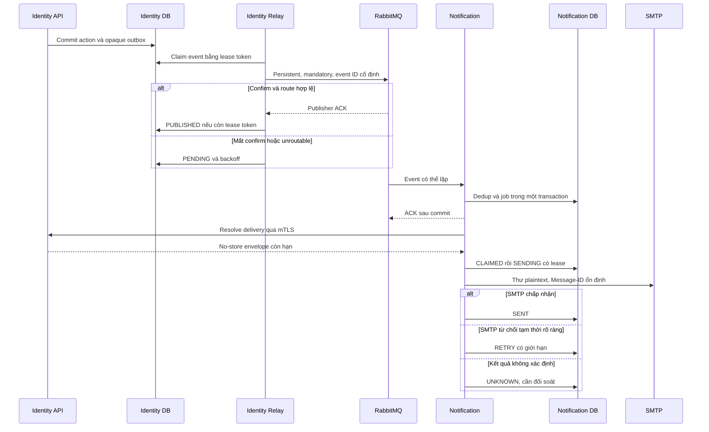

# ADR 0004 — Email giao dịch và relay Identity

Status ACCEPTED cho backend T09 local, theo yêu cầu tiếp tục thực hiện và quyền quyết định kỹ thuật thông thường. Giữ RabbitMQ và bảy service; không bổ sung service email riêng.

Identity chạy relay process độc lập chỉ đọc/ghi outbox của chính Identity. Publish persistent message lên durable topic exchange smartgym.events.v1, routing key theo type, mandatory và publisher confirm. Chỉ đánh dấu PUBLISHED sau confirm, không có basic.return. Mất confirm/timeout giữ retry; mất process sau confirm trước commit có thể phát lại cùng event ID. Claim bằng lease/token và SKIP LOCKED, không giữ transaction DB trong khi đợi broker. Lease cũ không được ghi đè kết quả relay mới.

Notification có database/inbox/delivery jobs/attempts riêng. Consumer chỉ nhận identity.email-action.requested.v1, validate envelope và consistency aggregate/deliveryRef, dedup event ID + hash canonical và unique business source. ACK chỉ sau commit inbox/job; payload không hợp lệ hoặc event ID bị tái dùng với nội dung khác được reject không requeue sang DLQ. DB lỗi đóng channel, để broker redeliver sau reconnect, tránh hot-loop nack. Durable quorum queue, manual ACK, prefetch 8; DLX binding/queue arguments được quản lý tại topology provisioning, không do runtime tự tạo. Thay đổi DLX về sau cần migration topology có kiểm soát.

Worker claim job bằng SKIP LOCKED và token lease. Resolve delivery qua Identity mTLS, kiểm schema/ref/purpose/expiry/origin của link trước render, chỉ giữ email/token trong bộ nhớ. Không lưu nội dung thư, raw recipient/link, hoặc error message provider trong Notification DB/log. Email security tách khỏi reminder preferences. expired/superseded/used action là CANCELED, 404 là terminal FAILED.

SMTP qua Nodemailer, plain-text UTF-8 template tiếng Việt, không render HTML tùy ý. Message-ID ổn định theo delivery job nhưng SMTP không đảm bảo dedup. Timeout sau khi bắt đầu send, disconnect không rõ đã accept hoặc worker chết khi SENDING => UNKNOWN, không tự retry. Chỉ lỗi xác định chưa nhận (SMTP 4xx, connect failure trước DATA) mới retry tối đa 5 lần, backoff 5s/30s/2m/10m, giới hạn bởi action expiry. SMTP 5xx terminal FAILED. Mất DB sau provider accept cũng thành UNKNOWN khi lease hết; không khẳng định exactly-once email.

UNKNOWN phải đối soát receipt bởi operator với bằng chứng ngoài DB; CLI resolve ghi audit, hoặc đánh dấu SENT nếu provider xác nhận, hoặc RETRY khi xác nhận chưa nhận. Nếu chưa biết, giữ UNKNOWN và người dùng có thể yêu cầu link mới. Không tự gửi lại UNKNOWN bằng cùng task. Broker DLQ/replay và SMTP UNKNOWN là hai cơ chế khác nhau.

AMQP/SMTP plaintext chỉ cho loopback sandbox với cờ local rõ ràng; deployment yêu cầu TLS và credential tách publisher/consumer. Provisioning topology có credential riêng, không cấp configure-all cho runtime. Identity HTTP không phụ thuộc broker/email để phục vụ phiên cũ. Notification health dùng mTLS, readiness DB và kết nối worker theo process, không mở API inbox/reminder trước T19/T20.

Chọn amqplib 2.2.1, Nodemailer 10.3.1 và smtp-server 3.21.3 cho sandbox test, theo npm registry kiểm 2026-11-07. Kiểm types/source/build/test sau install. RabbitMQ 4.4.0 và Erlang 28.5.0.7 portable chỉ phục vụ test Windows, archive kiểm SHA-256 theo GitHub releases, không cài Windows service. Runtime thực chỉ được ghi VERIFIED sau khi chạy. Production provider/domain/credentials và container ACL thuộc cổng triển khai sau.

Nguồn: [RabbitMQ confirms](https://www.rabbitmq.com/docs/confirms), [Erlang compatibility](https://www.rabbitmq.com/docs/which-erlang), [AMQP client](https://amqp-node.github.io/amqplib/channel_api.html), [SMTP transport](https://nodemailer.com/smtp). Các URL rolling là tham khảo; phiên bản chạy dựa vào manifest/lockfile và test.

