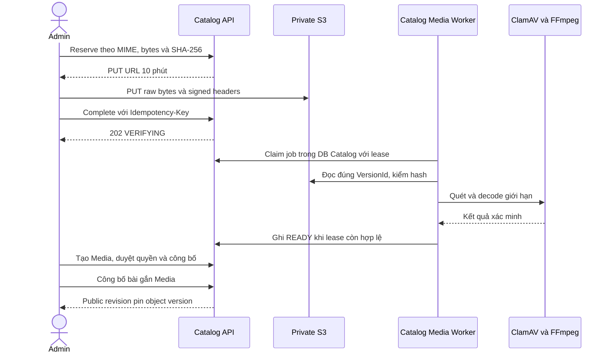

# ADR 0007 — Lưu trữ và xác minh media Catalog

ACCEPTED cho T33 theo quyền triển khai nhánh CMS. Catalog tiếp tục sở hữu metadata, quyền, revision và bytes trong prefix riêng. Quyết định này cụ thể hóa luồng media trong ADR 0001 và 0006.

Chọn S3 API và AWS SDK 3.1161.0, pin manifest/lockfile sau khi kiểm registry ngày 2026-11-07. Bucket private bật versioning và chặn truy cập ẩn danh. Catalog cấp PUT 10 phút, ký MIME, Content-Length, SHA-256 và If-None-Match. Khóa upload theo actor và có tối đa tám reservation đang mở. Credentials dùng IAM hoặc secret môi trường của Catalog. Signed URL chỉ được tạo ở biên phản hồi, receipt idempotency giữ ID và thời điểm hết hạn.

Worker riêng trong package Catalog tải đúng object version về file tạm private, kiểm giới hạn bytes/hash/magic, quét ClamAV INSTREAM và decode bằng FFmpeg. Nó chạy một job mỗi process, dùng lease PostgreSQL ba phút và token fencing. Giới hạn một lần xử lý 150 giây, tối đa năm lần cho lỗi phụ thuộc. Ảnh tối đa 4096×4096. Video tối đa 120 giây, cạnh dài 1920 và cạnh ngắn 1080, 7200 frame. Chạy decoder với protocol file và danh sách demuxer hẹp. Môi trường vận hành cần giới hạn bộ nhớ/CPU và cập nhật signature ClamAV.

Bài tập công bố pin support revision và object version đã xác minh, giữ đường dẫn gateway theo media ID/version. Gateway đọc PostgreSQL trước khi stream, chỉ phục vụ phiên bản có bài đang public tham chiếu. Dữ liệu trả no-store và hỗ trợ một byte range. Chuyển rightsStatus sang REJECTED đánh dấu upload bị thu hồi vĩnh viễn ở đường phục vụ. Cần upload ID mới cho tài sản được cấp quyền lại. Preview admin có signed GET tối đa 60 giây.

GC chỉ xóa upload hết hạn hoặc bản READY không được revision nào tham chiếu sau 30 ngày. Mọi lịch sử Media còn giữ đều chặn GC. Đánh dấu EXPIRED dưới khóa hàng trước khi xóa đúng phiên bản object. Retry dùng cùng object key/version. Không đặt lifecycle bucket tự xóa toàn prefix Catalog khi còn revision tham chiếu.

Kiểm thử cục bộ dùng SeaweedFS 4.52 qua S3, FFmpeg 9.0.2 và ClamAV 1.5.4 portable pin SHA-256. Scanner test nạp database chữ ký thử có tên rõ ràng. Nó xác minh protocol/nhánh phát hiện, còn dữ liệu chữ ký sản xuất và provider S3 đích được nghiệm thu ở staging. Quy trình vận hành và giới hạn xem [Operations](../guides/OPERATIONS.md).

Ngày đối chiếu 2026-11-07. [S3 presigned URLs](https://docs.aws.amazon.com/AmazonS3/latest/userguide/using-presigned-url.html) · [AWS presigner](https://docs.aws.amazon.com/AWSJavaScriptSDK/v3/latest/Package/-aws-sdk-s3-request-presigner/) · [ClamD protocol](https://docs.clamav.net/manual/Usage/ClamdProtocol.html) · [FFmpeg](https://ffmpeg.org/ffmpeg.html)
