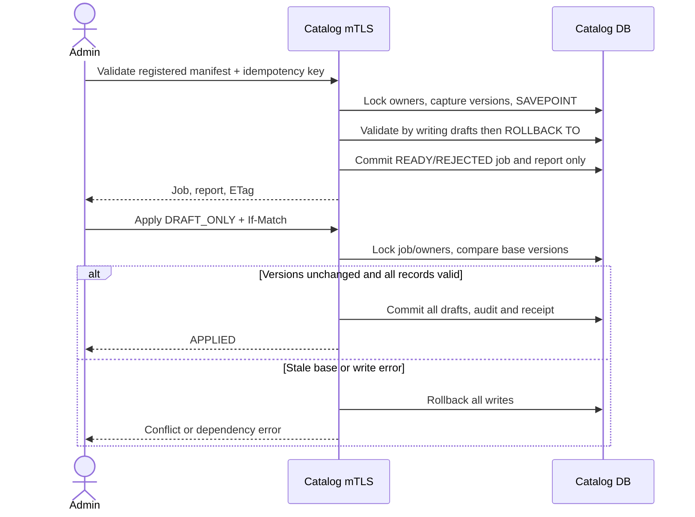

# ADR 0009 — Import nháp và export Catalog

ACCEPTED cho T34 theo quyền tiếp tục nhánh CMS ngày 2026-11-07. Cụ thể hóa ADM-006 và ADR 0006, giữ cùng Catalog boundary và database.

Operator đăng ký file JSON qua CATALOG_IMPORT_REGISTRY_FILE. Request chỉ chọn sourceKey/sourceRevision/manifestSha256 trong allowlist, không nhận path/URL. File phải ở trong thư mục registry sau realpath, tối đa 2 MiB và 200 record. Digest là SHA-256 trên JSON canonical theo cùng fingerprint Catalog. Gói chứa provenance và record typed cho năm loại CMS. Không đọc hoặc thực thi nguồn SmartGym/RAG trong runtime import.

Validate giữ advisory lock publication và khóa owner hiện có, chụp edit versions, thử ghi bằng aggregate hiện hành dưới SAVEPOINT rồi ROLLBACK TO. Chỉ job/report/base versions và audit validate được commit. Ghi thử không công bố, không tạo outbox hoặc thay slug. Sequence audit có thể có khoảng trống do rollback; không suy ra thiếu dữ liệu từ khoảng trống sequence.

Apply khóa job/owner, kiểm ETag và base digest, dùng payload đã xác minh trong DB thay vì đọc lại file. Tái sử dụng validation và lưu revision của AdminCatalog/AdminSupport trong cùng transaction, theo taxonomy/media → exercise → variant. Lỗi bất kỳ rollback toàn bộ draft/audit/receipt. Archived record không tự được phục hồi. Media vẫn phải READY và kiểm actor/quyền theo aggregate hiện hành. Manifest đã có job trả lại job đó, APPLIED không ghi lần hai, kể cả khóa idempotency mới. REJECTED cần sửa gói và manifest/revision để validate lại.

Export hiện hành tạo snapshot công khai, nguồn hướng dẫn và tombstone. Snapshot giữ bất biến khi được export lần đầu, giữ bảy ngày. Revision quá khứ chưa từng export không được tái dựng từ trạng thái hiện tại: trả 410. Mỗi lần đọc cache kiểm lại bài vẫn đang public cùng content revision và media chưa thu hồi. Thay/gỡ nội dung khiến bản cũ trả 410. Không thay publication bên trong snapshot cũ để che dữ liệu. generatedAt giữ lần tạo đầu; checksum của publication không phụ thuộc JSON formatting.

Đây là export admin T34. Feed/head/outbox cho đội RAG T36 vẫn cần đóng gói snapshot tại từng publication và thỏa thuận visibility/reconcile, không được coi lazy export này là provider integration đã hoàn tất. UI import/export thuộc T35. Cleanup bảng export đã hết hạn do runbook Catalog thực hiện; không có TTL tự xóa nguồn nghiệp vụ.

Đối chiếu ngày 2026-11-07: [PostgreSQL 18 SAVEPOINT](https://www.postgresql.org/docs/18/sql-savepoint.html), [ROLLBACK TO](https://www.postgresql.org/docs/18/sql-rollback-to.html), [RFC 8785 canonical JSON](https://www.rfc-editor.org/rfc/rfc8785).
