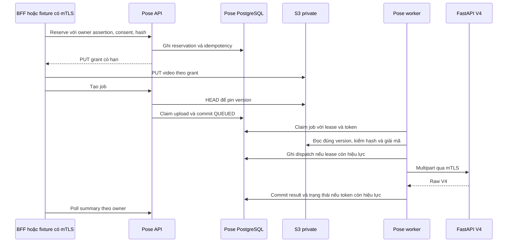

# ADR 0011 — Điều phối Pose quanh engine bàn giao

ACCEPTED cho T22 ngày 2026-11-07 theo quyền tiếp tục triển khai. Giữ bảy boundary và backend nghiệp vụ NestJS. Pose boundary có API/worker Node/NestJS cùng PostgreSQL Pose và object prefix riêng, gọi engine FastAPI V4 qua HTTP multipart mTLS. Không nhập domain/repository của service khác; Python engine giữ weights, preprocessing và inference nguyên bản.

Chọn NestJS cho coordination để dùng cùng toolchain và chuẩn JWT/mTLS/S3 đã được kiểm ở Web, thay vì thêm Python ORM/JWT/storage stack chỉ để bọc engine. Đây là cụ thể hóa ADR 0008: boundary Pose có nhiều process, không thêm service nghiệp vụ thứ tám. Engine có entrypoint Web-owned, import nguồn chỉ đọc, kiểm manifest/hash trước khởi động và Uvicorn yêu cầu client certificate. Engine chỉ bind loopback ở local; production dùng mạng riêng và CA riêng cho worker.

API chỉ nhận BFF mTLS + assertion Identity cho thao tác người dùng; raw result chỉ BFF, summary cho Progress với assertion owner. ADMIN không được đọc dữ liệu Pose người khác. JWT RS256, issuer/audience/TTL/JWKS đúng baseline. Không đọc database Identity. BFF và browser UI thuộc T24/T27; T22 nghiệm thu API/worker nội bộ.

Upload PUT private có 10 phút, ký MIME/size/SHA-256/If-None-Match, bucket versioning bắt buộc. Reserve gắn consent và owner, create job pin object version và chỉ claim upload một lần. Dedupe theo owner/hash/exercise/model/consent trong thời hạn kết quả. Idempotency receipt không lưu URL ký; replay chỉ dựng grant còn hạn sau kiểm owner. Không nhận owner/result/raw/hash model từ browser.

Worker claim bằng SKIP LOCKED, lease và token fencing. Kiểm bytes/hash/magic, ffprobe và decode giới hạn trước inference; không xử lý URL do client cấp. Đánh dấu dispatch bền trước POST. Timeout/crash sau dispatch là FAILED/INFERENCE_OUTCOME_UNKNOWN, không tự gửi inference lần hai. Mất lease trước dispatch có thể retry có giới hạn. Cancel không cam kết dừng GPU ngay, nhưng fencing ngăn lưu kết quả sau cancel. Result/raw/provenance và terminal job commit cùng transaction.

Video xóa sau terminal khi PUT grant đã hết hạn để tránh PUT hợp lệ tái tạo object sau delete; hạn cứng 24 giờ. Result mặc định 30 ngày; raw result chỉ đi qua API nội bộ owner-scoped, không đi Progress hoặc log. Cleanup theo DB claim/fencing, giữ retry xóa object và job ID đã hết hạn trả 410. Whole-video repCount null/UNAVAILABLE, không tự tạo rep hoặc coi không có nhãn lỗi là kỹ thuật đúng.

ADR 0012 bổ sung live session và BFF WSS ở T23. T24 nối UI và proxy upload. T25 nhập Progress và T27 dùng raw trong chat. CPU engine acceptance T21 không đủ cho quality/load/GPU/production. Artifact container, sandbox decoder, host S3/CA/secrets và production hardening còn gate T28/T29.

Đối chiếu yêu cầu ký conditional PUT với tài liệu S3 chính thức. [Conditional writes](https://docs.aws.amazon.com/AmazonS3/latest/userguide/conditional-writes.html)
