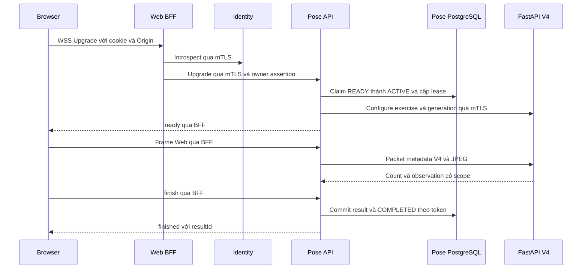

# ADR 0012 — Phiên tập trực tiếp qua WebSocket

ACCEPTED cho T23 ngày 2026-11-07. Dùng BFF HTTPS hiện có làm điểm vào cho browser. BFF kiểm Origin, host, subprotocol và cookie, lấy Identity assertion qua mTLS rồi mở WebSocket riêng đến Pose. BFF kiểm lại phiên mỗi 30 giây và đóng khi assertion hết hạn hoặc Identity từ chối. API Pose kiểm cert BFF và chữ ký assertion lúc mở kết nối. Node dùng `ws` 8.22.0 cho BFF và Pose, ghim `@types/ws` 8.18.2 cho Pose. Payload, số fragment và số buffer chunks đều có giới hạn. [Release ws](https://github.com/websockets/ws/releases/tag/8.22.0) · [Advisory về fragmentation](https://github.com/websockets/ws/security/advisories/GHSA-96hv-2xvq-fx4p)

PostgreSQL giữ một phiên READY hoặc ACTIVE mỗi owner. READY có hạn năm phút. Claim khóa hàng, chuyển ACTIVE trong tối đa 15 phút, tạo token và lease 30 giây. Pose gia hạn lease mỗi 10 giây. Sau disconnect, lỗi hoặc lease hết hạn, phiên cũ kết thúc và người dùng có thể tạo phiên mới. Finalize kiểm token rồi commit session và result trong một giao dịch. Frontend đọc lại GET theo owner nếu mất thông báo finished.

Pose chuyển header 12 byte big-endian của Web thành metadata V4, timestamp đổi từ mili giây sang giây và generation do server sinh. Adapter kiểm marker, kích thước JPEG trước khi engine decode, giới hạn 256 KiB, 640×480, refill 10 frame/giây với burst hai frame. Chỉ giữ một frame đang chạy và frame mới nhất đang chờ. Khi finish, xử lý xong frame đã dispatch và bỏ frame chờ. Khi frame gửi engine cách quá hai giây, V4 reset tracker, adapter giữ tổng đếm của các đoạn đã xử lý. Raw lưu observation hợp lệ gần nhất với scope `window` hoặc `rep` gốc. Đoạn quan sát này có thể kết thúc trước frame cuối. Phiên có đếm rep nhưng thiếu observation vẫn trả summary, route raw trả 422 `NO_RAW_OBSERVATION`. Phiên chưa thấy người trả `repCount=null`.

Result live cùng bảng với video, phân biệt bằng khóa ngoại. `sourceId` của live bắt nguồn từ hash session ID trong namespace Pose, dùng dedupe trong phạm vi phiên. `video_sha256` dành cho video tải lên. TTL kết quả live là 30 ngày kể từ lúc hoàn tất. Frame JPEG ở bộ nhớ và đi qua mTLS tới engine. T24 triển khai UI camera. T27 tiêu thụ raw qua API của Pose.

