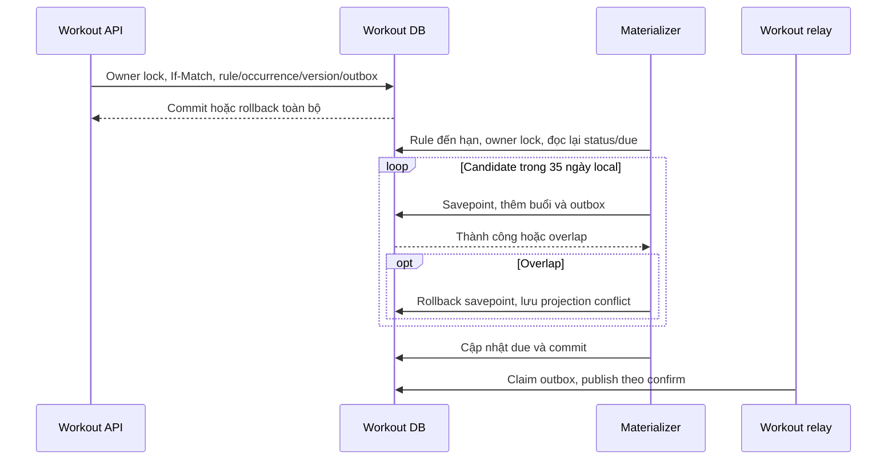

# ADR 0015 — Sửa lịch và phục hồi projection

ACCEPTED cho T15 theo quyền tiếp tục các task đã giao. Bổ sung [ADR 0014](0014-workout-schedule-time.md), không đổi ranh giới Workout.

## Phạm vi sửa và lịch sử

PUT schedule dùng If-Match và chỉ điều chỉnh buổi chưa bắt đầu, chưa được sửa riêng. Cùng ngày local gốc giữ ID và occurrence key, dù giờ hoặc zone rule thay đổi. Ngày không còn thuộc rule được hủy với version/event mới. Khi người dùng thêm lại ngày đó, có thể phục hồi buổi do rule hủy nếu chưa bắt đầu. Buổi đã dời/hủy riêng có overridden=true và không bị rule hoặc worker ghi lại. Buổi đã bắt đầu giữ nguyên dữ liệu.

Snapshot cùng plan ID được giữ nguyên khi sửa rule. Chọn plan ID khác chụp snapshot mới cho các buổi tương lai chịu rule. Buổi đã sửa riêng và quá khứ giữ snapshot cũ. Kế hoạch đích phải ACTIVE và thuộc owner. Không gọi Catalog khi chỉ sửa giờ vì Workout đã sở hữu snapshot được xác minh.

Hủy cả lịch hủy tất cả buổi chưa bắt đầu thuộc lịch, gồm buổi đã dời riêng. Đây là quyết định cụ thể hóa hành vi hủy chuỗi trong FLOW-05. Buổi đã hủy không phát event lần nữa khi gửi lệnh với ETag hiện hành. ETag cũ vẫn trả 412, thiếu trả 428. Hủy riêng hoặc dời buổi đã bắt đầu trả 409 OCCURRENCE_STARTED. Dời cần instant tương lai, thời lượng 5–240 phút và zone IANA hợp lệ. Không mở lại buổi đã hủy qua PATCH.

## Giao dịch và worker

Migration 003 thêm next_projection_at, last_projected_at, projection_error và index due/local slot. API và materializer cùng lấy advisory transaction lock owner 73021 trước row lock. PUT tạm giải phóng khoảng giờ của buổi đủ điều kiện trong cùng transaction rồi tính lại trạng thái cuối. Mọi thay đổi version và event outbox commit cùng dữ liệu. GiST từ chối overlap làm rollback toàn bộ lệnh của người dùng.

Materializer là process riêng, dùng database Workout, không cần Identity, Catalog hoặc broker. Mỗi batch tối đa 20 rule đến hạn, mỗi rule một transaction. Sau khi lấy lock phải đọc lại status/due để hai replica không áp dụng cùng lượt. Lượt thành công kiểm lại sau một phút. Crash trước commit không ghi một phần. Crash sau commit có due và occurrence key ngăn sinh trùng. Chỉ bổ sung buổi chưa có trong 35 ngày local từ hiện tại, không bù các buổi đã lỡ trong outage. Không nạp toàn bộ lịch sử occurrence khi đối chiếu rule.

Savepoint cho từng candidate giúp một overlap được ghi thành schedule_conflicts và các ngày hợp lệ còn lại vẫn được tạo. Conflict không có occurrence/event/reminder. Mỗi phút thử lại, khi hết xung đột thì tạo buổi và xóa conflict. Conflict ngoài cửa sổ hiện tại được dọn. Thay danh sách conflict tăng schedule version để ETag phản ánh response đã đổi. Worker không tăng version lịch chỉ vì refresh metadata vận hành.

Lỗi ngoài overlap rollback cả lượt rule, giữ last_projected_at cũ và lưu PROJECTION_FAILED cùng thời điểm retry sau một phút. Không ghi lỗi SQL hoặc dữ liệu riêng vào log. Mất DB hoàn toàn khiến process retry. Giám sát và cảnh báo đầy đủ thuộc T28/T29. Checkpoint thuộc Workout, không cần Redis hoặc Kafka cho cơ chế này.

Đối chiếu PostgreSQL 18 ngày 2026-11-07: [SAVEPOINT](https://www.postgresql.org/docs/18/sql-savepoint.html) và [transaction/advisory locks](https://www.postgresql.org/docs/18/explicit-locking.html). Hành vi thực tế được kiểm qua PostgreSQL 18.6 trong TST-15.

## Nghiệm thu và giới hạn

[TST-15](../planning/TEST_PLAN.md) kiểm stale writer, owner, race dời chồng, override, hủy lặp, rollback outbox, mở rộng horizon, hai replica, conflict/retry và worker process độc lập. T16 triển khai Planner/BFF, T19 đồng bộ reminder. T28/T29 kiểm tải, giám sát lag, role runtime tối thiểu và rollout/restore môi trường đích. Không coi thành công local là hoàn tất các cổng đó.
