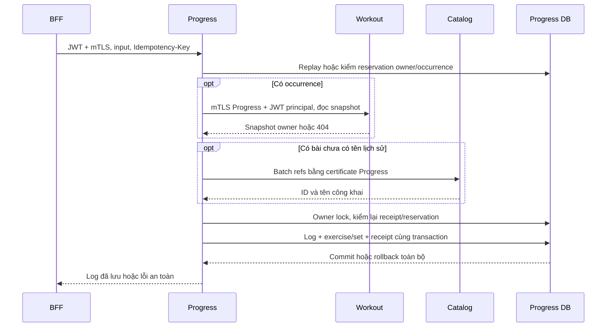

# ADR 0017 — Progress log và snapshot nguồn

ACCEPTED cho T17 theo quyền tiếp tục triển khai task. Giữ bảy service theo ADR 0001 và các ranh giới Workout/Catalog trong ADR 0013–0016. Không chuyển logic nhật ký vào Workout hoặc BFF.

## Dữ liệu và hợp đồng

Progress có NestJS package, database/role, migration/checksum, cấu hình mTLS, build/test/start riêng. Dùng cùng phiên bản Node 24.22.1, NestJS 12.4.0, pg 8.23.1 và Temporal 0.5.1 đã pin, không nâng công nghệ. Tái sử dụng bản sao tiện ích kỹ thuật auth/database/migrate/client trong repository, không import domain hoặc database repository của service khác.

Năm API nhật ký create/list/get/replace/delete theo owner. ADMIN không vượt quyền sở hữu. Mỗi bài được nhóm theo lần xuất hiện đầu trong input, set trả tăng dần ordinal trong bài. Cặp exerciseId/ordinal phải duy nhất. Một set có rep, thời lượng hoặc cả hai, weight và RPE tùy chọn. Dùng PostgreSQL numeric không ép scale để giữ số kg thập phân được gửi qua JSON, có CHECK 0–1000 loại NaN/Infinity. PerformedAt chuẩn hóa UTC millisecond và phải không ở tương lai. Đây là lựa chọn nghiệp vụ cho nhật ký thực tế, không dùng để đổi giờ kế hoạch.

Input không nhận tên snapshot. Output dùng WorkoutLoggedSetView có exerciseNameVi chỉ đọc, tách khỏi schema input. Bài manual mới phải đang công bố trong Catalog. Set đã có giữ tên lịch sử khi sửa, không cần đọc lại Catalog. Bài có trong snapshot lịch dùng tên đó, thêm bài ngoài kế hoạch phải qua Catalog refs. Batch refs tối đa 100 ID theo hợp đồng.

## Liên kết Workout

Thêm GET /internal/v1/workout/occurrences/{id}. Chỉ certificate Progress trong allowlist riêng cùng JWT principal đã xác minh được đọc. Certificate BFF không gọi nội bộ này và certificate Progress không được sửa plan/schedule/occurrence. Workout kiểm owner kể cả ADMIN, không tin owner ID từ body/header tùy ý. Progress không đọc database Workout.

Progress lưu snapshot occurrence gồm ID, phiên bản, instant, zone và planned exercises lúc đọc. Không có giao dịch phân tán hoặc khóa kéo dài giữa hai service. Dời/hủy sau lần đọc không sửa log. Cho phép ghi thực tế của buổi đã hủy hoặc tập sớm so với giờ dự kiến khi performedAt hợp lệ, vì nhật ký mô tả việc đã làm. Không tự đánh dấu occurrence hoàn thành. Trạng thái hoàn thành thuộc Progress.

Nguồn và occurrence đã liên kết là bất biến. PUT có thể bỏ occurrenceId để giữ liên kết, nếu có phải bằng ID đã lưu. Manual không được chuyển thành scheduled qua PUT. Import Pose thuộc T25, chưa có endpoint import runtime ở T17. Schema giữ pose_result_id/unique để T25 bổ sung bằng migration tiếp theo nếu cần, không lưu raw video/frame.

## Đồng thời, replay và xóa

Migration lock 73030, create/delete dùng owner transaction lock 73031 trong database Progress. Unique owner/occurrence và owner/pose không có predicate deleted_at, vì xóa vẫn giữ reservation nguồn. Hai key cùng occurrence chỉ một log được tạo. PUT và DELETE dùng If-Match, row lock và version, không ghi đè writer mới. I/O liên service ở ngoài transaction ghi ngắn, kết quả lưu thành snapshot.

Create receipt owner/operation/key có fingerprint canonical, log ID và response đầu tiên, TTL 24 giờ. Replay kiểm trước khi gọi nguồn để chịu outage và trả cùng response tạo đầu tiên. Sau khi log bị xóa, receipt bỏ response và replay cùng key còn hạn trả 410 LOG_DELETED. Đây là ngoại lệ có chủ đích của quy tắc replay thông thường để không lộ lại payload đã xóa. Khác key hoặc receipt hết hạn vẫn bị reservation occurrence từ chối 409 OCCURRENCE_ALREADY_LOGGED.

DELETE ẩn log khỏi get/list, xóa exercise/set, notes/duration/source snapshot và payload receipt, giữ ID/owner/source reference/performedAt/version/deleted_at làm tombstone. Không phải xóa tài khoản hoặc xóa backup toàn diện, quy trình đó thuộc T28/T29. GET tài nguyên đã xóa trả 404. ETag cũ khi DELETE lại trả 412. Với log manual, key hết TTL có thể tạo thao tác mới theo hợp đồng idempotency chung.

## Nghiệm thu và triển khai

TST-17 kiểm PostgreSQL thật, mTLS/API service riêng, caller/owner, race, set validation, decimal, rollback, cursor, tombstone và outage/restart. Runtime artifact version 0.1.0, build/start/migrate độc lập. Readiness kiểm schema 1 và DB, không phụ thuộc Catalog/Workout khi chỉ đọc dữ liệu cũ. Liveness độc lập DB. Container source ở Dockerfile.progress, build/tag/digest và môi trường đích cần kiểm tại T28/T29.

Nguồn đọc ngày 2026-11-07: [PostgreSQL 18 constraints](https://www.postgresql.org/docs/18/ddl-constraints.html), [numeric](https://www.postgresql.org/docs/18/datatype-numeric.html). Hành vi CHECK/unique/rollback được kiểm bằng PostgreSQL 18.6 trong TST-17.
