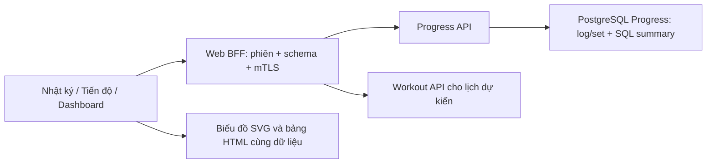

# ADR 0018 — Tổng hợp tiến độ và nhật ký trên Web

ACCEPTED cho T18 theo quyền tiếp tục triển khai task. Bổ sung [ADR 0017](0017-progress-log-ownership.md), giữ Progress sở hữu số liệu thực tế và Workout sở hữu lịch dự kiến.

## Tổng hợp theo ngày

GET /api/v1/progress/summary nhận from/to là ngày địa phương, bao gồm hai đầu, tối đa 366 ngày, cùng timeZone IANA. Temporal 0.5.1 đã pin tính ranh giới instant đầu ngày và đầu ngày sau ngày cuối, không coi ngày DST luôn dài 24 giờ. PostgreSQL lọc owner, deleted_at và khoảng UTC bằng index hiện có, nhóm performed_at AT TIME ZONE theo ngày địa phương.

Một câu SQL tạo số liệu của cả lần đọc: tổng hợp set theo log trước, sau đó theo ngày để không đếm một log nhiều lần. Rep chỉ cộng set có repetitions. Volume chỉ cộng repetitions × weight_kg khi cả hai có giá trị, không suy số rep từ thời lượng. PostgreSQL numeric tính volume và tổng trước khi đổi sang JSON number, không cộng hoặc ép scale trong JavaScript. Generate_series theo số nguyên tạo đủ ngày có giá trị 0. Không dùng cache, bảng tổng hợp hoặc kho dữ liệu mới. Sửa/xóa log phản ánh ở lần đọc kế tiếp. Response được kiểm ProgressSummary và trả lỗi an toàn nếu vượt giới hạn hợp đồng.

ICU/Temporal và tzdata PostgreSQL cần tương thích cho múi giờ vận hành. TST-18 kiểm Asia/Bangkok, UTC, New York DST và ngày bị bỏ của Apia. Vận hành kiểm lại khi nâng runtime/tzdata, không suy ra đã kiểm mọi vùng.

## BFF và UI

Web thêm allowlist sáu operation Progress, schema sinh từ OpenAPI. Mỗi request introspect Identity, giữ assertion server-side và gọi Progress bằng mTLS cấu hình riêng. Không chuyển cookie/role/Authorization của browser tới Progress. Kiểm path/query/header/body/response, If-Match, Idempotency-Key, ETag và Location. Không follow redirect hoặc tự retry command. Request tối đa 64 KiB, deadline Progress 7 giây. Response log được giới hạn 256 KiB mỗi item và nhân page limit cho list, tối đa 25 MiB theo limit 100. Không tạo package proxy chung hoặc import backend source.

Lỗi duplicate occurrence chỉ trả link tương đối đã kiểm UUID của log chính owner, không chuyển chi tiết lỗi tùy ý từ upstream. Input không nhận tên snapshot. Log editor giữ draft/ETag/key trong bộ nhớ, lỗi 409/412/401 không xóa nội dung. Tải bản mới và xóa có xác nhận. Sau tạo có link tới log đã lưu, retry cùng payload giữ key. Khi ghi theo lịch, dùng snapshot của buổi để điền các set, người dùng xác nhận số liệu thực tế. Nếu kế hoạch vượt 200 set, UI nêu rõ chỉ điền 200 set đầu theo giới hạn log, cho phép sửa/bỏ trước lưu.

Các route `/app/nhat-ky`, `/moi`, `/[id]` và `/app/tien-do` có gate phiên, noindex và dữ liệu API no-store. URL giữ bộ lọc ngày/zone/cursor. Biểu đồ số buổi dùng SVG, có bảng HTML đầy đủ với caption/header và vùng cuộn có nhãn, không buộc người dùng đọc đồ thị. Mọi chỉ số có đơn vị, biểu diễn số không ép ba hay chín chữ số thập phân.

Dashboard tải summary bảy ngày, ba log gần đây trong 30 ngày và lịch dự kiến bảy ngày bằng các request độc lập. Một service lỗi chỉ làm lỗi vùng phụ thuộc, không làm mất profile hoặc buộc logout. Lịch dự kiến vẫn do Workout xác nhận, không coi một log là lệnh sửa trạng thái occurrence. Widget thông báo/inbox chờ T20, không giả dữ liệu chưa đọc.

## Nghiệm thu và vận hành

TST-18 đối chiếu số liệu sau tạo/sửa/xóa, owner, UTC/local day, leap year/DST, decimal và zero-fill. Chromium kiểm CRUD, stale draft, duplicate occurrence mở log cũ, pagination, session/CSRF, responsive, bảng và lỗi widget. BFF unit dùng upstream TLS fixture có tên rõ để kiểm phản hồi độc hại, redirect, response cap và header. Không coi fixture là nghiệm thu provider AI. Giữ cổng T07 cho kiểm thiết bị thật/quyền phát hành và T28/T29 cho container, tải và vận hành đích.

Nguồn đọc ngày 2026-11-08: [PostgreSQL 18 aggregates](https://www.postgresql.org/docs/18/functions-aggregate.html), [date/time](https://www.postgresql.org/docs/18/functions-datetime.html), [W3C tables](https://www.w3.org/WAI/tutorials/tables/). Runtime và API được xác minh bằng PostgreSQL 18.6 và Chromium hiện có, không thêm dependency hoặc nâng phiên bản.
