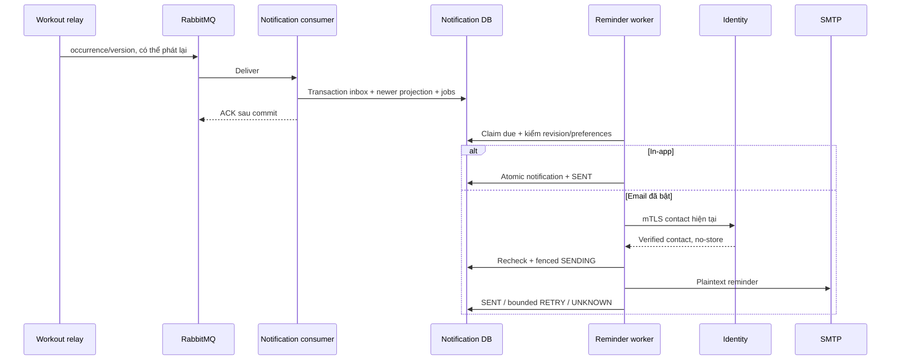

# ADR 0019 — Nhắc lịch theo phiên bản occurrence

ACCEPTED cho T19 theo quyền tiếp tục triển khai đã giao. Bổ sung [ADR 0004](0004-transactional-email.md) và [ADR 0015](0015-workout-schedule-reconciliation.md). Không thêm Redis/Kafka hoặc đọc database Workout/Identity.

Notification nhận `workout.occurrence.changed.v1` qua queue quorum riêng. ACK sau commit inbox, projection và jobs. Event ID/hash chống phát lại sai nội dung; occurrence version chỉ tăng, cùng version khác nội dung bị DLQ, bản thấp hơn bị bỏ qua. Owner occurrence bất biến. CANCELED được giữ làm tombstone để bản cũ không phục hồi lịch. Event kiểm schema, aggregate ID, khoảng giờ và IANA zone. Một owner advisory transaction lock điều phối consumer, preferences và worker trước row lock.

Migration 002 mở rộng delivery_jobs bằng owner và purpose WORKOUT_REMINDER, channel IN_APP/EMAIL, version occurrence; unique nguồn security chuyển thành partial index giữ nguyên quy tắc T09. Projection, preferences và notifications do Notification sở hữu. Mỗi channel/version chỉ có một job. Mặc định in-app bật, email tắt, lead 60 phút; trong khoảng lead nhưng chưa bắt đầu thì gửi ngay, đã bắt đầu thì bỏ nhắc. Đổi preference tính lại jobs chưa gửi; không gửi lại job đã SENT/FAILED/UNKNOWN. Bộ thao tác preference nội bộ được kiểm ở T19; API và UI owner-scoped thuộc T20.

Worker claim và chuyển sang SENDING kiểm lại projection revision, trạng thái, giờ bắt đầu và preferences hiện tại. Lease token chặn worker cũ. In-app được ghi cùng SENT/attempt trong một giao dịch, không có cửa sổ UNKNOWN. Email lấy contact hiện tại qua Identity mTLS/no-store, chỉ nhận email đã xác minh và giữ trong bộ nhớ; link chỉ tới route occurrence của Web. Không lưu tên chương trình, email hoặc nội dung provider trong job/event/log. SENDING là điểm dispatch: dời/hủy hoặc opt-out đã commit trước điểm này ngăn gửi; sau đó SMTP có thể đã nhận, không thể thu hồi. Sự kiện Workout chưa đến cũng là cửa sổ eventual consistency được chấp nhận, không tuyên bố hủy tức thì xuyên service.

Retry tối đa 5 lần với backoff 5s/30s/2m/10m và dừng khi buổi bắt đầu. Lỗi rõ chưa gửi mới retry; kết quả SMTP mơ hồ hoặc lease SENDING hết hạn giữ UNKNOWN, dùng CLI đối soát T09. CLAIMED hết hạn có thể retry, mọi ghi kết quả phải khớp token. Scheduler tiếp tục xử lý projection bền vững khi broker mất kết nối; DB lỗi giữ broker message chưa ACK và không gửi nếu chưa commit dispatch marker. Email auth không chịu preference và worker auth không claim jobs nhắc lịch.

Topology mới được provision riêng bằng quyền quản trị; runtime chỉ consume queue được cấp, không configure/publish/đọc DLQ. Readiness yêu cầu migration 002 và cả hai consumer; worker retry không xóa dữ liệu. Giữ migration 001 và checksum đã áp dụng. Không tự purge inbox/projection/version tombstone; retention/replay phải được phối hợp theo runbook.

Đối chiếu hành vi bằng installed pg/amqplib/Nodemailer đã pin và các ca TST-19. [PostgreSQL 18 locks](https://www.postgresql.org/docs/18/explicit-locking.html), [RabbitMQ consumer acknowledgements](https://www.rabbitmq.com/docs/confirms) và [Nodemailer SMTP](https://nodemailer.com/smtp) là nguồn kỹ thuật; không thay thế nghiệm thu thực tế. [Database](../design/DATABASE.md) · [Test plan](../planning/TEST_PLAN.md) · [Operations](../guides/OPERATIONS.md).
