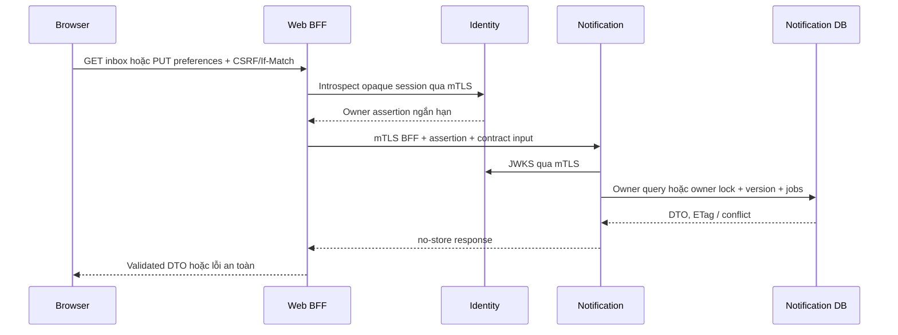

# ADR 0020 — Hộp thông báo và tùy chọn nhắc trên Web

ACCEPTED cho T20 theo quyền tiếp tục các task đã giao. Giữ [ADR 0019](0019-notification-reminders.md), ownership Notification và default in-app bật/email nhắc tắt/lead 60 phút. Không thêm dependency hoặc migration.

Bốn operation OpenAPI được phục vụ qua BFF cùng origin. Notification bật API có chủ đích bằng NOTIFICATION_API_ENABLED=true, yêu cầu fingerprint BFF và issuer Identity; chế độ health/worker T19 vẫn chạy khi API tắt. API trực tiếp bắt buộc mTLS đúng BFF và JWT owner ngắn hạn đã xác minh qua JWKS Identity. ADMIN không được đọc dữ liệu người khác. BFF introspect phiên mỗi request, bỏ cookie/Authorization/header owner giả trước upstream, kiểm Origin/CSRF và contract hai chiều. Không trả token hoặc trường nội bộ ra browser. API và trang riêng no-store/noindex; backend không phụ thuộc trạng thái broker để đọc inbox hoặc lưu preference.

Danh sách keyset giảm dần theo (created_at,id), limit 1–100 mặc định 20; cursor gắn owner/filter/limit và giữ microsecond timestamp DB, không dùng offset. Predicate owner luôn nằm trong SQL. Thêm unreadCount vào NotificationPage: số tất cả mục chưa đọc của owner, cùng statement snapshot với trang dữ liệu, không phải số của riêng trang. Filter unreadOnly chỉ nhận true/false. Đọc mục dùng UPDATE owner + COALESCE(read_at,now), PUT lặp giữ nguyên timestamp, tài nguyên người khác trả 404. Lịch sử thông báo đã gửi không bị sửa theo occurrence mới; link đưa tới trạng thái hiện hành.

Preferences GET/PUT trả strong ETag. PUT bắt buộc If-Match và schema ba trường, version check trong owner lock của T19; stale trả 412, thiếu 428, body sai 422. Mặc định được tạo nguyên tử khi đọc lần đầu. Đổi kênh/lead đi qua ReminderPreferences, tính lại jobs chưa dispatch trong cùng giao dịch; không ghi SQL riêng bỏ qua fencing, không tác động auth email. UI giữ input khi 412/401/503, chỉ tải lại bản server sau xác nhận bỏ thay đổi. Không tự retry PUT sau lỗi mạng không rõ kết quả; có nút tải cấu hình server để đối chiếu.

Routes /app/thong-bao và /app/cai-dat/thong-bao có requireProfile, metadata riêng, link tài khoản/lịch. Inbox có tất cả/chưa đọc, phân trang, read button và link buổi tập riêng biệt. Chỉ đánh dấu đã đọc sau thao tác rõ ràng. Badge số chưa đọc ở dashboard dùng số server; lỗi không giả số 0. Refresh khi focus, mỗi 30 giây khi tab hiện; không có polling khi tab ẩn. Refresh giữ dữ liệu đã tải kèm thông báo lỗi, mọi request bị hủy khi unmount và phản hồi cũ không ghi đè phản hồi mới. Không tự refresh form preference đang sửa. Thông báo role=status/alert, nhãn điều khiển, keyboard, 320–1440px và zoom 200% thuộc TST-20.

[API](../api/API_CONTRACTS.md) · [Database](../design/DATABASE.md) · [UI/UX](../design/UI_UX.md) · [Test plan](../planning/TEST_PLAN.md) · [Operations](../guides/OPERATIONS.md).

Nguồn chính thức đối chiếu ngày 2026-11-08: [PostgreSQL 18 ordering](https://www.postgresql.org/docs/18/queries-order.html), [RFC 9110 If-Match](https://www.rfc-editor.org/rfc/rfc9110.html#name-if-match), [W3C status messages](https://www.w3.org/WAI/WCAG22/Understanding/status-messages.html). Runtime theo versions đã pin và TST-20, không suy từ framework rolling documentation.
