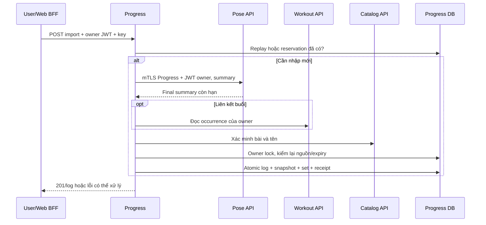

# ADR 0021 — Nhập Pose vào nhật ký Progress

ACCEPTED cho T25 theo quyền tiếp tục triển khai. Bổ sung [ADR 0017](0017-progress-log-ownership.md), [ADR 0011](0011-pose-coordination.md) và [ADR 0012](0012-pose-live-session.md), không đổi boundary hay thuật toán AI.

Progress gọi GET /internal/v1/pose/results/{id} với certificate Progress trong allowlist riêng và assertion owner Identity. Chỉ nhận summary hợp lệ, ID khớp, completedAt không tương lai và expiresAt còn hạn. Pose chỉ lưu result khi job/live hoàn tất; kết quả chưa hoàn tất/foreign không tồn tại theo API, expired trả 410. Không truy cập Pose DB/raw route/object/video/frame. Cấu hình Pose client tùy chọn theo PROGRESS_POSE_ORIGIN: thiếu thì import trả 503, các log/summary cũ vẫn chạy; cấu hình khai báo nhưng sai TLS phải fail startup.

Nhật ký hiện cần ít nhất một set có rep/thời lượng. Summary V4 không có thời lượng tập. Chỉ nhập repCountStatus=AVAILABLE và repCount từ 1 đến 500, tạo một set gộp ordinal=1 cho bài tương ứng, không suy ra phân set, trọng lượng, thời lượng hoặc đánh giá đúng/sai. UNAVAILABLE, null hoặc 0 trả 422 NO_LOGGABLE_RESULT, không tạo receipt/reservation; UI giải thích và dẫn ghi thủ công. Không dùng số lượng reps[] làm số rep vì observation có thể thiếu.

performedAt mặc định completedAt (thời điểm hoàn tất phân tích, không khẳng định lúc quay video); UI cho người dùng xác nhận/chọn thời gian thực tế. occurrenceId tùy chọn phải đọc được qua API Workout của cùng owner; giữ snapshot hiện hành như T17 và không đổi completion của Workout. Tên bài qua Catalog refs công khai; nguồn không sẵn thì không ghi một phần. Log lưu poseResultId và poseSummary gồm chỉ số gốc, source, exerciseId, modelVersion/configVersion, completedAt/expiresAt; đây là provenance tham chiếu, hash/raw do Pose sở hữu. Snapshot chỉ đọc không đổi khi sửa set thực tế, nguồn/occurrence/result bất biến. Xóa log scrub snapshot/sets/notes/receipt payload, giữ reservation nguồn.

Unique owner/result và owner/occurrence có sẵn ở migration 001; không thêm migration. Import dùng operation pose:import trong progress_idempotency, fingerprint input chuẩn hóa, TTL 24h và owner advisory lock 73031 trước ghi. Replay cùng key kiểm trước gọi nguồn, trả phản hồi tạo đầu tiên; khác payload 409, sau xóa 410 LOG_DELETED. Khác key cùng result trả 409 POSE_RESULT_ALREADY_IMPORTED kèm link tương đối an toàn nếu log còn tồn tại. Kiểm duplicate trước network để vẫn mở log đã nhập khi Pose hết hạn hoặc ngắt. Hai key đồng thời chỉ một log. API fetch ngoài transaction, sau đó owner lock/kiểm lại uniqueness và expiry/commit log + set + receipt nguyên tử. Không có transaction phân tán; snapshot Pose bất biến được kiểm còn hạn tại lúc ghi, outage không làm mất log đã lưu.

UI trên chi tiết và màn hình kết thúc Pose cần thao tác xác nhận rõ, giữ key khi gửi lại cùng payload, không tự POST khi render. Có thời điểm thực tế và chọn buổi owner gần thời gian kết quả (tùy chọn), lỗi 401/409/410/422/503 không xóa input; duplicate có link log. BFF thêm allowlist importPoseResult vào Progress, không chuyển raw hoặc nhận rep/model từ browser. Log detail phân biệt số AI gốc với set người dùng có thể sửa.

[API](../api/API_CONTRACTS.md) · [Database](../design/DATABASE.md) · [AI integration](../design/AI_INTEGRATION.md) · [Test plan](../planning/TEST_PLAN.md) · [Operations](../guides/OPERATIONS.md).
