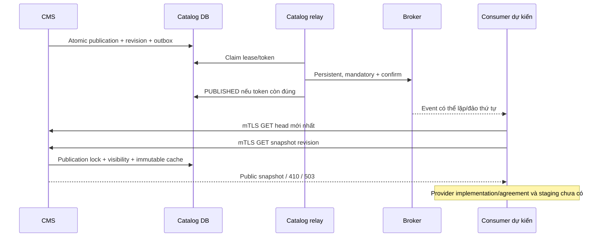

# ADR 0022 — Producer Catalog cho feed RAG

ACCEPTED cho phía Catalog theo quyền tiếp tục T36. Provider agreement và staging vẫn UNCONFIRMED/NOT RUN; không thay trạng thái chấp thuận bằng ADR này. User xác nhận ngày 2026-11-08 chưa có bản bàn giao bổ sung. Chỉ ghi trong WRITE_ROOT, không sửa pipeline RAG hoặc tạo corpus thay thế.

Hai GET internal snapshots/head và snapshots/{revision} chạy trên listener Catalog admin mTLS hiện có, với CATALOG_RAG_FINGERPRINTS riêng. RAG không dùng cert BFF, refs, ADMIN token hoặc database credential. Feed không gọi Identity, không đọc dữ liệu tài khoản. No-store và schema đúng OpenAPI; empty Catalog chưa bootstrap trả 503, không giả head rỗng.

Migration 008 thêm catalog_feed_snapshots riêng, không thay cache/export CMS T34 hoặc checksum 001–007. Snapshot chứa public ExerciseDetail và nguồn hướng dẫn thuần văn bản từ summary/instructions/commonMistakes, source ID ex_ + SHA-256(exercise ID) như CMS export. Không đưa bản nháp, audit/actor, upload grant/object key hoặc secret vào feed. Snapshot materialize lazy trong publication lock 73002; revision hiện hành giữ được khi quá TTL, obsolete snapshot tối đa 7 ngày từ lúc tạo và luôn có thể bị từ chối sớm khi visibility đổi. Known revision chưa materialize/không retained trả 410, unknown 404; consumer phải fetch head mới, không yêu cầu dựng lại quá khứ từ dữ liệu hiện tại.

Tombstone lấy publication/unpublish history mới nhất mỗi exercise, giữ ARCHIVED/WITHDRAWN qua restore-as-draft; chỉ lần publish mới xóa tombstone khỏi head snapshot. Không dựa đơn thuần lifecycle ARCHIVED vì restore draft không xuất bản lại. Full snapshot là tập public có thẩm quyền. Head và snapshot kiểm media pin đang được phép: media bị revoke hoặc mất quyền làm head 503 CATALOG_VISIBILITY_UNAVAILABLE và snapshot 410 SNAPSHOT_WITHDRAWN. Không sửa payload immutable hoặc báo head fresh khi chưa thể xác minh visibility. Operator phải gỡ/sửa bài liên quan để tạo head mới; chưa tự động cascade-unpublish media.

Mỗi snapshot có canonical hash trong DB, giới hạn 16 MiB UTF-8 và tối đa 50.000 exercises/sources/tombstones, vượt giới hạn fail closed, không truncate. Materialization + schema/hash/cache commit nguyên tử, media query trong cùng transaction snapshot. Với cached snapshot, kiểm tất cả exercise vẫn public đúng publishedRevision và pin media vẫn hợp lệ; trả 410 thay vì rò lại nội dung đã gỡ. Không tuyên bố snapshot cũ luôn truy cập được đủ 7 ngày.

Catalog relay là process riêng chỉ dùng DB Catalog. Dùng amqplib 2.2.1 đã được chọn tại T09/T14, không nâng dependency version. Migration 008 thêm lease token/until và error_code cho outbox hiện có. Publish persistent/mandatory/confirm lên smartgym.events.v1, ba routing key catalog.exercise.published/updated/unpublished.v1; sau confirm mới PUBLISHED. Mất confirm/commit có thể phát lại cùng event ID; lease/token fencing và SKIP LOCKED bảo vệ replica. Backoff 5 giây tăng tối đa 5 phút, không bỏ event vì broker/provider ngắt. Invalid contract giữ PENDING và mã lỗi an toàn cho operator, không publish payload sai.

Topology Catalog quorum queue/DLX/DLQ là đề xuất artifact cấp bằng admin riêng để kiểm producer local; không có consumer RAG thật. Consumer phải dedup event ID/hash, lấy max aggregateVersion toàn cục, không rollback vì reorder; event là invalidation hint, fetch head mới nhất và snapshot tương ứng, đồng bộ tombstone/visibility trước phục vụ. Poll 30 giây, head quá 60 giây fail closed nguồn Catalog, dừng dùng generation cũ khi head đổi là policy đề xuất cần provider xác nhận. Corpus sách/HTML và version KB của provider độc lập, không bị Catalog quản lý. T26 kiểm mapping/rebuild/atomic index/citation/withdrawal qua provider và staging thật.

Migration 008 lưu reason trong publication_revisions, backfill từ outbox còn giữ; lịch sử gỡ không còn payload dùng ARCHIVED như hành vi CMS hiện có. Các lệnh mới ghi reason cùng publication/outbox nên tombstone không phụ thuộc thời gian giữ outbox. Head và capture dùng REPEATABLE READ; capture giữ lock 73002, retry toàn transaction tối đa ba lần khi SQLSTATE 40001 hoặc xung đột PK cache do capture đồng thời. Snapshot SQL được chụp trước khi chờ lock có thể thuộc revision cũ nhưng nhất quán; consumer vẫn phải giữ max version và reconcile. Visibility phản ánh thời điểm đọc, không hứa thu hồi tức thời trên toàn mạng.

Đối chiếu ngày 2026-11-08: [PostgreSQL 18 isolation](https://www.postgresql.org/docs/18/transaction-iso.html) mô tả snapshot và yêu cầu retry; [RabbitMQ confirms](https://www.rabbitmq.com/docs/confirms) hiển thị version 4.4, tách publisher confirms khỏi consumer ACK. Hai cơ chế không chứng minh consumer RAG đã ingest thành công; bằng chứng producer nằm ở test PG18.6/RabbitMQ4.4.0 cục bộ.

[API](../api/API_CONTRACTS.md) · [Database](../design/DATABASE.md) · [Test plan](../planning/TEST_PLAN.md) · [Operations](../guides/OPERATIONS.md#catalog--rag-producer-t36) · [Handoff](../api/catalog-rag-handoff.yaml).
