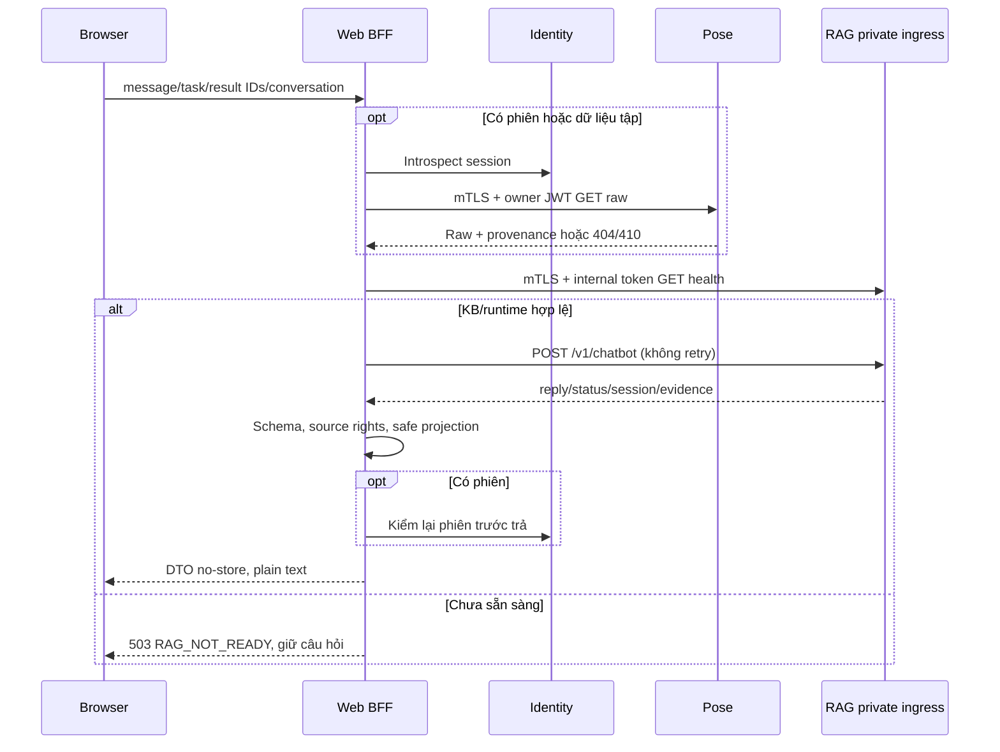

# ADR 0023 — Adapter chatbot bàn giao trong Web/BFF

ACCEPTED cho triển khai Web T27 ngày 2026-11-08 theo quyền tiếp tục task. Không xác lập provider đã sẵn sàng hoặc chấp thuận feed Catalog. Kế thừa ADR0008, không viết lại Python RAG và không sửa nguồn chỉ đọc.

Public /hoi-dap cho knowledge không cá nhân; score/summary/practice và knowledge có result cần phiên đã xác minh. Browser gửi message/task, tối đa 50 Pose result UUID khác nhau, tối đa 8 conversation turns, videoState none/selected/analyzing. Không nhận raw/model hash/source ID/rules/scoring_policy/generate từ browser. BFF lấy raw owner qua Pose internal mTLS/JWT, kiểm schema/expiry/provenance theo manifest đã pin và tạo observation/source IDs từ dữ liệu server. Records đã phân tích tự đặt video_context=analyzed; selected/analyzing chỉ là metadata, không là bằng chứng. Không tự đặt penalty policy: rules=[]/scoring_policy=null, giữ thiếu quy tắc, penalty_total phải null.

RAG gọi qua private HTTPS/mTLS ingress với token riêng từ secret file, pin runtime_revision của handoff; không mở listener FastAPI không auth. Health kiểm mỗi request trước gửi chat, kb_ready=false trả 503 RAG_NOT_READY. Health chỉ xác lập KB được nạp, không chứng minh LLM/generation thành công. Không tạo fixture corpus để bật readiness. Provider HTTP200 unavailable vẫn giữ status unavailable, không biến thành thành công được sinh. Deadline toàn luồng 45 giây, provider health/Pose từng call tối đa 5 giây, không retry POST. Abort browser hủy request outbound, không bảo đảm Python/LLM đã dừng; per-process concurrency vẫn giữ đến outbound đóng, ingress/provider phải có quota tương ứng ở môi trường đích.

Giới hạn hai request đang chạy/process, một request/key và 5 request/phút/key; key từ owner đã introspect hoặc socket IP thật, không tin forwarded headers. Map giới hạn 10.000 key, fail closed khi đầy, TTL dọn trên request. Đây là bảo vệ local; deployment nhiều replica bắt buộc ingress quota chung (T29), chưa thêm Redis/Kafka. Body 128KiB (đủ UTF-8 cho 8 turns × 3000 ký tự), aggregate outbound records tối đa 8MiB, provider response tối đa 2MiB; vượt/schema sai fail closed.

Response ứng dụng giữ reply/task/status/generation_used/generation_mode/kb_version/model_version, allowlisted session summaries, joined references và user_notices; không chuyển technical_details/retrieval/warnings thô, raw/hash/source private. Render plain text, không thực thi Markdown/HTML. Nguồn KB chỉ từ registry operator đã duyệt quyền theo source_id, loại BOOK/HTML/NOTE, không chấp nhận Catalog trước T26. URL chỉ HTTPS đúng origin registry, cấm credential/local/IP, không fetch URL và không giả endpoint mở toàn văn provider chưa có. Registry quyền nguồn được đọc lại trước trả, thu hồi giữa generation chặn citation. Tham chiếu sai/mất evidence/không được duyệt trả lỗi; citation excerpt tối đa 800 ký tự. getChatSource giữ cổng chưa bàn giao, không cung cấp full-text giả hoặc scrape sách.

Transcript chỉ ở memory tab, không localStorage hoặc DB; giữ tối đa 8 turns gửi upstream, hiện tối đa 20 lượt, hủy/đổi lựa chọn/xóa hội thoại không nhận response cũ. Lỗi/timeout giữ câu hỏi để gửi lại có chủ đích, không tự retry. Clear transcript khi 401; thao tác cá nhân kiểm phiên lại trước trả response để tránh logout trong lúc chờ. Các gate corpus/index/model generation, approved sources/rights, scoring policy và Catalog freshness chưa đạt, T27 chưa DONE.

[AI integration](../design/AI_INTEGRATION.md) · [API](../api/API_CONTRACTS.md) · [Security](../design/SECURITY.md) · [Test plan](../planning/TEST_PLAN.md).
