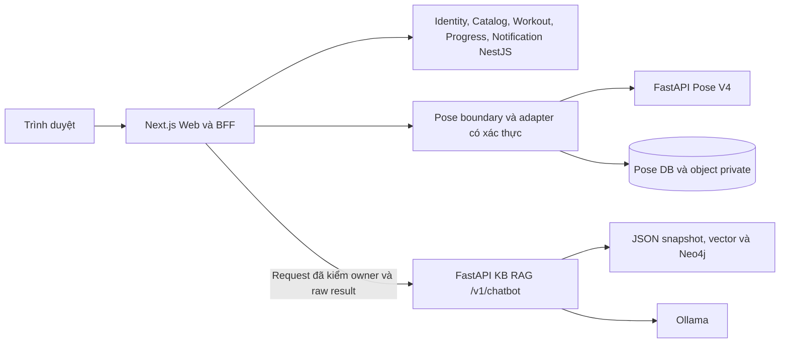

# Đánh giá và thiết kế tích hợp AI hiện hành

T27 đã căn chỉnh DTO và adapter `/v1/chatbot` qua BFF cùng-origin, đủ bốn task/chín status, owner raw/provenance từ Pose, video context, references/notices/session allowlist và thiếu scoring policy giữ null. Có `/hoi-dap` và CTA từ kết quả AI, registry quyền nguồn riêng. Deadline45s là budget beta được chọn, chưa là số đo generation thật; không retry POST, HTTP200 unavailable khác trả lời được. Không thêm backend FastAPI/Nest proxy dư hoặc tạo corpus. Các đoạn “T27 cần chốt DTO” bên dưới là gap của baseline trước ADR0023; schema/code hiện hành ở OpenAPI/Web. Full-text source endpoint, corpus/index, LLM E2E, accepted ingress và provider feed còn cổng chưa có bàn giao. [ADR 0023](../adr/0023-rag-web-adapter.md) · [TST-27](../planning/TEST_PLAN.md)

Kiểm read-only lại ngày 2026-11-08: RAG app/ingest chưa có Catalog head/event consumer/tombstone; raw/curated/index chỉ .gitkeep, canonical Chapter4 rules vẫn thiếu. User xác nhận không có corpus/index/endpoint hoặc bản bàn giao mới. Không thực thi script provider. Catalog producer T36 đã có head/snapshot mTLS + outbox relay và [handoff YAML](../api/catalog-rag-handoff.yaml), song provider agreement UNCONFIRMED, generation/staging NOT RUN. Test broker chỉ là probe hợp đồng, không phải consumer/index RAG. T26 chờ phía provider; có thể tiếp T27 phần DTO/BFF/readiness độc lập nhưng không bật chatbot sẵn sàng hoặc DONE trước E2E corpus/model thật. [ADR 0022](../adr/0022-catalog-rag-producer.md)

T25 hiện thực import chỉ số từ Pose summary cuối qua Progress, không tái xây AI hoặc đọc raw/video. VIDEO V4 vẫn UNAVAILABLE, live 0 không log được tự động; chỉ count AVAILABLE dương tạo một set gộp. Snapshot modelVersion/configVersion/resultId là provenance tham chiếu; hash/raw giữ trong Pose. Test nhập dùng summary lưu bền làm fixture có tên rõ qua Pose API thật, không khẳng định chạy inference hoặc đánh giá chất lượng model mới trong T25. Cổng inference T21–24 và corpus/index/generation RAG vẫn độc lập. [ADR 0021](../adr/0021-pose-progress-import.md)

Ngày 2026-11-07. Nguồn được người dùng xác nhận là `E:\do an\smart-gym-ai\services\kb_rag` cho RAG và `E:\do an\SmartGym` cho Pose. Backend nghiệp vụ giữ NestJS. [ADR 0008](../adr/0008-ai-provider-handoff.md) · [Ma trận tương thích](../api/ai-provider-compatibility.yaml).

## Kết luận và bằng chứng

NestJS cùng các dịch vụ AI Python phù hợp với nguồn bàn giao. Identity, Catalog và Notification đã có mã. Adapter browser/BFF AI thuộc các task tiếp theo. API và worker Pose T22 đã có. T21 đã kiểm hash và chạy inference CPU cho bốn bài, có đủ raw scope video/window/rep; validator RAG nhận 14 fixtures thật. Provider regressions 16/16 đạt bằng dữ liệu tổng hợp. [Bằng chứng runtime](../api/ai-runtime-verification.yaml) · [Profile CPU](../adr/0010-local-ai-cpu-runtime.md). Ollama, Neo4j và generation corpus thật chưa chạy. raw/index RAG chỉ có .gitkeep; services.rar cũng không kèm corpus/index.

File quy tắc `E:\do an\CHUONG_4_KG_RAG_RULES_PLAN.md` được AGENTS bên bàn giao tham chiếu đang thiếu. Lượt này chỉ đọc nguồn provider và sửa tài liệu Web. Cần khôi phục file đó trước khi sửa pipeline của provider.

## Phân ranh giới

| Thành phần | Nguồn và trách nhiệm |
|---|---|
| Web/BFF | Next.js hiện có, cùng origin, kiểm phiên, lựa chọn kết quả và client HTTP/WebSocket có validation. |
| Nghiệp vụ NestJS | Identity, Catalog, Workout, Progress và Notification, giữ database ownership như thiết kế. |
| Pose | `SmartGym/smart_gym_web_v4/server` và `smart_gym_test_rtmpose_v4`, inference RTMPose/ST-GCN++ V4. Adapter trong cùng boundary sở hữu vòng đời upload/job/live/result và provenance theo owner. |
| RAG | `smart-gym-ai/services/kb_rag`, FastAPI, KB/retrieval/Ollama, JSON snapshot/vector, Neo4j tùy chọn. |
| Catalog → RAG | Feed nội dung công bố theo T26/T36, tách khỏi corpus sách/HTML đã bàn giao. |

RAG cũ `SmartGym/backend/rag` chỉ còn là dữ kiện lịch sử. Backend FastAPI nháp `smart-gym-ai/backend` còn gọi endpoint cũ và không xác lập hợp đồng mới.

Adapter là lớp tích hợp trong boundary hiện có. Model nạp trong process Python. BFF đọc Pose qua API nội bộ và không truy cập database Pose.

## Mapping đã xác minh

| Catalog ID | Pose ID | RAG code | Nhãn |
|---|---|---|---|
| bodyweight_squat | squat | SQUAT | 14 |
| push_up | push_up | PUSHUP | 21 |
| jumping_jacks | jump_jack | JUMPING_JACK | 29 |
| reverse_crunch | situp | REVERSE_CRUNCH | 19 |

Bốn ONNX thực tế khớp SHA-256 trong RAG label catalog. Bốn *_v4_contract.json phía Pose và RAG giống từng byte. Digest và schema version ở YAML tương thích. `situp` là reverse crunch theo V4. Các bài khác trong Catalog cần model/contract và nghiệm thu riêng.

Contract JSON trên Windows có CRLF. Hash contract đăng ký khớp bản UTF-8 chuẩn hóa LF, còn hash bytes gốc khác. YAML lưu cả hai digest và chính sách so sánh. Hash ONNX được so trực tiếp bytes, không chuẩn hóa.

Bằng chứng gồm [engine Pose](../../../SmartGym/smart_gym_web_v4/server/engine.py), [validator RAG](../../../smart-gym-ai/services/kb_rag/kb_service/v4.py) và [label catalog](../../../smart-gym-ai/services/kb_rag/label_catalog_v4.json).

## Các lệch phải xử lý

| Mức | Hiện trạng | Công việc |
|---|---|---|
| P0 | Pose nhận multipart exercise/file tại /api/analyze-video, trả đồng bộ result/elapsed_seconds. Web dự kiến signed upload/job. | T22 thêm owner, job, idempotency và điều phối trong Pose boundary rồi gọi engine. Timeout sau gửi inference cần trạng thái chưa rõ, không retry mù. |
| P0 | Live provider nhận 4-byte little-endian JSON length + metadata + JPEG. Web dùng header 12-byte big-endian. | T23 triển khai chuyển framing, timestamp, configure/generation, backpressure và kết thúc phiên qua BFF. T24 dùng hợp đồng này cho camera. |
| P0 | Whole-video chỉ trả labels scope video. Live mới có rep_count và rep_result. | T21 đã sửa schema repCount nullable + repCountStatus và capability đếm riêng từng mode, qua contract tests. T22 cần thực thi lưu/đọc; T25 trả NO_LOGGABLE_RESULT khi thiếu chỉ số, không tạo số 0 thay dữ liệu thiếu. |
| P0 | RAG cần full label_results, Web PoseResult chỉ giữ summary. | Pose lưu raw result bất biến và provenance. T22 có API nội bộ theo owner cho BFF, browser chỉ chọn result ID. |
| P0 | Web ChatRequest question/exerciseId khác RAG message/task/records/conversation. | T27 chốt contract ứng dụng cho bốn task, video state, references và các nhánh status. OpenAPI M0 đã đánh dấu cần căn chỉnh. |
| P0 | Pose chưa xác thực user/service. RAG dùng token nội bộ tùy cấu hình. | Adapter kiểm session/owner/consent, private ingress và mTLS termination. Token RAG phải khác JWT user và không rỗng khi tích hợp. |
| P1 | RAG đọc JSON snapshot một lần khi start, chưa nhận Catalog events/head/tombstone. | T26/T36 chốt feed riêng với đội RAG, giữ namespace/version của corpus ngoài. |
| P1 | Runtime CPU đã có; RAG chưa có corpus/index dùng được. | Khôi phục dữ liệu đúng manifest, kiểm kb_ready và generate=true trước nghiệm thu T27. T21 không thay corpus bằng fixture tổng hợp. |

## Contract ứng dụng cần chốt trước khi code AI

T22 đã chạy luồng S3 → worker → FastAPI mTLS → PostgreSQL Pose với video thật. BFF có thể đọc raw V4 qua `getPoseRawResultForRagAdapter` bằng mTLS và owner assertion. Progress có route summary riêng. T23 bổ sung live qua BFF và giữ scope raw của observation gần nhất. T24 nối giao diện và proxy upload, T25 nhập Progress và T27 tích hợp chat. [ADR 0011](../adr/0011-pose-coordination.md) · [TST-22](../planning/TEST_PLAN.md)

Upstream là [ChatbotRequest](../../../smart-gym-ai/services/kb_rag/kb_service/chatbot.py). Có message 2–3000 ký tự, task knowledge/score/summary/practice, tối đa 50 records và tám lượt conversation. Mỗi model_result cần exercise, schema_version, scope, quality.usable và đầy đủ label_results có key/kind/raw_label/probability/threshold.

Browser gửi message/task và Pose result ID đã lưu. BFF kiểm phiên và owner rồi lấy raw qua API Pose. observation_id và source_id được tạo từ dữ liệu server, dùng video hash ổn định để dedup. Model digest gắn từ manifest deployment đã xác minh. Không tin raw result, simulated hoặc model hash do browser tự cung cấp.

Chat kiến thức không có dữ liệu cá nhân có thể công khai với rate limit. Tham chiếu kết quả tập cần phiên và quyền owner. Policy điểm do ứng dụng phê duyệt theo ID/version. Nếu thiếu policy, giữ trạng thái thiếu quy tắc của provider, không chuyển xác suất nhãn thành điểm trừ. Conversation ở bộ nhớ tab theo mặc định.

Adapter giữ reply, task, status, generation_used/mode, kb_version, model_version, session, references và user_notices phục vụ UI. Join references.number/chunk_id với evidence để hiện tên nguồn, URL và trang/mục. Trace kỹ thuật có DTO kiểm soát riêng, loại secret/path và dữ liệu riêng không cần thiết. Các status có generated, grounded_guidance, evidence_only, insufficient_evidence, insufficient_observation, conversational, needs_clarification, out_of_scope và unavailable. Nhánh unavailable có thể ở HTTP 200. /v1/chatbot chưa khai báo response_model, T27 cần snapshot fixture cho từng nhánh.

kb_version là version corpus KB, khác Catalog publication revision. Giữ namespace cho source/chunk của provider, không ép thành Catalog ID. T26 chốt quyền và cách mở nguồn sách/HTML. Nguồn Catalog chỉ được trích khi feed và visibility đã nghiệm thu.

Provider timeout LLM mặc định 120 giây mỗi lời gọi, một request có thể gọi model nhiều lần. T27 đo và chốt deadline end-to-end, cancellation, concurrency và trạng thái UI theo từng task. HTTP request body timeout, socket inactivity và thời gian chờ inference là các giới hạn khác nhau. Không sao chép deadline ngắn của API auth hay tự retry POST chat.

## Dữ liệu, giới hạn và chất lượng

Pose owner giữ raw V4, summary, scope, schema/model version, model digest, source/video hash, owner và thời hạn. Raw không đi vào Progress. Giữ baseline consent, xóa video tối đa 24 giờ và result 30 ngày để kiểm tại M5. Progress chỉ nhập chỉ số đã xác minh theo hành động người dùng.

Provider nhận video tới 200 MiB và chưa giới hạn 120 giây tại ingress. Adapter Web giữ 100 MiB/120 giây, live 10 fps, 640×480 và 256 KiB/message. Chất lượng rep/form phải đo theo từng scope. Mục tiêu beta MAE rep ≤1 trên clip phù hợp, live p95 ≤500 ms và citation/abstain ≥90% vẫn là giả định cần bộ kiểm chứng độc lập.

Corpus RAG dùng sách/HTML/notes với manifest quyền riêng. Catalog sở hữu nội dung 35 bài đã nhập. RAG-002 giữ trong full scope, nhưng giao thức nhận Catalog do đội RAG xác nhận. Các thiết kế SQLite/ChromaDB không áp đặt lên pipeline JSON đã bàn giao.

## Thứ tự triển khai

1. T21 DONE cho engine: manifest, mapping bốn bài và fixtures video/window/rep qua smoke CPU. Auth user/owner/mTLS của adapter vẫn ở T22/T23 theo ADR 0010.
2. T27 làm knowledge chat không video qua BFF, đủ status/references, readiness và lỗi provider. Có thể phát triển bước này trước feed Catalog, nhưng T27 chưa DONE khi chức năng session còn thiếu.
3. T22/T23 hoàn thiện owner/job/live quanh engine, chuyển protocol và lưu raw/provenance. T24 nối UI, T25 nhập chỉ số đủ căn cứ.
4. T27 kiểm summary/practice/score có policy hoặc trạng thái thiếu policy, result người khác, video trùng và hội thoại đổi chủ đề.
5. T34/T36/T26 hoàn thiện feed Catalog đã được hai bên xác nhận và kiểm tombstone. Giữ namespace KB ngoài.
6. T28–T30 nghiệm thu deploy, cô lập lỗi, bảo mật, retention, chất lượng và tải.

[Tasks](../planning/TASKS.md) và [Test Plan](../planning/TEST_PLAN.md) ghi công việc còn lại. Lượt đánh giá này không xác lập AI đã tích hợp runtime.
