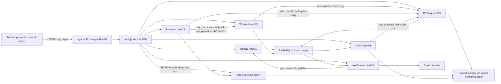
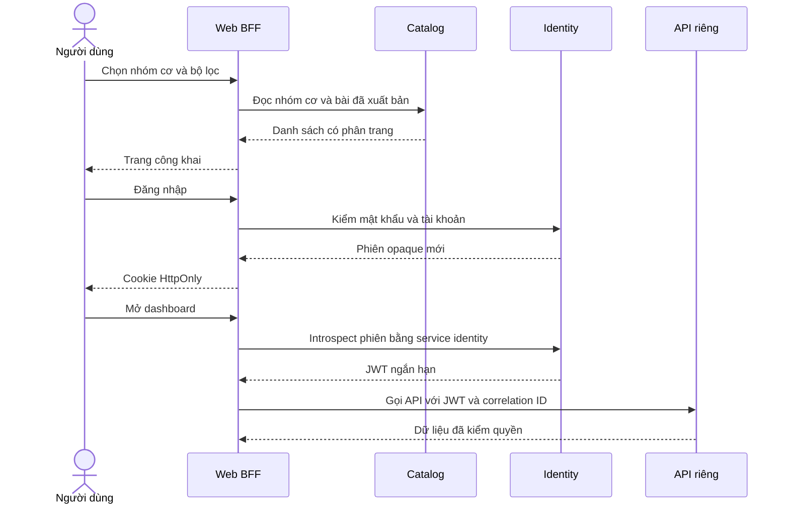
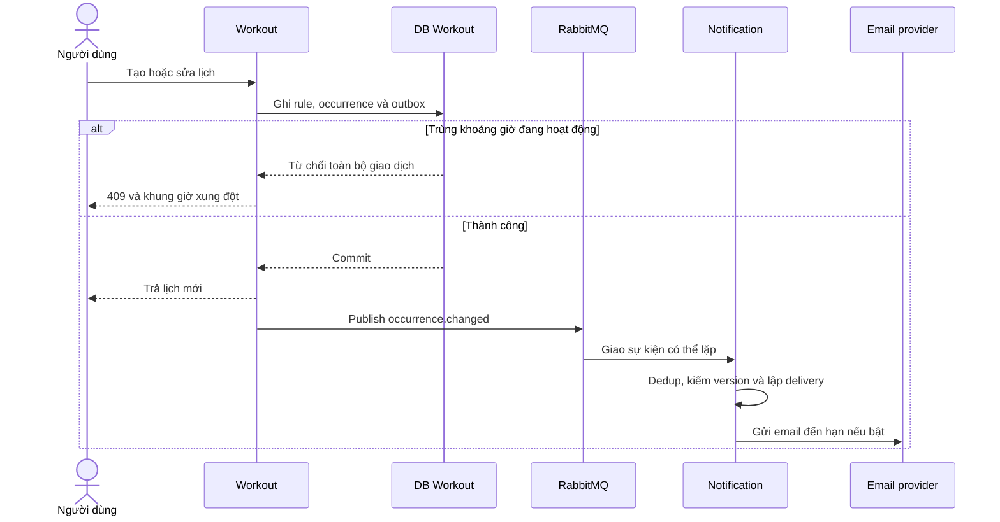
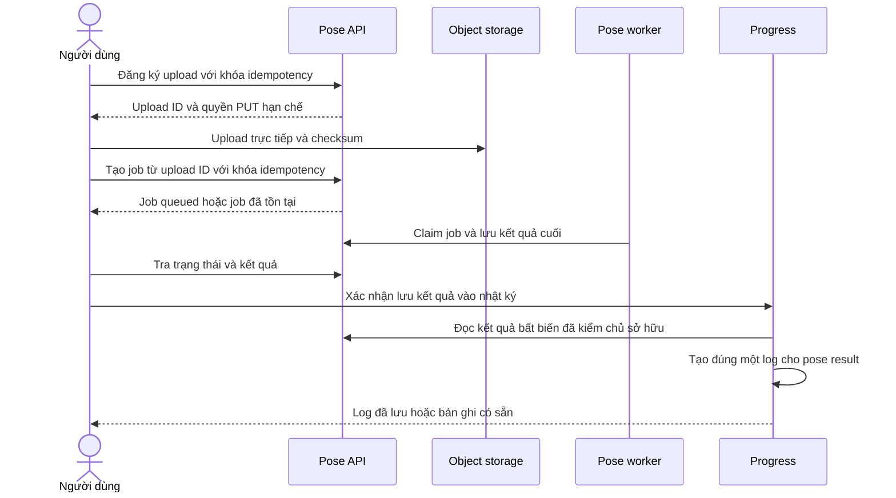
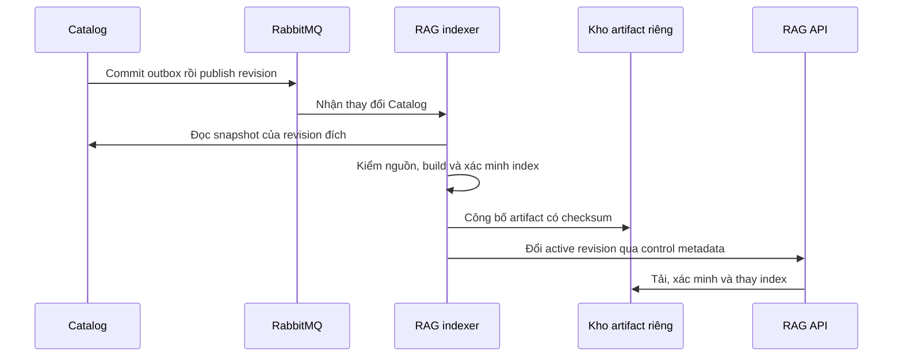
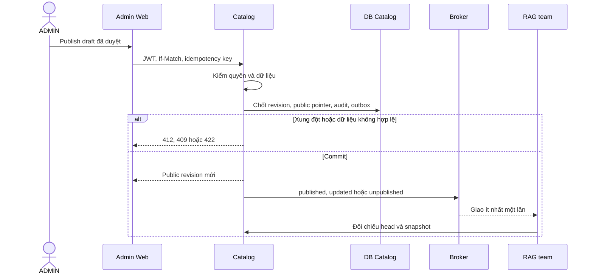

# Kiến trúc toàn hệ thống SmartGym Web

T27 hiện thực adapter ở Web/BFF theo ADR0008, không tạo thêm service hoặc DB. BFF → Identity introspect → Pose raw API theo owner → RAG private ingress mTLS/token; không đọc kho chéo. Kiểm runtime pin/KB health trước POST, giới hạn 45s/no retry/abort, kiểm lại session và result expiry trước trả. Public library độc lập outage RAG. Provider giữ generation/index; local fixture chứng minh transport/DTO/UI chứ không chứng minh chất lượng hoặc real generation. [ADR 0023 và sequence](../adr/0023-rag-web-adapter.md)

T36 bổ sung producer Catalog, không thêm service: API feed dùng listener mTLS CMS với allowlist RAG riêng; relay process độc lập chỉ đọc/ghi Catalog DB rồi publish broker. RAG dự kiến đọc API + consume events, không truy cập Catalog DB. Head/snapshot dùng chung publication history nhưng cache riêng export CMS. Outage Identity không chặn feed; broker ngắt giữ outbox, không chặn public library. Provider chưa có consumer nên reconciliation/index/citations chưa được nghiệm thu. [ADR 0022 và sequence](../adr/0022-catalog-rag-producer.md) · [Handoff](../api/catalog-rag-handoff.yaml)

T25 nối Progress → Pose internal summary bằng mTLS/JWT owner, giữ đọc Workout/Catalog qua API. Progress sở hữu log/snapshot/idempotency, Pose sở hữu result/raw/provenance hash và retention. Không giao dịch phân tán hoặc DB/source import chéo. Import kiểm metadata/expiry rồi recheck trong owner transaction; replay/duplicate xử lý trước network để sống được khi Pose ngắt. API/client Pose chưa cấu hình chỉ chặn nhập mới, không chặn nhật ký/summary cũ. [ADR 0021](../adr/0021-pose-progress-import.md)


T20 hiện thực bốn owner API Notification, Web BFF và inbox/preferences UI, vẫn trong ranh giới Notification/Web hiện có. Không thêm DB/service/cache hoặc transaction xuyên service. BFF introspect Identity từng request; Notification xác minh mTLS/JWT và chỉ đọc/ghi kho của mình. Version preference và cập nhật reminder jobs cùng owner transaction T19; broker lỗi không chặn đọc inbox hoặc sửa preference. Thông báo đã gửi giữ lịch sử, link đến Workout để đọc trạng thái hiện hành. [ADR 0020](../adr/0020-notification-inbox-web.md)

T18 hiện thực summary Progress và Web nhật ký/tiến độ/dashboard, không đổi data ownership. BFF chỉ chuyển hợp đồng mTLS, SQL summary đọc kho Progress và widget lịch vẫn lấy Workout riêng. [ADR 0018](../adr/0018-progress-summary-ui.md)

T21 đã nghiệm thu engine CPU cục bộ theo [ADR 0010](../adr/0010-local-ai-cpu-runtime.md), không thay bảy ranh giới service. [Runtime evidence](../api/ai-runtime-verification.yaml) tách smoke in-process khỏi deployment: T22 và T23 bổ sung owner/job/mTLS và live BFF. T27 còn chat adapter và corpus RAG. Không mở provider không auth ra mạng vì model đã chạy được.

Microservices và phạm vi đầy đủ là yêu cầu đã xác nhận. Topology dưới đây là quyết định thiết kế được chọn cho bản đặc tả. Các ngưỡng tải và cấu hình vận hành là giả định để kiểm chứng trong triển khai. Xem [PRD](PRD.md), [ranh giới service](SERVICE_BOUNDARIES.md), [mô hình dữ liệu](DATABASE.md), [hợp đồng API](../api/openapi.yaml), [ADR](../adr/0001-service-boundaries.md) và [kế hoạch triển khai](../planning/IMPLEMENTATION_PLAN.md).

Nguồn AI và storage RAG cập nhật theo [ADR 0008](../adr/0008-ai-provider-handoff.md). Các đường Catalog/Broker → RAG bên dưới là feed đích T26/T36, chưa có consumer trong provider bàn giao. Chat kiến thức dùng corpus độc lập có thể tích hợp qua `/v1/chatbot` trước feed.

## Thành phần và biên tin cậy

Progress T17 hiện thực API log riêng với PostgreSQL Progress và snapshot occurrence. Đọc nguồn qua Catalog refs/Workout internal mTLS, giữ dữ liệu cũ khi hai nguồn gián đoạn. Log/exercise/set/receipt commit cùng transaction trong Progress, không có transaction phân tán hoặc ghi DB chéo. Xóa giữ reservation nguồn và gỡ payload. BFF/UI/summary thuộc T18. [ADR 0017](../adr/0017-progress-log-ownership.md)



Mỗi service sở hữu kho và tài khoản truy cập của mình. Các đường dữ liệu ở [Database](DATABASE.md). Browser gọi HTTP/WSS cùng origin qua BFF. Pose T22 cấp upload grant và điều phối job quanh engine V4. Public Catalog, chat kiến thức và đăng nhập có phạm vi truy cập riêng. RAG dùng corpus sách/HTML đã bàn giao. Nguồn Catalog chỉ đi vào RAG sau nghiệm thu feed nội dung công bố.

Identity sở hữu phiên. Chỉ tài khoản đã xác minh email được cấp phiên đăng nhập. Cookie host-only `__Host-sg_session` dùng `Secure`, `HttpOnly`, `Path=/`, `SameSite=Lax` và lưu token ngẫu nhiên dạng opaque. Phiên hết hạn sau 7 ngày tuyệt đối hoặc 24 giờ không hoạt động. Token verify hết hạn 24 giờ, reset hết hạn 30 phút, dùng một lần. BFF kiểm tra Origin và biện pháp chống CSRF ở mutation dùng cookie. Với API cần đăng nhập, BFF gọi Identity qua mTLS để đổi phiên hợp lệ thành JWT xuống dòng có TTL tối đa 5 phút. BFF giữ JWT phía máy chủ. Service kiểm chữ ký từ JWKS, issuer, audience, thuật toán cho phép, thời hạn, role và quyền đối với bản ghi theo `sub`. Endpoint nội bộ kiểm service caller qua mTLS và quyền gọi cụ thể. Log, trace và broker loại cookie, JWT, mật khẩu, reset token, dữ liệu video và nội dung chat cá nhân. [RFC 8725](https://www.rfc-editor.org/rfc/rfc8725.html)

### Mạng và triển khai độc lập

| Unit | Process độc lập | Dữ liệu và tài nguyên | Readiness tối thiểu |
|---|---|---|---|
| Web | Next.js Node/TypeScript | Không có dữ liệu nghiệp vụ riêng. Cache public có giới hạn TTL. | Process phục vụ HTTP. Báo phụ thuộc theo tính năng để public route không mất khi AI lỗi. |
| Identity | NestJS API và outbox worker cùng artifact, tách process khi cần | PostgreSQL Identity, kho khóa ký và RabbitMQ cho worker | API kiểm DB và khóa đang dùng. Worker kiểm broker. |
| Catalog | NestJS API, media verifier/GC và outbox worker | PostgreSQL Catalog, prefix object private có versioning, ClamAV và FFmpeg cho verifier | API kiểm DB. Sự cố media/broker hạ chức năng tương ứng, giữ API đọc nội dung đã xuất bản. |
| Workout | NestJS API, worker materialize lịch và outbox | PostgreSQL Workout với extension `btree_gist` | API kiểm DB. Worker kiểm DB và broker nếu publish. |
| Progress | NestJS API | PostgreSQL Progress | Kiểm DB. Các thao tác liên service trả lỗi theo từng route. |
| Pose | NestJS API/worker quản lý upload/job. BFF nối WSS đến Pose, Pose dịch stream sang engine FastAPI Python/ONNX qua mTLS. | PostgreSQL Pose, object storage riêng, model theo checksum, CPU mặc định và GPU nếu qua đo tải | API kiểm DB/storage. Worker và live upgrade so manifest engine qua mTLS. |
| RAG | FastAPI provider và CLI ingest/embed | JSON snapshot/vector, Neo4j theo cấu hình và Ollama | Kiểm kb_ready và smoke generation thật. Schema lưu trữ do provider sở hữu. Lỗi RAG không chặn Catalog. |
| Notification | NestJS API, scheduler và email worker | PostgreSQL Notification, RabbitMQ và email provider | API kiểm DB. Worker báo tình trạng broker/provider riêng. |

Triển khai cục bộ có thể dùng Compose. Mỗi unit có artifact phiên bản hóa, manifest phụ thuộc, env schema, quy trình migration/build/test/start, liveness kiểm process, readiness kiểm năng lực và rollback theo service. Kết nối PostgreSQL chỉ nằm trên mạng riêng, thông tin xác thực tách theo service. Dùng đồng thời hai phiên bản tương thích trong lúc rollout. Test M6 cần chạy từng artifact độc lập với các phụ thuộc đã công bố, nâng cấp hoặc khởi động lại riêng, và chứng minh role DB không thể đọc dữ liệu của service khác.

Workout T13/T14 chạy API plan/schedule mTLS độc lập trong `backend/apps/workout`, đọc JWKS từ Identity và đối chiếu bài qua Catalog refs trên listener private. Plan/items/schedule/occurrence/receipt/outbox thuộc database Workout. Snapshot và sự kiện ghi cùng transaction, GiST bảo đảm không chồng lịch theo owner. Relay RabbitMQ chạy process riêng, broker lỗi giữ PENDING và API tiếp tục ghi lịch. T15 đã bổ sung sửa/hủy theo version, bảo toàn override và materializer độc lập đọc database Workout để mở rộng 35 ngày, lưu conflict và retry sau gián đoạn. [ADR 0015](../adr/0015-workout-schedule-reconciliation.md) [ADR 0013](../adr/0013-workout-plan-implementation.md) · [ADR 0014](../adr/0014-workout-schedule-time.md)

Dependency Web/NestJS giữ theo manifest/lockfile hiện có. Pose V4 dùng FastAPI, RTMPose, ONNX Runtime và thư viện decode của nguồn đã kiểm kê. Coordination DB là phần bổ sung trong Pose boundary. RAG giữ FastAPI, JSON snapshot/vector, Neo4j tùy chọn và adapter Ollama của bàn giao. Phiên bản provider theo lockfile/manifest của provider, chưa xác minh cài đặt tại Web. [Kế hoạch](../planning/IMPLEMENTATION_PLAN.md) và [AI integration](AI_INTEGRATION.md) ghi cổng triển khai.

### Module HTTP của Catalog

Catalog đặt controller, module và logic liên quan cạnh nhau trong [`src/modules/`](../../backend/apps/catalog/src/modules/). `exercises/` chứa thư viện, quản trị bài tập và tra cứu tham chiếu. `media/` chứa upload, phục vụ file công khai, xử lý xác minh và storage. `content/`, `revisions/`, `transfers/` và `feed/` chứa module cùng phần xử lý tương ứng. `admin/` chứa guard, hợp đồng và các tiện ích CMS dùng chung. Health check có controller và module riêng trong `src/modules/`.

Catalog khởi tạo hai listener từ `src/main.ts`. [Module gốc công khai](../../backend/apps/catalog/src/app.module.ts) và [module gốc quản trị mTLS](../../backend/apps/catalog/src/admin-app.module.ts) đăng ký các module tương ứng. Module tra cứu tham chiếu và module snapshot cho RAG có guard riêng theo danh tính service gọi. Hai listener thuộc cùng đơn vị triển khai Catalog và dùng dữ liệu do Catalog sở hữu. Database, migration CLI, entrypoint media worker và entrypoint relay đặt ở cấp service.

### Module HTTP của các service NestJS còn lại

Mỗi service khởi tạo ứng dụng HTTP tại `src/app.ts` và đăng ký module tính năng trong `src/app.module.ts`. Controller, provider và module nằm theo tính năng trong `src/modules/`. Health và trạng thái Pose có controller và module riêng. Các entrypoint tiến trình, migration CLI và database ở cấp service.

| Service | Nhóm nghiệp vụ |
|---|---|
| [Identity](../../backend/apps/identity/src/modules/) | `accounts/` chứa xác thực, phiên, hồ sơ, API nội bộ và phần xử lý tài khoản. |
| [Workout](../../backend/apps/workout/src/modules/) | `plans/` chứa chương trình và tra cứu Catalog. `scheduling/` chứa lịch, buổi tập, API nội bộ cho Progress và logic materializer. |
| [Progress](../../backend/apps/progress/src/modules/) | `logs/` chứa nhật ký, nhập kết quả Pose và các client đọc nguồn. `summary/` chứa thống kê. |
| [Notification](../../backend/apps/notification/src/modules/) | `inbox/` chứa inbox, tùy chọn và nhắc lịch. `delivery/` chứa job gửi và SMTP. |
| [Pose](../../backend/apps/pose/src/modules/) | `analysis/` chứa upload, job, kết quả và storage. `live/` chứa phiên tập và WebSocket. Status module công bố health và capabilities. |

Pose engine và RAG provider tiếp tục chạy bằng FastAPI theo [thiết kế tích hợp AI](AI_INTEGRATION.md).

## Cây repository

```text
SmartGym_Web/
  frontend/                       Next.js, UI và BFF
  backend/
    nest-cli.json                 Nest CLI Monorepo Mode
    apps/
      identity/                   NestJS API và outbox
      catalog/                    NestJS API, import, publish
      workout/                    NestJS API, materializer và outbox
      progress/                   NestJS API
      notification/               NestJS API, scheduler và email worker
      pose/                       NestJS API, worker và engine FastAPI
  # RAG lấy từ nguồn bàn giao qua Docker Compose
  tests/system/                   E2E, fault injection và kiểm tra vận hành
  infra/                          Compose/manifest khi được phép triển khai
  docs/                           Quyết định, hợp đồng và tài liệu vận hành
```

pnpm quản lý phụ thuộc toàn repository. Nest CLI build lần lượt hoặc riêng từng ứng dụng backend với hợp đồng phiên bản hóa. Quy tắc dependency chặn import domain, ORM repository, migration và mã worker từ service khác. UI không import domain service. Xác thực dùng khóa và hợp đồng Identity, mỗi consumer áp dụng kiểm quyền riêng. [ADR 0027](../adr/0027-nest-cli-monorepo.md)

## Hợp đồng đồng bộ

- Web dùng phiên bản API trong [OpenAPI](../api/openapi.yaml). Consumer kiểm version, validate payload và phân biệt 401 phiên không hợp lệ, 403 thiếu quyền, 404 bản ghi vắng hoặc không được nhìn thấy, 409 xung đột nghiệp vụ, 412 version không còn đúng, 428 thiếu precondition, 429 quá tải và 503 phụ thuộc không khả dụng. Mã nghiệp vụ cụ thể thuộc hợp đồng.
- Giá trị deadline khởi điểm cho đọc nội bộ là 1 giây mỗi hop và 3 giây toàn BFF. RAG có ngân sách riêng 15 giây. Video dùng job, webcam dùng stream. Chỉ retry hữu hạn với jitter cho đọc an toàn hoặc mutation có cùng khóa idempotency. Trả lỗi sớm khi dependency không khả dụng. Timeout chưa xác định kết quả mutation được xử lý qua cùng khóa hoặc tra trạng thái.
- Mỗi mutation chỉ commit trong database owner. Snapshot đọc từ service khác được lấy trước giao dịch ghi. Với tham chiếu có version, ghi version đã kiểm và từ chối nếu điều kiện nguồn không còn đúng. Ngoại lệ lưu lịch sử hợp lệ sau khi source bị gỡ được mô tả theo nghiệp vụ. Pose nhận exercise ID đã ánh xạ một biến thể được kiểm chứng. Biến thể có thể chọn độc lập cần ID Catalog riêng.
- Pose kiểm consent trước khi cấp quyền tải trực tiếp. Quyền ký chỉ cho object key cụ thể với hạn 10 phút, dung lượng giới hạn và checksum theo hợp đồng. Tạo job kiểm phiên bản consent khớp với reservation và còn được phép. Worker đọc object version đã chốt hoặc bản copy riêng có hash đã xác minh. Tiến trình dọn staging thuộc Pose. CORS chỉ cho origin web, và client không giữ credential lưu trữ. Bản ghi idempotency mặc định 24 giờ, tách khỏi hạn của URL.

## Hợp đồng sự kiện

RabbitMQ dùng durable topic exchange và queue theo consumer. Envelope có `id`, `type`, `schemaVersion`, `occurredAt` UTC, `producer`, `aggregateId`, `aggregateVersion`, `correlationId`, `data` và `traceparent` tùy chọn. Routing key khớp `type`. [Event schema](../api/events.yaml) quy định trường bắt buộc và payload cụ thể. Producer ghi outbox cùng giao dịch thay đổi nghiệp vụ. Worker publish dùng persistent message và đợi publisher confirm. Consumer ghi inbox với khóa `(consumer,event_id)` và thay đổi nội bộ trong cùng giao dịch trước khi ACK. Nếu bị mất ACK hoặc confirm, cùng event có thể xuất hiện lại. [RabbitMQ Reliability Guide](https://www.rabbitmq.com/docs/reliability)

| Event | Producer → consumer | Dữ liệu và quy tắc |
|---|---|---|
| `identity.email-action.requested.v1` | Identity → Notification | Tham chiếu giao nhận ngẫu nhiên, mục đích và hết hạn. Notification đọc envelope gửi qua API nội bộ dành riêng. Replay dùng cùng delivery ref, provider nhận khóa gửi ổn định nếu hỗ trợ. Không đưa địa chỉ thư, reset token hoặc URL bí mật lên broker. |
| `catalog.exercise.published.v1` | Catalog → RAG | ID bài và revision snapshot. `aggregateId` là catalog, version tăng toàn Catalog. Indexer tích lũy revision đích mới nhất rồi đọc snapshot. |
| `catalog.exercise.updated.v1` | Catalog → RAG | Bài đang công bố được thay revision public. |
| `catalog.exercise.unpublished.v1` | Catalog → RAG | Tombstone ID, revision. RAG loại kết quả cho ID bị gỡ đã biết trước khi index rebuild. |
| `workout.occurrence.changed.v1` | Workout → Notification | Chủ lịch, occurrence ID, version, trạng thái, thời điểm UTC và thông tin tối thiểu cho nhắc lịch. Consumer cập nhật projection khi version tăng và hủy delivery chờ của bản cũ. |

Queue retry dùng exponential backoff có giới hạn. Poison message vào DLQ kèm reason và correlation ID đã lược dữ liệu nhạy cảm. Replay do vận hành thực hiện theo runbook sau khi xử lý nguyên nhân. Kiểm version ở từng aggregate vì broker có thể giao sai thứ tự khi nhiều consumer hoặc replay. Notification tạo delivery với khóa nghiệp vụ duy nhất và phân biệt `UNKNOWN` nếu provider timeout sau khi có thể đã nhận. Có idempotency của provider thì replay cùng khóa. Nếu thiếu, đối soát trạng thái hoặc xử lý thủ công trước khi gửi lại.

## Luồng quan trọng

### Duyệt bài và đăng nhập



### Đặt lịch và nhắc lịch



### Pose và lưu tiến độ



Với webcam, REST tạo live session sau khi kiểm consent và capability. Upgrade WSS tại `/api/v1/pose/live-sessions/{sessionId}/stream` yêu cầu cookie `__Host-sg_session`, Origin khớp chính xác và subprotocol `smartgym.pose.v1`. Web/BFF có handler upgrade hoặc proxy chuyên biệt cùng biên tin cậy, introspect Identity và chuyển JWT qua mTLS tới Pose. Không chuyển cookie xuống Pose. Pose kiểm owner, expiry và claim chuyển `READY → ACTIVE` nguyên tử, nên mỗi session có tối đa một socket. READY chờ tối đa 5 phút. ACTIVE chạy tối đa 15 phút với idle timeout 15 giây. BFF tái kiểm tra phiên khi assertion hết hạn, tối đa 5 phút giữa hai lần kiểm, và đóng socket nếu phiên thu hồi hoặc hết hạn. Sau upgrade, gửi frame nhị phân đã lấy mẫu với sequence tăng theo [hợp đồng stream](../api/API_CONTRACTS.md). Server giới hạn kích thước và frame rate, drop frame cũ khi quá tải, phát rep event theo sequence. Mất kết nối bất thường đánh dấu FAILED, không nối dữ liệu rep vào phiên mới. Restart phục hồi READY/terminal từ DB và đóng ACTIVE đã mất socket. Hoàn tất có chủ đích tạo kết quả bất biến của session, nhập Progress qua `poseResultId`.

### Catalog cập nhật chỉ mục RAG



Sequence trên là thiết kế feed đích T26/T36. Consumer và quy trình kích hoạt artifact cần phía RAG chấp nhận, không áp đặt SQLite. Provider hiện đọc snapshot JSON khi khởi động. Chỉ tích hợp nguồn Catalog sau khi có kiểm checksum, visibility/tombstone và lỗi phục hồi. Ngưỡng poll 30 giây/freshness 60 giây là đề xuất cho nguồn Catalog. Corpus ngoài dùng kb_version riêng. Catalog không chờ RAG phục hồi.

### Admin → Catalog Headless CMS

CMS chạy trong Catalog, giữ bảy backend. Admin Web gọi Catalog API và dùng Identity để xác thực. Catalog tự kiểm ADMIN, thực thi draft/publish/archive, revision, import/export, audit và media. Không thêm schema builder, GraphQL, plugin hay webhook chung. Pose/RAG là dependency do đội ngoài sở hữu, SmartGym Web chỉ chịu trách nhiệm biên giao tiếp. Cấu hình nội bộ AI trong baseline cũ không ràng buộc đội ngoài.



Các đường dẫn, runtime và kho dữ liệu AI trong thiết kế baseline là tài liệu đối chiếu provider. M0 CMS chỉ đặc tả kết nối và dữ liệu Catalog. Bằng chứng triển khai độc lập của Pose/RAG tại M6 đến từ đội sở hữu.

T08 triển khai Identity riêng theo [ADR 0003](../adr/0003-identity-implementation.md), ngoài luồng public Catalog hiện có. Identity không gọi hoặc đọc DB Catalog. Phiên browser chỉ chuyển tới Identity qua BFF mTLS; assertion chỉ phát nội bộ cho BFF. Email action và outbox được ghi nguyên tử tại Identity, relay/Notification theo T09. Xem [runbook](../guides/OPERATIONS.md#identity-t08) và [checkpoint](../planning/AUTO_CHECKPOINT.md) để phân biệt thành phần đã chạy với topology đích. Build/process/DB isolation đã kiểm local; container và toàn bộ bảy service vẫn cần nghiệm thu M6.

T09 đã nối Identity relay → RabbitMQ durable quorum → Notification → SMTP sandbox. Relay process thuộc Identity và chỉ dùng outbox Identity; Notification process có DB riêng và resolve action qua mTLS. Worker lease/token fencing và UNKNOWN sau SMTP không rõ kết quả theo [ADR 0004](../adr/0004-transactional-email.md). T19 nối thêm Workout outbox/relay → queue Workout → version projection → reminder in-app/SMTP, không đọc database service khác. Contact hiện tại qua Identity mTLS, email auth độc lập preferences. Scheduler và consumers cùng Notification process hiện hành; bản chiếu bền cho phép xử lý due khi broker ngắt. Dời/hủy có cửa sổ eventual consistency và email sau dispatch không thể thu hồi theo [ADR 0019](../adr/0019-notification-reminders.md). Chạy/nâng Notification hoặc broker độc lập không chặn public Catalog hoặc Identity API. T20 triển khai API/UI inbox/preferences; container và vận hành đích còn T28/T29.
