# Thiết kế dữ liệu toàn hệ thống SmartGym Web

T27 không thêm migration/bảng. BFF không lưu transcript, raw hoặc provider trace; chỉ giữ limiter map TTL60s/process, tối đa10.000 keys và hai request đang chạy. Session/context trình duyệt memory, tối đa20 turns hiển thị/8 turns gửi (mỗi content cắt tối đa3000 ký tự). Runtime/source rights registry là cấu hình operator, không phải nguồn corpus mới. Pose raw/result/expiry vẫn thuộc kho Pose, RAG KB version độc lập Catalog head. [ADR 0023](../adr/0023-rag-web-adapter.md)

T36 áp dụng [migration 008](../../backend/services/catalog/migrations/008_catalog_feed.sql), Catalog sở hữu toàn bộ bảng mới. publication_revisions.reason lưu ARCHIVED/WITHDRAWN và backfill từ event cũ (fallback ARCHIVED khi không còn payload); tombstone lấy hành động mới nhất mỗi exercise nên còn sau restore-as-draft và độc lập purge outbox. catalog_feed_snapshots(revision PK/FK, publication JSONB, sha256, created_at, expires_at) bất biến UPDATE, tách catalog_exports của CMS. Capture hiện hành lazy với REPEATABLE READ + lock 73002, rollback cả cache nếu schema/hash/visibility lỗi; retry conflict tối đa ba lần. Obsolete giữ tối đa 7 ngày từ capture, có thể 410 sớm; current dùng quá TTL. Chưa có job purge tự động, operator chỉ xóa obsolete expired sau xác nhận head. Outbox thêm lease_token/lease_until theo cặp, error_code và pending lease index; claim SKIP LOCKED/30 giây, token fence update, confirm trước PUBLISHED, retry cùng event ID. Sequence có thể khuyết, chỉ yêu cầu tăng toàn cục. Không tạo bảng hoặc credential RAG trong kho Catalog. [ADR 0022](../adr/0022-catalog-rag-producer.md)

T25 dùng schema Progress 001 hiện có, không sửa migration/checksum. source_snapshot chứa occurrence tùy chọn và poseSummary được Progress snapshot từ API Pose; unique owner/pose_result_id và owner/occurrence_id giữ qua deleted_at. progress_idempotency thêm operation pose:import, phân biệt log:create, TTL 24h. Import owner lock 73031, recheck receipt/reservation/expiry rồi ghi log/set/snapshot/receipt nguyên tử. DELETE scrub cả poseSummary và payload receipt, giữ reference tombstone; chỉnh set thực tế không đổi AI snapshot. Hash/raw/video vẫn do Pose sở hữu. [ADR 0021](../adr/0021-pose-progress-import.md)

T20 không thêm migration, dùng schema Notification 002. List áp dụng owner trong SQL, keyset DESC(created_at,id) và count chưa đọc cùng snapshot trong một statement; cursor giữ 6 số microsecond, không làm mất mục cùng millisecond. PUT read dùng UPDATE owner + COALESCE(read_at,now), hai lần đọc không thay timestamp. GET preference tạo default nguyên tử, PUT qua ReminderPreferences với owner lock/version rồi replan jobs cùng transaction, không SQL riêng bỏ qua fencing. [ADR 0020](../adr/0020-notification-inbox-web.md)

Đây là đặc tả schema và giao dịch. Development triển khai migration theo [kế hoạch](../planning/IMPLEMENTATION_PLAN.md). Xem [ranh giới](SERVICE_BOUNDARIES.md), [kiến trúc](ARCHITECTURE.md), [hợp đồng API](../api/openapi.yaml) và [bảo mật](SECURITY.md).

## Quy ước, cách ly và lifecycle

- PostgreSQL theo service sở hữu dữ liệu quan hệ, credential/migration/backup riêng. RAG giữ JSON snapshot/vector và Neo4j theo provider bàn giao trong ADR 0008. Object storage và filesystem artifact tách quyền theo boundary.
- ID nội bộ mặc định UUID ngẫu nhiên. Exercise ID là chuỗi nghiệp vụ ASCII ổn định từ nguồn, tách khỏi slug. Bản ghi ngoài miền chỉ lưu ID và snapshot tối thiểu. Dùng `timestamptz` UTC và lưu IANA zone riêng nếu nghiệp vụ theo giờ địa phương. Version tăng nguyên tử theo aggregate. API ghi cạnh tranh kiểm version theo hợp đồng.
- Bảng cá nhân có owner hoặc user ID. Truy vấn đọc và ghi lọc owner. Migration role, backup/restore role và runtime role tách quyền. Khôi phục từng database bằng credential của owner rồi đối soát snapshot, version và outbox trước khi mở traffic.
- Các cột dưới đây là bắt buộc trừ khi ghi tùy chọn. FK thuộc cùng database. Thêm created_at và updated_at cho bảng có thay đổi, index cho FK và truy vấn owner–thời gian. Dùng CHECK cho range, enum và quan hệ điều kiện. Giữ schema/API tương thích lúc rollout theo expand/migrate/contract.
- Retention đề xuất theo [Security](SECURITY.md) và [Operations](../guides/OPERATIONS.md). Pose xóa media thô khi terminal nếu khả thi và tối đa 24 giờ từ lúc tải. Kết quả Pose giữ tối đa 30 ngày. Bản sao đã lưu trong Progress theo chính sách Progress. Dữ liệu test dùng fixture.

## Mẫu giao dịch dùng theo service

| Bảng | Trường và ràng buộc |
|---|---|
| `outbox_events` | event_id PK, type, schema_version, aggregate_id/version, occurred_at, correlation_id, payload JSONB, status, attempts, available_at, published_at. Index pending theo available_at. Ghi cùng transaction với nghiệp vụ. Publish confirm trước khi đánh dấu. |
| Lease relay Identity | Migration 002 bổ sung lease_token, lease_until, error_code. Claim PENDING bằng SKIP LOCKED, lease 30 giây, publish timeout 5 giây; mọi cập nhật kết quả kiểm lease token. Retry giữ event ID, backoff 5 giây đến 5 phút. Không giữ transaction trong khi chờ broker. |
| `inbox_events` | consumer, event_id, received_at, processed_at, outcome. PK (consumer,event_id). Commit xử lý nội bộ cùng dedup rồi ACK. Version projection ngăn event trễ đảo trạng thái. |
| `idempotency_keys` | owner_user_id, operation, key, request_fingerprint, resource_id, response_status, state, expires_at. Unique (owner_user_id,operation,key). Tạo cùng transaction với resource. Replay không lưu password, bearer, presigned URL hoặc dữ liệu nhạy cảm. Hạn mặc định 24 giờ. URL upload đã hết hạn trả 410 hoặc chỉ dẫn mở reservation mới theo hợp đồng. |

Identity, Catalog và Workout dùng outbox. Notification dùng inbox. Inbox cho RAG feed thuộc thiết kế T26/T36 cần provider xác nhận. Pose và các mutation idempotent dùng kho receipt của đúng owner. Dedup giữ ít nhất bằng cửa sổ replay, xử lý dữ liệu cũ theo runbook.

## Identity

| Bảng | Trường và ràng buộc |
|---|---|
| `users` | id PK, email chuẩn hóa unique, email trình bày, display_name, time_zone IANA, role USER/ADMIN, status PENDING/ACTIVE/DISABLED, email_verified_at tùy chọn, version. Index status/role. |
| `credentials` | user_id PK/FK users, password_hash, password_changed_at, credential_version. Hash Argon2id với tham số chốt sau đo tải. |
| `sessions` | id PK, user_id, secret_hash unique, expires_at, last_seen_at, revoked_at tùy chọn, credential_version. Index active theo user và expiry. Rotate khi login, revoke khi logout/reset/disable. |
| `email_actions` | id PK làm delivery ref, user_id, purpose VERIFY_EMAIL/RESET_PASSWORD, token_hash unique, encrypted_delivery_secret, expires_at, used_at/superseded_at tùy chọn. Index user/purpose. |
| `identity_audit` | id PK, actor_id, target_user_id, action, outcome, version, at, correlation_id. Dữ liệu audit tối thiểu. |
| `identity_rate_limits` | bucket_hash PK là HMAC(scope, identifier), window_started_at, hits. Upsert nguyên tử cho cửa sổ 15 phút; xóa bucket cũ hơn một ngày. Không lưu IP/email thô. |

T08 triển khai [migration 001](../../backend/services/identity/migrations/001_identity.sql) trong database Identity riêng, không dùng schema hay repository Catalog. Khóa user trước session/action khi login, reset, verify và đổi role. Credential version được kiểm lại sau hash để reset đồng thời không để lại phiên dùng mật khẩu cũ. Email action và outbox commit nguyên tử; event không chứa email hoặc token. Ciphertext AES-GCM gắn deliveryRef/purpose và được xóa khi dùng/supersede, hoặc trong vòng một phút sau hết hạn khi sweeper hoạt động. Token không được giải mã sau hết hạn kể cả sweeper lỗi. Bảng và quyền runtime/audit chỉ đọc theo cổng hardening M6; test PostgreSQL đã dùng role owner không superuser và từ chối kết nối database khác.

Khóa ký JWT nằm trong kho khóa. Metadata rotation có kid, trạng thái và secret reference. Chỉ cấp session sau khi email đã xác minh. Session hết hạn tuyệt đối 7 ngày và idle 24 giờ. Xác minh email hết hạn 24 giờ, reset hết hạn 30 phút. Đăng ký/yêu cầu email bảo mật ghi email action và outbox nguyên tử. Notification chỉ nhận delivery ref. Secret để render email được mã hóa, xóa khi hết hạn hoặc dùng xong. Link chỉ cập nhật tài khoản một lần khi hash, hạn và trạng thái đều hợp lệ. Admin được cấp theo runbook của người vận hành có quyền, ghi audit. Bảo vệ admin cuối trong transaction tuần tự.

## Catalog

T11 áp dụng migration 003. Bảng `exercises` giữ `edit_version`, `current_draft_version`, `current_published_version` và `published_from_version`. `exercise_revisions` lưu tác giả và thời điểm. Bản bootstrap có thể dùng revision public làm bản đọc quản trị ban đầu. `publication_revisions` ghi bài, phiên bản, hành động và actor. `catalog_audit` cấm UPDATE, DELETE và TRUNCATE bằng trigger. `outbox_events` giữ một event cho mỗi lệnh công bố hoặc gỡ bài thành công. `idempotency_keys` lưu fingerprint và phản hồi theo actor, operation và khóa trong cửa sổ replay 24 giờ. Cần thu dọn bản ghi hết hạn ở tầng vận hành trước khi tăng tải. [Migration 003](../../backend/services/catalog/migrations/003_exercise_cms.sql) · [ADR 0006](../adr/0006-catalog-exercise-publication.md)

Phần backend M2 đã có migration 002 cho `search_key` sinh từ document bằng hàm chuẩn hóa Unicode/NFD và xử lý Đ/đ. API lọc nhóm cơ/dụng cụ, substring tên Việt/Anh, keyset theo ID với C collation và LIMIT+1 trong một câu SQL cùng snapshot revision. Dữ liệu trả về được giới hạn tại DB. Substring hiện quét các revision sau lọc, chưa dùng search engine hoặc trigram index. Đánh giá tải ở T07 trước khi chọn thêm index.

Bootstrap CLI hỗ trợ append snapshot phát triển mới khi taxonomy và bài đã có giữ nguyên ngữ nghĩa. Nó từ chối thay đổi nội dung đã tồn tại, giữ revision public M1 và chỉ thêm ID mới; không thực hiện các mutation CMS của M4. Manifest nguồn được lưu ở `catalog_imports.source_manifest`. Runner migration kiểm đầy đủ checksum/sequence, khóa và chạy phiên bản còn thiếu trong giao dịch, giữ nguyên file 001 đã dùng.

Migration 004 tạo owner và revision hỗ trợ, backfill nhóm cơ/dụng cụ và pin version 1 cho các bản công bố trước T31. Giữ danh sách SVG cũ trong revision và projection public. Nhóm cơ legacy có sort order 0 để giữ thứ tự theo ID. Slug chỉ unique trong từng loại đã công bố. Cột sinh theo loại và FK khóa owner/revision, bảng revision cấm UPDATE, DELETE và TRUNCATE. Media pin upload ID và object version đã xác minh ở DB. Pipeline đưa object vào READY và các trường kỹ thuật phục vụ phát media thuộc T33. [Migration 004](../../backend/services/catalog/migrations/004_support_cms.sql)

Migration 005 làm `exercise_revisions` append-only và thêm `catalog_audit.source_version` cho thao tác khôi phục. Lịch sử sắp theo version của snapshot và dùng chỉ mục audit theo loại, ID và after version để đọc hành động, lý do và bản nguồn. Với revision bài public, audit công bố chỉ tới bản nháp đã tạo bản public. Bootstrap không có actor, dữ liệu lưu trước CMS được chiếu từ nội dung còn lưu. Khôi phục tạo snapshot mới, giữ con trỏ public và metadata nguồn cũ để truy vết. [Migration 005](../../backend/services/catalog/migrations/005_revision_history.sql)

Migration 006 thêm kết quả xác minh, kích thước/thời lượng thật, lease/attempt, revoke và cleanup cho upload. Worker claim bằng SKIP LOCKED và chỉ ghi kết quả khi lease token còn đúng, còn hạn. Writer gắn Media khóa SHARE upload READY đã có verified_at. GC khóa upload, kiểm lại lịch sử tham chiếu, chuyển EXPIRED rồi xóa object version ngoài transaction. Public media kiểm revision đang được bài public dùng, trạng thái upload và revoked_at. [Migration 006](../../backend/services/catalog/migrations/006_media_verification.sql) · [ADR 0007](../adr/0007-catalog-media-storage.md)

| Bảng | Trường và ràng buộc |
|---|---|
| `muscle_groups`, `equipment`, `exercise_variants`, `media_assets` | Mỗi bảng có stable ASCII id PK, lifecycle DRAFT/PUBLISHED/ARCHIVED, edit_version, current_draft_version, current_published_version nullable, created_by, updated_at. Variant có exercise_id FK bất biến. |
| `support_revisions` | PK (content_type,content_id,version), typed payload theo OpenAPI, actor, action, created_at. Ràng buộc loại cố định và integrity với bảng owner qua ghi giao dịch. Nhóm cơ lưu tên/slug/sort/SVG key/side, dụng cụ lưu tên/slug, variant lưu tên/ghi chú, Media lưu upload/object version và provenance. |
| `exercises` | id PK ASCII, lifecycle DRAFT/PUBLISHED/ARCHIVED, current_published_version tùy chọn, edit_version, created_by, updated_at. |
| `exercise_revisions` | PK (exercise_id,version), title_vi, alternative_terms, summary, difficulty, steps_vi, common_errors_vi, canonical_slug, author, created_at. Phiên bản đã publish bất biến. Steps/errors dùng JSONB có schema. |
| `revision_muscle_groups` | FK exercise revision, group_id, support_version được chốt lúc publish, rank PRIMARY/SECONDARY, PK (exercise_id,version,group_id). |
| `revision_equipment` | FK exercise revision, equipment_id, support_version được chốt lúc publish, PK (exercise_id,version,equipment_id). |
| `revision_variants` | FK exercise revision, variant_id, support_version được chốt lúc publish, PK (exercise_id,version,variant_id). |
| `media_uploads` | id PK, actor_id, private object_key unique, object_version, expected_mime/bytes/sha256, detected_mime, width/height/duration_ms, verified_at, status, expires_at, error_code. Worker có verify_after/lease_token/lease_until/attempts. Revocation có revoked_at, GC có cleanup_after/purged_at. Trạng thái RESERVED/VERIFYING/READY/REJECTED/EXPIRED. Upload thuộc actor. Preview còn cho phép ADMIN đọc upload READY gắn với media đang công bố và được duyệt quyền. |
| `revision_media` | FK exercise revision, media_id, support_version được chốt lúc publish, display_order. Unique (exercise_id,version,display_order). Object được định danh bất biến theo checksum/version. |
| `slug_history` | slug PK, exercise_id, state RESERVED/CANONICAL/ALIAS, changed_at. Không cấp slug cũ cho bài khác. Bài bị gỡ không phục vụ nội dung. |
| `knowledge_sources` | source_id PK ASCII ổn định, exercise_id FK tùy chọn, source_kind EXERCISE/ARTICLE, current_published_version tùy chọn. Nội dung kiến thức chung không gắn exercise_id. |
| `knowledge_source_revisions` | PK (source_id,version), title, body_markdown, source_ref, digest_sha256, rights_status, approved_at tùy chọn. Chỉ xuất nguồn đã duyệt. |
| `publication_revisions` | aggregate_version PK tăng toàn Catalog, revision token unique, created_at, exercise_id/entity_version tùy chọn, content_type/content_id của support, action, actor và reason (008). Feed lấy head hiện hành cùng public pointers; không dựng snapshot lịch sử chưa capture. Knowledge source sách/HTML thuộc provider RAG, không có FK hoặc knowledge_source_id trong bảng này. |
| `catalog_imports` | Bảng bootstrap hiện hữu: source_revision PK, checksum, source_manifest, imported_at. Không dùng bảng này làm workflow CMS; T34 dùng catalog_import_jobs bên dưới. |
| `catalog_import_jobs` | Hiện thực T34 ở migration 007: id PK, source_key/source_revision/manifest_sha256 unique, package JSONB đã kiểm, base_versions/base_digest, READY/REJECTED/APPLIED, accepted_count/error_count/report, edit_version, actor_id, updated_at/applied_at. Không sửa bảng catalog_imports bootstrap đang tồn tại. |
| `catalog_exports` | revision PK/FK publication_revisions, publication JSONB bất biến, sha256 canonical, generated_at/expires_at. Giữ 7 ngày sau lần export đầu, kiểm quyền lại khi đọc; chưa có snapshot revision cũ trả 410. Cache export CMS tách feed. |
| `catalog_feed_snapshots` | Migration 008: revision PK/FK publication_revisions, publication JSONB, sha256, created_at/expires_at. UPDATE bị chặn; current lazy capture dùng quá TTL, obsolete tối đa 7 ngày và có thể bị thu hồi sớm. Chỉ Catalog sở hữu. |
| `catalog_audit` | id PK, actor_id, content_type, content_id, action, before_version, after_version, reason, correlation_id, at. Index (content_type,content_id,at) và (actor_id,at). Append-only. |

### Giao dịch và vòng đời CMS

- Mỗi lần lưu tạo revision bất biến và tăng edit version. Lifecycle biểu diễn khả năng đọc công khai. Với bài đang PUBLISHED, edit tạo nháp riêng và giữ con trỏ public cũ. Publish khóa hàng owner và các tham chiếu theo thứ tự ID ổn định, kiểm version, dữ liệu, quyền và trạng thái support, rồi đổi con trỏ. Ghi audit, publication revision và outbox trong cùng transaction. `publication_revisions` ghi loại/ID bị tác động, public version và global sequence. Đặt unique cho slug/SVG key công khai và không cấp lại slug đã giữ cho bài khác.
- Khi publish bài, pin revision của nhóm cơ, dụng cụ, variant và media. Publish bản hỗ trợ mới không tự sửa revision bài đang public. Khi cần cập nhật nội dung bài, publish lại bài để chốt phiên bản mới. Archive support trả 409 nếu còn bài đang public tham chiếu bất kỳ revision nào. Khóa tham chiếu dùng cùng giao thức với publish để tránh race. Public taxonomy lấy các bản hỗ trợ đang public, có stable IDs.
- Archive bài gỡ con trỏ public và giữ ID, slug, history và tombstone. Restore tạo bản nháp mới, chỉ publish riêng mới trở lại public. Restore revision sao chép dữ liệu vào nháp mới, không thay lịch sử hay con trỏ hiện hành. Không có DELETE vật lý cho năm content type. GC chỉ xóa object tạm hoặc object không còn được tham chiếu bởi public/history còn trong retention và không có hold. Khi phải thu hồi quyền media ngay, chặn phục vụ tại media gateway/CDN và purge; giữ audit và thay/gỡ nội dung qua publish. Object private, bytes không vào PostgreSQL.
- Import chọn snapshot đóng gói đã kiểm hash. Validate trước, ghi báo cáo và chụp version của từng ID đích. Apply yêu cầu đúng ETag job và base versions, upsert nháp theo stable ID trong một giao dịch. Không ghi đè edit mới hơn. Replay cùng manifest đã apply trả job cũ. Nếu giao dịch lỗi, giữ dữ liệu và public revision cũ. Nếu cần hoàn tác bản đã áp dụng hoặc publish, khôi phục revision đã duyệt thành nháp và publish lại thành revision mới.

`knowledge_sources` và `knowledge_source_revisions` là cấu trúc kỹ thuật xuất nguồn công khai từ bài và phụ lục KB đã duyệt, không có CRUD CMS và không bổ sung content type thứ sáu.

Publish kiểm dữ liệu và quyền media, cập nhật publication, slug, event outbox và audit cùng giao dịch. Public filter đọc revision đã xuất bản, sort ổn định bằng khóa chính phụ. Index slug, trường filter và từ khóa tiếng Việt chuẩn hóa. Import kiểm ID trùng, nhóm cơ/dụng cụ sai và provenance. Một nguồn lỗi giữ bản public trước đó. Bài đã gỡ loại các knowledge source gắn bài khỏi snapshot. Kiến thức chung đi qua import có duyệt, ghi revision/audit và kích hoạt RAG reconcile qua Catalog head. RAG tải snapshot chính xác theo revision, checksum và tombstone.

## Workout

| Bảng | Trường và ràng buộc |
|---|---|
| `workout_plans` | id PK, owner_user_id, title, description tùy chọn, status, version. Index owner/status. |
| `workout_plan_items` | id PK, plan_id FK, sort_order, exercise_id, title_snapshot, target_sets, target_reps tùy chọn, target_duration_seconds tùy chọn, rest_seconds tùy chọn. Unique (plan_id,sort_order). CHECK đúng một trong target_reps và target_duration_seconds. Duration 1–3600 giây. |
| `workout_idempotency` | T13 tạo owner_user_id/key PK, fingerprint canonical, response JSONB và expires_at 24 giờ. Receipt cùng transaction với plan/items, replay owner sau restart. |
| `workout_schedules` | id PK, owner_user_id, plan_id FK, mode ONCE/WEEKLY, time_zone IANA, local_start, duration_minutes, weekdays ISO nếu WEEKLY, start_date, end_date tùy chọn, status ACTIVE/CANCELED, version. Index owner/status. |
| `workout_occurrences` | id PK, owner_user_id, schedule_id FK, occurrence_key ổn định theo ngày/giờ local ban đầu, starts_at, ends_at, time_zone, status SCHEDULED/CANCELED, plan_snapshot, version, overridden. Unique (schedule_id,occurrence_key) và starts_at < ends_at. |
| `schedule_conflicts` | schedule_id FK, occurrence_key, local_date, starts_at, ends_at, code SCHEDULE_OVERLAP, detected_at. PK (schedule_id,occurrence_key). Chỉ lưu lỗi projection, không chiếm lịch hoặc gửi reminder. |

Occurrence đang hoạt động có exclusion GiST trên owner_user_id WITH = và `tstzrange(starts_at, ends_at, '[)') WITH &&`, với predicate status = SCHEDULED. Cài `btree_gist` cho equality owner. Hai khung tiếp giáp được phép. Tạo/sửa/dời/hủy cập nhật rule, occurrence và outbox theo version cùng transaction. Khi DB từ chối vì chồng lịch, rollback và trả 409. [PostgreSQL Range Types](https://www.postgresql.org/docs/current/rangetypes.html)

T13 có migration `001_workout_plans.sql` trong database Workout, khóa migration 73020 và checksum lịch sử. API `name` ánh xạ `title`, `exerciseNameVi` ánh xạ `title_snapshot`. Snapshot giữ tên đã xác minh từ Catalog. T14 bổ sung schedule/occurrence ở migration 002 và kiểm active schedule trước archive dưới owner lock rồi plan lock. [ADR 0013](../adr/0013-workout-plan-implementation.md)

Migration 002 bổ sung snapshot vào schedule, occurrence và outbox. `workout_idempotency` có thêm `operation`, khóa cũ được backfill `plan:create` và giữ receipt cũ. Tạo schedule dùng `schedule:create`. Khóa owner 73021 chạy trước khóa plan, GiST `workout_no_overlap` chặn cả ghi trực tiếp gây overlap. Mỗi occurrence có event duy nhất theo type/aggregate/version. Relay dùng các cột lease/token/attempt/status của outbox. T15 thêm migration 003, readiness và startup hiện yêu cầu migration 3. [ADR 0014](../adr/0014-workout-schedule-time.md)

Migration 003 thêm next_projection_at, last_projected_at và projection_error vào workout_schedules, cùng index due và (schedule_id,local_date,id). Materializer triển khai 35 ngày theo IANA zone, khóa theo user khi mở rộng, đọc lại due/status rồi dùng occurrence key để retry. Mỗi rule commit riêng, lỗi ngoài overlap rollback và giữ checkpoint thành công cũ, retry sau một phút. Conflict dùng savepoint, không tạo outbox cho ngày lỗi. Danh sách conflict đổi làm tăng version lịch. [ADR 0015](../adr/0015-workout-schedule-reconciliation.md) DST gap tiến tới instant hợp lệ đầu tiên, giờ local lặp chọn instant sớm hơn. Dời giữ ID/key, hủy ghi trạng thái và version. Chỉnh lịch không sửa occurrence quá khứ. Khi mở rộng horizon xuất hiện xung đột, lưu projection conflict để UI hiển thị. Progress lưu snapshot lịch lúc xác nhận log và giữ quyền sở hữu trạng thái hoàn thành.

## Progress

T18 không thêm migration hoặc bảng metric/cache. Summary dùng một câu SQL với index owner/performed_at/deleted_at hiện có, tổng hợp per-log trước per-day và dùng numeric cho volume/totals. Tạo dense series bằng integer generate_series, from/to inclusive local quy đổi thành UTC [start,nextDay). Sửa/xóa phản ánh ngay lần đọc kế tiếp, không có job đồng bộ số liệu cần chờ. [ADR 0018](../adr/0018-progress-summary-ui.md)

T17 dùng weight_kg numeric không ép scale, CHECK khoảng hữu hạn và ordinal theo bài. Chỉ tạo log_exercises/log_sets cho số liệu thực tế, chưa có source_rep_summary ở T17. user_metrics chưa tạo vì T18 có thể tổng hợp từ log. performed_at/created_at/updated_at có độ chính xác millisecond để keyset cursor khớp dữ liệu trả về. DELETE giữ tombstone header/reference nhưng xóa exercise/set, notes/duration/source snapshot và payload receipt. Unique occurrence/pose không lọc deleted_at nên không tạo liên kết nguồn thứ hai sau xóa.

T17 hiện thực kho riêng ở `backend/services/progress/migrations/001_workout_logs.sql`, migration lock 73030 và checksum. Create/delete dùng owner transaction lock 73031, mutation dùng row lock và version. Không có foreign key sang Identity/Workout/Catalog. Snapshot occurrence lấy qua API owner có mTLS, không sửa theo các lần dời/hủy sau đó. [ADR 0017](../adr/0017-progress-log-ownership.md)

| Bảng | Trường và ràng buộc |
|---|---|
| `workout_logs` | id PK, owner_user_id, occurrence_id tùy chọn, pose_result_id tùy chọn, performed_at, duration_seconds tùy chọn, notes tùy chọn, source_type MANUAL/OCCURRENCE/POSE, source_snapshot, deleted_at, version. Unique partial (owner_user_id,occurrence_id) và (owner_user_id,pose_result_id) khi ID có giá trị. Giữ reservation khi soft-delete để replay không tạo bản ghi thứ hai. |
| `log_exercises` | id PK, log_id FK, exercise_id, title_snapshot, order_no. Unique (log_id,order_no). |
| `log_sets` | id PK, log_exercise_id FK, ordinal, repetitions/duration_seconds tùy chọn nhưng có ít nhất một, weight_kg, rpe và source_rep_summary tùy chọn. Giá trị hữu hạn theo API, unique (log_exercise_id,ordinal). |
| `progress_idempotency` | owner_user_id/operation/key PK, fingerprint, log_id FK nội bộ, response JSONB và expires_at 24 giờ. Receipt/log/exercise/set ghi nguyên tử. DELETE xóa response, giữ log_id và fingerprint cho replay 410. |
| `user_metrics` | id PK, owner_user_id, metric_type, normalized_value, unit, measured_at, source_log_id tùy chọn. Chỉ thêm bảng nếu metric cần tồn tại ngoài tổng hợp từ log. |

Nhập Pose đọc kết quả bất biến của đúng owner trước khi ghi và không kéo media thô. Dùng unique nguồn cùng idempotency cho replay, một transaction cho log/exercise/sets. Occurrence trỏ snapshot Workout đã kiểm. Log giữ dữ liệu dù bài bị gỡ hoặc kết quả Pose hết hạn. Tên snapshot lịch sử trả dưới dạng exerciseNameVi chỉ đọc. Dashboard bỏ log đã xóa, nhóm theo khoảng UTC quy đổi từ IANA zone. Tổng volume bằng tổng repetitions × weight_kg cho set có cả số rep và tạ.

## Pose Analysis — dữ liệu do provider sở hữu

Phần schema bên dưới là baseline lưu từ M0, không giao SmartGym Web triển khai hoặc thay đổi kho provider. Web dùng hợp đồng đã xác nhận.

| Bảng | Trường và ràng buộc |
|---|---|
| `model_versions` | id PK, version unique, artifact_ref, checksum, runtime, calibration_version, model_license_ref, status, activated_at. |
| `exercise_capabilities` | exercise_id, verified_variant_key nội bộ, input_mode UPLOAD/LIVE, model_id FK, enabled, config_version. Unique (exercise_id,input_mode,model_id,config_version), unique partial (exercise_id,input_mode) khi enabled. API công bố exercise ID khi ánh xạ một biến thể đã kiểm chứng. |
| `pose_uploads` | id PK, owner_user_id, staging_key unique, object_version tùy chọn, checksum, expected_size, verified_size tùy chọn, expected_type, consent_version, consent_acknowledged_at, expires_at, deleted_at tùy chọn. Có thể reserve trước khi tạo job sau khi kiểm consent. |
| `pose_jobs` | id PK, owner_user_id, exercise_id, model_id FK, upload_id FK unique, consent_version, status QUEUED/RUNNING/SUCCEEDED/FAILED/CANCELED, status_version, attempts, claim_token/lease_until tùy chọn, expires_at, error_code tùy chọn. Index queue và owner/created_at. |
| `pose_live_sessions` | id PK, owner_user_id, exercise_id, model_id FK, consent_version, status READY/ACTIVE/COMPLETED/FAILED/EXPIRED, status_version, last_sequence, expires_at. |
| `pose_results` | Thiết kế coordination T22. id PK, job_id/live_session_id đúng một nguồn, owner_user_id, exercise_id, model_version/schema_version, model_sha256, source_sha256/source_id, scope, raw_model_result JSONB bất biến, rep_count nullable, rep_count_status, form_status, limitations, completed_at/expires_at. Raw V4 giữ full label_results cho RAG. Kết quả video chưa có rep count phải biểu diễn UNAVAILABLE. |
| `pose_reps` | PK (result_id,rep_seq), FK result, ended_at_ms, feedback_code và confidence tùy chọn. Kiểm timestamp và sequence. |

Upload reserve metadata sau khi kiểm consent rồi trả quyền PUT có hạn. Tạo job kiểm owner, consent còn được phép và khớp reservation, checksum/format/giới hạn và object version trước khi claim upload bằng unique FK. Worker chỉ đọc version bất biến hoặc copy đã xác minh. Job worker claim theo khóa hàng và lease. Token fencing ngăn worker cũ ghi sau khi lease mất. Finalize result và terminal state cùng giao dịch. Cleanup theo expiry kèm retry xóa object. Live upgrade kiểm owner và expiry, claim `READY → ACTIVE` nguyên tử. Một socket đang hoạt động cho mỗi session, restart hoặc disconnect xử lý state theo [hợp đồng](../api/API_CONTRACTS.md). Live mặc định không lưu frame thô. Tối đa 100 MiB/120 giây upload và live ≤10 fps, 640×480, ≤256 KiB/frame là baseline cần xác minh tải.

T22 triển khai migration Pose 001 trong database riêng. `pose_uploads` giữ owner, object key/version, grant 10 phút, consent version, hash và raw TTL. `pose_jobs` dùng upload unique, pin model digest/config, claim token/lease và thời điểm dispatch. `pose_dedupe` unique theo owner/hash/bài/model/consent. `pose_idempotency` giữ ID và fingerprint trong 24 giờ. `pose_results` có summary và raw JSONB bất biến, gắn job/owner, hash và schema. Worker xóa raw result khi hết hạn, giữ metadata job để trả 410. T22 đọc capability từ manifest model đã duyệt và kiểm manifest tương ứng ở engine. Migration T23 bên dưới hiện thực `pose_live_sessions` và lưu danh sách rep trong summary JSONB. Quản trị phiên bản model vẫn thuộc các phần sau. [Migration](../../backend/services/pose/migrations/001_pose_jobs.sql) · [ADR 0011](../adr/0011-pose-coordination.md)

T23 thêm migration Pose 002 cho `pose_live_sessions`. Index unique giữ tối đa một phiên READY hoặc ACTIVE cho mỗi owner. Phiên ACTIVE có token và lease, dùng trong heartbeat, finalize và phục hồi sau restart. `pose_results` trỏ đúng một upload job hoặc một live session. Raw là bắt buộc cho upload và tùy observation cho live. Hết hạn raw được dọn bằng worker hiện có. [ADR 0012](../adr/0012-pose-live-session.md) · [Migration](../../backend/services/pose/migrations/002_pose_live.sql)

## RAG — dữ liệu do provider sở hữu

[ADR 0008](../adr/0008-ai-provider-handoff.md) thay giả định SQLite/PostgreSQL RAG của M0 bằng storage đã bàn giao.

| Kho provider | Hiện trạng đã kiểm từ code |
|---|---|
| data/index/snapshot.json | Sources, chunks, claims, graph, label catalog, version và report được tạo bởi ingest. |
| data/index/embeddings.json | Vectors gắn kb_version và embedding model. Vector không khớp snapshot/model bị bỏ. |
| Neo4j | Backend đồ thị tùy cấu hình, có fallback local snapshot được ghi trong trace. |
| Corpus raw/curated | PDF/HTML/notes theo sources.json, cần chuẩn bị đủ dữ liệu và quyền nguồn. Bản đọc hiện tại chưa có corpus/index. |

Engine đọc snapshot khi start, cần restart sau ingest/embed theo provider hiện có. Khả năng rollback/hot activation cho feed Catalog phải được T26/T36 xác nhận. Chưa có consumer Catalog events/head/tombstone hay các bảng index_control của baseline cũ. Không tạo database RAG mới trong Web để thay pipeline provider.

BFF chỉ giữ transcript ở bộ nhớ tab theo mặc định và chuyển records đã kiểm owner trong request. RAG không sở hữu nhật ký Progress hoặc raw video. Nguồn KB ngoài có namespace/kb_version riêng. Catalog giữ publication revision và trạng thái công bố riêng.

## Notification

| Bảng | Trường và ràng buộc |
|---|---|
| `notification_preferences` | user_id PK, reminder_in_app_enabled, reminder_email_enabled, lead_minutes 5–1440, version. Mặc định in-app bật, email nhắc tắt, nhắc trước 60 phút. Email bảo mật tách khỏi opt-out nhắc lịch. |
| `occurrence_projection` | occurrence_id PK, owner_user_id, version, status, starts_at, ends_at, time_zone, updated_at. Chỉ nhận version cao hơn. Reminder dùng nội dung tối thiểu từ projection và link đến occurrence. |
| `notifications` | id PK, user_id, kind, occurrence_id tùy chọn, source_ref, source_version, render_data tối thiểu, created_at, read_at tùy chọn. Unique (user_id,kind,source_ref,source_version). Index user/read/created_at. |
| `delivery_jobs` | id PK, owner_user_id tùy chọn, channel, purpose, source_ref, source_version, due_at, status, attempts, lease_until, provider_ref tùy chọn, provider_idempotency_key, error_code tùy chọn. Unique (channel,purpose,source_ref,source_version). Index (status,due_at). |
| `delivery_attempts` | id PK, delivery_job_id FK, attempt_no, at, outcome, provider_receipt tùy chọn. Unique (delivery_job_id,attempt_no). |
| `delivery_resolutions` | id PK, delivery_job_id FK, actor_ref opaque, decision CONFIRMED_SENT/CONFIRMED_NOT_SENT, evidence_ref opaque, at. Operator có quyền DB đối soát UNKNOWN, không lưu raw provider response/email/link. |

T09 triển khai [migration Notification 001](../../backend/services/notification/migrations/001_email_delivery.sql): inbox_events, delivery_jobs, delivery_attempts, delivery_resolutions. T19 bổ sung [migration 002](../../backend/services/notification/migrations/002_workout_reminders.sql) cho preferences, occurrence_projection và notifications; giữ nguyên checksum 001. Delivery thêm owner, purpose WORKOUT_REMINDER và channel IN_APP. Partial unique security_delivery_source giữ source_ref duy nhất riêng cho VERIFY_EMAIL/RESET_PASSWORD; unique (channel,purpose,source_ref,source_version) áp dụng từng phiên bản reminder. Job email security không giữ token/recipient. Trạng thái email PENDING → CLAIMED → SENDING → SENT; nhánh RETRY/FAILED/CANCELED/UNKNOWN theo [ADR 0004](../adr/0004-transactional-email.md). Lease 60 giây, claim/finish có token fencing, attempt tăng trong giao dịch claim cùng attempt row. CLAIMED quá lease được retry trong ngân sách; SENDING quá lease thành UNKNOWN. In-app ghi notification + SENT nguyên tử, không dispatch ra ngoài. SMTP accepted chỉ là nhà cung cấp nhận thư, không phải xác nhận đã vào inbox. provider_ref/provider_receipt ở baseline SMTP là Message-ID để đối soát, không thay bằng chứng provider.

Consumer dedup, cập nhật projection và tạo/hủy delivery trong một giao dịch. Scheduler kiểm thời điểm, projection version và preferences lúc claim. Dời/hủy vô hiệu job cũ đang chờ khi event được áp dụng. Nếu có race trước khi event đến hoặc thư đã qua điểm không thể thu hồi, giữ lịch sử và ghi nhận theo runbook. Email bảo mật dùng delivery ref từ Identity và xử lý secret trong bộ nhớ. Với reminder email, lấy địa chỉ đã xác minh qua internal API Identity. Provider timeout sau gửi dùng UNKNOWN và đối soát trước retry.

T19 dùng owner advisory lock (hashtextextended với seed 19001) trước job row lock cho consumer/preferences/worker; cùng version khác nội dung hoặc đổi owner bị từ chối, bản thấp hơn bị bỏ qua. Event CANCELED giữ tombstone. Mỗi kênh có job kể cả khi mặc định tắt; bật lại chỉ phục hồi CANCELED vì PREFERENCE_DISABLED, không hồi SENT/FAILED/UNKNOWN. Đổi lead tính lại pending/retry/claimed, thu hồi token đang claim. Buổi đã bắt đầu không được nhắc bù. notifications giữ title/message tối thiểu trong render_data và occurrence ID; không giữ plan snapshot, contact hoặc link token. Đọc inbox và sửa preferences qua HTTP/UI thuộc T20. [ADR 0019](../adr/0019-notification-reminders.md)

## ERD theo database logic

```mermaid
erDiagram
    IDENTITY_USER ||--|| IDENTITY_CREDENTIAL : has
    IDENTITY_USER ||--o{ IDENTITY_SESSION : owns
    IDENTITY_USER ||--o{ IDENTITY_EMAIL_ACTION : requests
    CATALOG_EXERCISE ||--o{ CATALOG_REVISION : versions
    CATALOG_REVISION ||--o{ CATALOG_REVISION_MUSCLE : classifies
    CATALOG_MUSCLE_GROUP ||--o{ CATALOG_REVISION_MUSCLE : maps
    CATALOG_REVISION ||--o{ CATALOG_REVISION_MEDIA : displays
    CATALOG_MEDIA_ASSET ||--o{ CATALOG_REVISION_MEDIA : links
    CATALOG_EXERCISE |o--o{ CATALOG_KNOWLEDGE_SOURCE : informs
    CATALOG_KNOWLEDGE_SOURCE ||--o{ CATALOG_SOURCE_REVISION : versions
    WORKOUT_PLAN ||--o{ WORKOUT_PLAN_ITEM : contains
    WORKOUT_PLAN ||--o{ WORKOUT_SCHEDULE : plans
    WORKOUT_SCHEDULE ||--o{ WORKOUT_OCCURRENCE : generates
    WORKOUT_SCHEDULE ||--o{ WORKOUT_CONFLICT : reports
    PROGRESS_LOG ||--o{ PROGRESS_LOG_EXERCISE : contains
    PROGRESS_LOG_EXERCISE ||--o{ PROGRESS_SET : records
    POSE_MODEL ||--o{ POSE_JOB : serves
    POSE_UPLOAD ||--o| POSE_JOB : inputs
    POSE_JOB |o--o| POSE_RESULT : finalizes
    POSE_LIVE |o--o| POSE_RESULT : finalizes
    POSE_RESULT ||--o{ POSE_REP : records
    RAG_DOCUMENT ||--o{ RAG_CHUNK : splits
    NOTIFICATION_DELIVERY ||--o{ NOTIFICATION_ATTEMPT : retries
```

Không nối thực thể giữa các prefix ở ERD. Liên hệ theo ID qua hợp đồng API, event hoặc snapshot được mô tả ở [kiến trúc](ARCHITECTURE.md).

Catalog đánh dấu bài tập đã xóa bằng `exercises.deleted_at` (migration 009). Chỉ bài `ARCHIVED` không có bản công khai mới được đánh dấu. Các phiên bản, nhật ký, ID và slug lịch sử vẫn được giữ; bài không còn trong danh sách, thống kê hoặc luồng khôi phục CMS.
