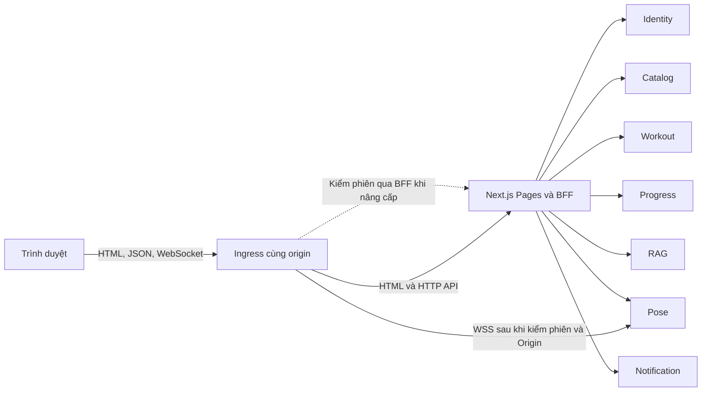

# Kiến trúc frontend SmartGym Web

T27: /hoi-dap page parse unique resultId query (≤50 UUID), Chat client quản lý transcript memory/8-turn context/20-turn display, task/message/result selection và abort generation token. /api/v1/chat ở custom Web server gọi adapter riêng, không browser gọi private provider. Không cache nội dung chat hoặc lưu localStorage. History gửi chỉ 8 turns gần nhất, content dài cắt 3000 ký tự theo giới hạn provider; UI vẫn giữ reply đầy đủ trong tối đa20 turns. Gắn raw chỉ sau owner API; selection lỗi chặn gửi đến khi bỏ/chọn lại, hủy/clear không nhận response cũ, HTTP200 unavailable giữ input. Render text + source details, URL đã duyệt, noindex/no-referrer; không có full-text nguồn giả. [ADR 0023](../adr/0023-rag-web-adapter.md) · [TST-27](../planning/TEST_PLAN.md)

T25 thêm frontend/app/progress/pose-import.tsx vào ResultSummary ở trang kết thúc và chi tiết Pose. Không import backend; Progress BFF thêm một operation từ generated schema, kiểm source=POSE/ID snapshot/Location đúng log và whitelist duplicate link. Form yêu cầu xác nhận, giữ key cùng payload, không tự POST/retry hoặc giả số rep. Có thời điểm thực tế, zone và picker occurrence owner ±7 ngày quanh completedAt, lazy fetch 100 mục/trang với tải thêm/thử lại. GET result chỉ cần BFF_POSE_ORIGIN/TLS; live/upload giữ flags riêng, không bật capability chỉ vì có origin đọc summary. Chi tiết log hiển thị AI snapshot riêng với set người dùng sửa. [ADR 0021](../adr/0021-pose-progress-import.md)

T20 thêm routes /app/thong-bao và /app/cai-dat/thong-bao, requireProfile/noindex và return path allowlist tương ứng. Client components ở frontend/app/notifications/views.tsx dùng HTTP helper kỹ thuật của Web, không import backend. BFF frontend/server/notifications.mjs chỉ cho bốn operation sinh từ OpenAPI qua sync-web-notification-contract; mTLS Notification + assertion mới từ Identity từng request, validation hai chiều, origin/CSRF, 64 KiB request và tối đa limit × 16 KiB response. Không forward cookie/header owner/Set-Cookie, không theo redirect hoặc tự retry command. Inbox/badge chỉ refresh khi focus/visible hoặc 30 giây lúc tab hiện, giữ dữ liệu cũ khi refresh lỗi, clear inbox khi 401, generation/abort chặn phản hồi cũ. Form preference không polling, giữ draft/ETag và explicit reload khi conflict/lỗi lưu chưa rõ kết quả. [ADR 0020](../adr/0020-notification-inbox-web.md)

T18 hiện thực `/app/nhat-ky`, `/app/nhat-ky/moi`, `/app/nhat-ky/[id]`, `/app/tien-do` và ba vùng dashboard. Frontend giữ form/draft/ETag/key trong bộ nhớ, dùng shared HTTP/form helpers cùng picker Catalog trong Web. `frontend/server/progress.mjs` allowlist sáu operation qua mTLS/introspection, generated contract kiểm stale. Không import backend source, không shared cache dữ liệu riêng. SVG và bảng đọc cùng summary, bộ lọc ngày/zone/cursor ở URL. Profile và từng widget tải độc lập, Workout lỗi không chặn summary/nhật ký. [ADR 0018](../adr/0018-progress-summary-ui.md)

T16 hiện thực chương trình ở `/app/chuong-trinh`, `/moi`, `/[id]`, lịch ở `/app/lich` và chi tiết `/app/lich/buoi/[id]`. Các page kiểm phiên phía server, editor/agenda/tuần là client component. `frontend/server/workout.mjs` giữ transport mTLS và kiểm schema từ `frontend/data/workout-contracts.json`, sinh bằng `scripts/sync-web-workout-contract.mjs`. GET Catalog picker công khai tách khỏi assertion Workout. Form và draft chỉ ở bộ nhớ, POST giữ key khi thử lại cùng payload, mutation dùng ETag mới từ response. Lỗi 409/412/401 giữ input, tải lại bản mới có xác nhận. URL giữ date/zone/view/cursor, request GET cũ bị abort, không tự retry command. Temporal 0.5.1 xử lý local time và DST đúng policy của backend. [ADR 0016](../adr/0016-workout-planner-bff.md)

`/app/tap-ai` lấy bài và chế độ từ capability của Pose. Luồng camera chỉ xin quyền sau khi người dùng đồng ý và chọn bắt đầu. Client gửi JPEG với header 12 byte tới `streamPath` qua WSS cùng origin, điều tiết bằng `ack`, cập nhật số đếm từ `rep` và poll GET khi socket mất sau finish. Khi kết thúc, hủy hoặc rời trang, client dừng các camera tracks. Upload hiện tiến độ PUT và trạng thái job, có hủy và phân biệt trường hợp số rep chưa có. Chi tiết tại `/app/tap-ai/ket-qua/[id]` kiểm tra quyền theo owner qua BFF. [Hợp đồng live](../api/API_CONTRACTS.md#5-websocket-camera) · [ADR 0012](../adr/0012-pose-live-session.md)

[PRD](PRD.md) · [Luồng nghiệp vụ](USER_FLOWS.md) · [UI/UX](UI_UX.md) · [Kiến trúc hệ thống](ARCHITECTURE.md) · [Hợp đồng](../api/API_CONTRACTS.md) · [Bảo mật](SECURITY.md) · [Kiểm thử](../planning/TEST_PLAN.md) · [Truy vết](../planning/TRACEABILITY.md)

## 1. Kiến trúc và trách nhiệm

Mã Next.js nằm ở `frontend/`, có manifest và build riêng. Backend nằm ở `backend/apps/`; frontend chỉ sử dụng API và hợp đồng, không import trực tiếp source của backend. Scripts/tests/Docker dùng đường dẫn này theo cấu trúc người dùng đã chọn.

**Quyết định thiết kế.** Một ứng dụng Next.js App Router và TypeScript có layout public, tài khoản, người dùng và admin. Backend-for-frontend cùng origin phục vụ API trình duyệt. Các service sở hữu nghiệp vụ, dữ liệu và kiểm tra quyền. Frontend sở hữu điều hướng, hiển thị, tương tác và chuyển tiếp tới hợp đồng đã công bố. Giữ lớp BFF mỏng, có timeout, không tạo bản sao dữ liệu nghiệp vụ.

- Server render trang công khai và khung trang riêng. Dùng client components có chủ đích cho SVG, bộ lọc, editor, biểu đồ, webcam, upload và chat. Server-side API adapters đọc cấu hình riêng, kiểm tra schema response, timeout và chuyển lỗi sang dạng UI. Gọi cùng adapter từ server page và Route Handler khi phù hợp.
- Trình duyệt gọi API cùng origin. Cookie phiên opaque được chuyển đúng luồng Identity/BFF. JWT downstream do BFF lấy sau kiểm tra phiên và giữ ở server. WebSocket nâng cấp qua `GET /api/v1/pose/live-sessions/{sessionId}/stream` cùng origin, dùng cookie phiên, kiểm tra Origin và subprotocol `smartgym.pose.v1` theo [hợp đồng Pose](../api/API_CONTRACTS.md). JavaScript trình duyệt không giữ JWT hay thông tin bí mật service.
- Dùng generated types từ OpenAPI tại lớp adapter hoặc build step, với type/runtime checks tại ranh giới. Chỉ dùng chung hợp đồng và công cụ kỹ thuật. Page modules và domain model backend không được import chéo.
- API trả lỗi thống nhất. BFF giữ mã nghiệp vụ, status, thông tin retry nếu có và correlation ID phù hợp. Lỗi quyền ở frontend không thay thế kiểm tra ở service. Downstream timeout chỉ ảnh hưởng phần giao diện phụ thuộc.

AI dùng nguồn mới theo [ADR 0008](../adr/0008-ai-provider-handoff.md). BFF có client riêng cho Pose V4 và `/v1/chatbot`, validate request/response và chuyển protocol qua Pose boundary. Browser gửi result ID, BFF giải owner và lấy raw V4 qua API nội bộ. Chat cần task, conversation, video state, references và notices. Không dùng DTO question/exerciseId hai trạng thái của M0 làm đủ hợp đồng chatbot bàn giao. T27 căn chỉnh trước code và đo deadline theo task.

## 2. Route inventory và trách nhiệm page

Tên route trình duyệt được quyết định ở đây. Đường dẫn và `operationId` HTTP/API lấy từ [OpenAPI](../api/openapi.yaml). Ký hiệu `[slug]` và `[id]` là segment động. UI và luồng đối chiếu [mã SCR](UI_UX.md) và [mã FLOW](USER_FLOWS.md).

| Route | Truy cập | Trách nhiệm của page và API chính | Màn hình/yêu cầu |
|---|---|---|---|
| `/` | Công khai | Server render giới thiệu, liên kết danh mục, nhóm cơ. SVG khởi động phía client. Catalog nhóm cơ. | SCR-01, CAT-001, WEB-001 |
| `/bai-tap` | Công khai | Tìm kiếm và lọc theo URL, phục hồi khi quay lại. Catalog nhóm cơ và danh sách bài. | SCR-02, CAT-001, CAT-002 |
| `/nhom-co/[slug]` | Công khai | Landing nhóm cơ chính thức, render mô tả và bài liên quan. Kiểm tra nhóm đang công bố; dùng cùng adapter danh mục. | SCR-02, CAT-001, CAT-002 |
| `/bai-tap/[slug]` | Công khai | Server render nội dung chính, xử lý canonical slug và bài đã gỡ. Trình bày media đã duyệt và khả năng AI theo trạng thái. | SCR-03, CAT-003, POS-001 |
| `/hoi-dap` | Knowledge công khai có rate limit; task cá nhân/results cần phiên | Bốn task, conversation và Pose result IDs theo owner, references/notices/status. Transcript memory, lỗi giữ input, noindex. BFF Chat API; KB/model thật còn cổng bàn giao. | SCR-13, RAG-001 |
| `/dang-ky`, `/xac-minh-email` | Công khai | Form đăng ký, trạng thái gửi, đọc token từ liên kết và xác nhận qua mutation. Gửi lại qua form công khai có phản hồi trung tính. Identity. | SCR-04, IDN-001, NTF-003 |
| `/dang-nhap`, `/quen-mat-khau`, `/dat-lai-mat-khau` | Công khai | Xác thực và reset, chỉ redirect về path nội bộ được phép. `403 EMAIL_UNVERIFIED` dẫn tới bước xác minh và gửi lại, phiên chưa được cấp. Identity. | SCR-05, IDN-002, IDN-003 |
| `/app` | Phiên đã xác minh | Dashboard lấy dữ liệu độc lập theo widget. Identity, Workout, Progress, Notification. | SCR-06, IDN-002, PRG-002 |
| `/app/ho-so` | Phiên đã xác minh | Quản lý thông tin hồ sơ theo quyền. Identity. | SCR-06, IDN-002 |
| `/app/chuong-trinh`, `/app/chuong-trinh/moi`, `/app/chuong-trinh/[id]` | Chủ sở hữu | Danh sách, tạo, xem và sửa chương trình. Catalog picker, Workout plans. | SCR-07, SCR-08, WKT-001 |
| `/app/lich`, `/app/lich/buoi/[id]` | Chủ sở hữu | Agenda/lịch tuần, dời/hủy, preview lặp lại, liên kết nhật ký. Workout schedules và occurrences dùng `from`, `to` là thời điểm RFC 3339 cho khoảng nửa mở. Đọc cài đặt Notification khi hiển thị nhắc. | SCR-09, WKT-002, WKT-003 |
| `/app/nhat-ky`, `/app/nhat-ky/moi`, `/app/nhat-ky/[id]` | Chủ sở hữu | Nhật ký, log nhập tay/theo lịch và chi tiết kết quả đã lưu. Progress, đọc thông tin buổi qua Workout khi mở từ lịch. | SCR-10, PRG-001, PRG-003 |
| `/app/tien-do` | Chủ sở hữu | Tải tổng hợp theo khoảng ngày gồm cả hai đầu, gửi `from`, `to` dạng ngày và `timeZone` IANA. Hiển thị biểu đồ, bảng và liên kết log. Progress summary. | SCR-11, PRG-002 |
| `/app/tap-ai`, `/app/tap-ai/ket-qua/[id]` | Phiên đã xác minh/chủ sở hữu kết quả | Chọn capability, webcam hoặc tải video, trạng thái và kết quả. Pose, lưu rõ ràng qua Progress. | SCR-12, POS-001 đến POS-003, PRG-003 |
| `/app/thong-bao`, `/app/cai-dat/thong-bao` | Chủ sở hữu | Hộp thư, đánh dấu đọc, cập nhật tùy chọn nhắc. Notification. | SCR-14, NTF-001, NTF-002 |
| `/admin`, `/admin/bai-tap` | ADMIN | Tổng quan, danh sách nội dung và trạng thái. Catalog admin, tín hiệu đồng bộ nếu có hợp đồng. | SCR-15, ADM-001, ADM-002 |
| `/admin/bai-tap/moi`, `/admin/bai-tap/[id]`, `/admin/bai-tap/[id]/xem-truoc` | ADMIN | Tạo/sửa nháp, preview riêng, quản lý nguồn, công bố/gỡ và audit. Catalog admin. | SCR-16, ADM-001, ADM-002, IDN-004 |
| `/robots.txt`, `/sitemap.xml` | Công khai | Cấu hình tìm kiếm và sitemap XML, chỉ liệt kê URL công bố hợp lệ. | WEB-001 |

Điều hướng tuyến riêng kiểm tra phiên server-side trước khi tải dữ liệu. Trang tài nguyên riêng áp dụng phản hồi truy cập theo hợp đồng để giảm lộ thông tin. Trang admin trả lỗi quyền có lối về an toàn. Chuyển hướng login chỉ nhận path nội bộ đã kiểm, không chấp nhận URL tuyệt đối, path bắt đầu bằng hai dấu gạch chéo hoặc quay về chính luồng đăng nhập. Request token từ email dùng trang riêng có `no-store`, `no-referrer` và không gắn analytics bên thứ ba. Chỉ thực hiện xác minh/reset bằng mutation có ý định rõ và lọc token khỏi log.

## 3. Component architecture và state

T12 dùng layout riêng cho trang admin và gọi API cùng origin từ browser. BFF sinh allowlist, schema request và response từ OpenAPI. Các trang gồm tổng quan với bài mới cập nhật, danh sách lọc và phân trang, editor, preview bản nháp đã lưu và audit. Catalog cung cấp danh sách nhóm cơ và dụng cụ đang công bố. Editor chỉ gửi trường đã đổi, dùng ETag gốc khi lưu và giữ input khi gặp 412. Người dùng có thao tác riêng để tải phiên bản mới. Create, publish và unpublish giữ Idempotency-Key khi gửi lại cùng nội dung và precondition trong cùng editor. [BFF CMS](../../frontend/server/catalog-admin.mjs) · [Editor](../../frontend/app/admin/editor.tsx)

T10 triển khai các route tài khoản, /app/ho-so và entry gate /admin theo [ADR 0005](../adr/0005-web-auth-bff.md). Next App Router render trang; Node HTTPS custom server trong frontend/server.mjs xử lý allowlist BFF trước Next và lấy IP từ socket peer. Không tin forwarded/IP/user/role headers từ client. Serverless/standalone output không áp dụng cho cách khởi chạy này; ingress mới phải đánh giá trust boundary riêng. Auth tắt thì Catalog public vẫn chạy HTTP local, auth API trả unavailable.

T35 dùng `/admin/noi-dung/[type]` cho nhóm cơ, dụng cụ và media. Danh sách hỗ trợ giữ bộ lọc và cursor trong URL, form giữ ETag và nội dung đang nhập trong bộ nhớ. `RevisionPanel` dùng chung cho năm loại và đọc snapshot khi mở lịch sử. `/admin/nhap-xuat` chỉ thao tác gói đã đăng ký. `/admin/nhat-ky` lọc theo quyền ADMIN và query của Catalog. BFF kiểm request/response theo OpenAPI, mọi JSON quản trị dùng `no-store`. Bản nháp và tải private không dùng cache công khai. [Runbook T35](../guides/OPERATIONS.md#admin-cms-t35)

frontend/server sở hữu transport/policy/schema validation, không import backend source hoặc DB driver. Generated frontend/data/auth-contracts.json lấy request/response/operation từ OpenAPI và được kiểm stale. API identityRequest chỉ gọi origin/path đã cấu hình qua mTLS, deadline 5 giây, không retry/follow redirect. SSR profileForSession introspect và getMe mỗi request, so ID/role/email verified, chỉ trả Profile cho page; JWT không serialize. Không có cache profile/role, localStorage hoặc browser bearer.

frontend/app/auth/forms.tsx sở hữu pending/error/success, native field constraints, submit lock, timeout 12 giây và explicit token action. Token chỉ đọc từ fragment, xóa address bar và giữ trong bộ nhớ component; query token không được dùng. Navigation chỉ cho return path /app, /app/ho-so, /admin. requireProfile server-side redirect khi thiếu/thu hồi session, hiển thị recovery khi Identity unavailable. /admin trả 403 cho USER tại Node gate và kiểm lại role khi render; CMS chưa thuộc T10. App account ở T10 không giả widget Workout/Progress/Notification chưa triển khai.

| Lớp | Sở hữu | Ràng buộc |
|---|---|---|
| Layout và page | Route, metadata, session gate, suspense/error boundary, gọi use case UI và tổ hợp component. | Không nhúng rule nghiệp vụ backend. Không chuyển token vào client props hoặc RSC payload. |
| UI primitives | Nút, trường, dialog, typography, focus, trạng thái, token và thông điệp tiếng Việt. | Hoạt động với dữ liệu truyền vào, test bàn phím và không gọi service. |
| Feature components | Catalog, bản đồ, lịch, log, biểu đồ, Pose, RAG, thông báo và editor admin. | Giữ logic form và state cục bộ. Dữ liệu bền lấy qua adapter đúng service. |
| Adapter server/BFF | Base URL, hợp đồng, session downstream, lỗi, timeout, correlation. | Chỉ server-side, schema validated, không công bố endpoint nội bộ. |

- **URL state.** Catalog dùng `q`, `muscleGroupId`, `equipmentId` và `cursor` trong query string, với giới hạn trang theo OpenAPI. Dùng thứ tự sắp xếp ổn định của API. Cursor là giá trị opaque, chỉ dùng cho cùng bộ lọc. Đồng bộ lựa chọn bản đồ theo thiết kế UI. Dùng cùng parser typed trên server và client. Chuẩn hóa ID và giá trị, giới hạn kích thước từ khóa, bỏ cursor khi đổi lọc. Hủy request cũ khi đổi truy vấn nhanh. Bộ lọc đã xác nhận là nguồn cho back/forward.

  T05 dùng query đã chọn lọc trên server để tạo link cho cả SVG và danh sách HTML. Khi chọn hoặc xóa nhóm, giữ `q` và `equipmentId`, bỏ `cursor` và để server đọc Catalog. `side` và roving focus nằm trong component. Trạng thái chọn lấy từ URL sau khi điều hướng. Khi API bài lỗi riêng, bản đồ và bộ lọc vẫn hiển thị nếu taxonomy khả dụng. [UI/UX bản đồ](UI_UX.md#4-interactive-muscle-map-bằng-svg)
- **Client state.** Input chưa lưu, tiến độ upload, trạng thái phiên/rep webcam, chat transcript, chọn biểu đồ và dialog ở cấp feature. Dọn riêng theo chủ sở hữu khi đổi user, logout hoặc hết phiên. Không lưu video, token, log cá nhân, chat hoặc draft nhạy cảm vào storage dài hạn của trình duyệt.
- **Server state.** Catalog, lịch, log, tiến độ, notification và admin nội dung thuộc các service. Client query cache theo user/route/filter và xóa khi hết phiên. Sau mutation, cập nhật từ response thật hoặc invalidate đúng key. Chỉ tối ưu cập nhật lạc quan cho thao tác dễ phục hồi theo hợp đồng, thí dụ trạng thái đã đọc.
- **Form.** Dùng validation định dạng và lỗi trường phía client, server giữ quyết định cuối. Gửi khóa chống lặp khi endpoint yêu cầu và tái dùng khóa với cùng nội dung khi kết quả chưa rõ. Dữ liệu xung đột giữ bản đang nhập, hiển thị thông tin server cho phép và để người dùng chọn thao tác tiếp.

## 4. Fetching, cache và suy giảm chức năng

CMS dùng [hook yêu cầu cùng origin](../../frontend/app/admin/cms-request.tsx) cho các lượt đọc danh sách, bản nháp và nhật ký. Kết quả được gắn với đường dẫn và lượt tải để dữ liệu cũ không xuất hiện khi đổi truy vấn hoặc thử lại. Các màn hình import trực tiếp module danh sách, thống kê, xem trước hoặc nhật ký theo nhu cầu. Layout gốc không tạo bộ nhớ đệm React Query vì các màn hình hiện tại không dùng query client.

| Dữ liệu | Chiến lược | Invalidation và lỗi |
|---|---|---|
| Nhóm cơ và danh mục công khai | SSR với khóa theo revision, query đã chuẩn hóa và locale nếu cần. Cache công khai chỉ cho response vô danh. Cấu hình thời hạn rõ thay vì dựa vào mặc định framework. | Khi publish/unpublish, cập nhật revision và revalidate keys liên quan. Tránh phục vụ payload bị gỡ. Nếu đường invalidation chưa được kiểm chứng, đọc có điều kiện từ origin hoặc tắt shared cache cho response tương ứng. |
| Chi tiết bài và canonical slug | Server lấy bản đang công bố và kiểm tra redirect trước render. Ưu tiên conditional fetch với Catalog và không phục vụ dữ liệu chi tiết đã gỡ khi origin không xác nhận. | Bài gỡ hoặc không tồn tại theo response hợp đồng. Dừng cache stale cho chi tiết nếu việc công bố bị rút. Khi media lỗi, giữ nội dung chữ. |
| Riêng tư và admin | Fetch theo phiên, `Cache-Control: private, no-store` tại ranh giới thích hợp. Client giữ dữ liệu tối thiểu trong bộ nhớ. | Invalidate khi ghi, xóa khi hết phiên hoặc quyền. Với dashboard, chờ từng widget độc lập. |
| Pose và RAG | Kết quả và media phiên không shared cache. Poll job với giới hạn/backoff và dừng ở terminal/đóng trang. Socket chỉ mở trong phiên live. Chat dùng request có deadline và phản hồi thiếu căn cứ. | Khi Pose/RAG lỗi, UI tương ứng hiển thị fallback. Luồng đọc Catalog không bắt buộc gọi hai service này. |
| Hộp thư | Fetch lần đầu, làm mới khi focus hoặc theo interval đã chốt, tạm dừng khi tab ẩn. | Đánh dấu đã đọc invalidate số chưa đọc và mục liên quan. Lỗi email hoặc Notification không làm hỏng lưu lịch. |

Chỉ dùng chính sách retry của [hợp đồng](../api/API_CONTRACTS.md). Giữ timeout riêng cho các yêu cầu có chi phí khác nhau. Khi catalog upload/import đổi revision, không đồng nhất public cache, CDN asset và RAG index thành một trạng thái. Trình bày trạng thái từng lớp trong admin nếu có dữ liệu đáng tin. [Tài liệu caching Next.js](https://nextjs.org/docs/app/guides/caching-without-cache-components)

## 5. Media, webcam và tích hợp chat

- Ảnh Catalog từ host được duyệt, có `width`/`height`, `sizes`, ảnh responsive và lazy-load dưới vùng đầu. Ảnh đại diện quan trọng có ngân sách riêng. Poster video trước thao tác phát, không preload tất cả clip. Chỉ công bố phiên bản media được cấp phép. Metadata gồm alt, caption khi cần, nguồn và fallback. SVG của Muscle Map là asset kiểm duyệt và data mapping riêng.
- Xác minh camera được hỗ trợ trước khi xin quyền trên secure context. MediaStream thuộc component phiên. Khi dừng, unmount, logout hoặc lỗi dứt điểm, stop track, đóng socket và hủy timer. Chỉ truyền frame sau khi thông báo quyền riêng tư và handshake hợp lệ. Dùng nhịp frame, kích thước và backpressure của hợp đồng. Không log hoặc cache raw frame. [MediaDevices.getUserMedia](https://developer.mozilla.org/en-US/docs/Web/API/MediaDevices/getUserMedia)
- Upload dùng handoff theo hợp đồng Pose, có tiến độ, hủy và thông báo lỗi khi tệp vượt ngưỡng. Nếu dùng URL ký, giới hạn host, quyền và thời hạn. Trình duyệt không xây đường dẫn object key tùy ý. Phân biệt lỗi upload, tạo job và chạy inference. Preview cục bộ nếu có chỉ dùng object URL ngắn hạn và revoke khi không dùng.
- Chat hiển thị văn bản đã xử lý an toàn. Không thực thi HTML tùy ý do model trả. Chỉ hiển thị link trích dẫn hợp lệ, với tên và đích rõ ràng. Nếu liên kết nguồn bị gỡ, UI dùng trạng thái riêng và không nhúng bản lưu cũ. Giá trị từ query `exerciseId` chỉ là ngữ cảnh, RAG kiểm tra bài công bố.

## 6. SEO và chính sách slug

- Trang chủ, thư viện gốc, landing nhóm cơ và trang bài đã công bố dùng server metadata tiếng Việt, title/description riêng, canonical tuyệt đối theo domain cấu hình và Open Graph phù hợp. Sitemap XML lấy từ Catalog công bố. Route riêng, auth, admin, preview, chat và biến thể query tìm/lọc động dùng `noindex` theo thiết kế và không có trong sitemap.
- URL filter/search vẫn chia sẻ được, với bộ lọc được chuẩn hóa. URL này không mặc nhiên trở thành landing SEO. Chỉ định canonical về landing tương đương khi nội dung thực sự tương đương. Giữ trang nhóm cơ là route độc lập đã chọn, dùng canonical chính nó. [Quy tắc canonical của Google Search Central](https://developers.google.com/search/docs/crawling-indexing/consolidate-duplicate-urls)
- Catalog sở hữu ID và mapping slug cũ/mới. Khi bài đổi slug và còn công bố, Web đọc phản hồi `308` từ Catalog, kiểm đích thuộc cùng họ API và chuyển người dùng bằng `308` đến `/bai-tap/[slug]` chuẩn trong một hop. Bài đã gỡ hoặc slug không tồn tại trả `404` và UI dẫn về thư viện. Canonical, sitemap, internal links và dữ liệu chia sẻ lấy cùng nguồn slug.
- Bảo vệ route riêng bằng xác thực và phân quyền. Metadata `noindex` và robots chỉ điều khiển crawling/indexing.

T06 giữ `/` là thư viện công khai đang phục vụ. `WEB_PUBLIC_ORIGIN` cấp origin tuyệt đối cho canonical, Open Graph và sitemap của thư viện cùng các bài đang công bố. URL truy vấn lọc và phân trang có `noindex, follow` và giữ được khi chia sẻ. Catalog sở hữu slug chuẩn, Web kiểm alias bằng đúng hình dạng path trước khi trả 308. Metadata và nội dung dùng cùng kết quả đọc cho mỗi lượt render. Trang nhóm cơ riêng và route thư viện riêng vẫn thuộc thiết kế mở rộng. [Runbook T06](../guides/OPERATIONS.md#thư-viện-công-khai-t06)

Frontend trình bày ảnh ở thẻ bài và media trong chi tiết khi URL thuộc `WEB_CATALOG_MEDIA_ORIGIN` và khớp gateway versioned. Ảnh dành khung trước và lazy load. Video tạo trình phát sau khi người dùng mở, với poster nếu Catalog đã cấp URL phù hợp. Browser đọc trực tiếp từ gateway để Catalog kiểm quyền và byte range cho mỗi request. Hướng dẫn chữ giữ nguyên khi media thiếu, bị thu hồi hoặc lỗi. [ADR 0007](../adr/0007-catalog-media-storage.md)

## 7. Kiểm thử và đầu ra

- **Unit/component.** Query parser và builder, quy tắc sort/filter, mapping hotspot, state transitions, phục hồi focus, định dạng múi giờ, aria labels, dữ liệu rỗng/lỗi.
- **Contract.** BFF payload, error mapping, cookie/phiên, slug redirect, headers cache/SEO, mock adapter theo OpenAPI và hợp đồng WebSocket. Kiểm tra schema drift trong build triển khai.
- **E2E.** Tất cả FLOW-01 đến FLOW-10 theo [ma trận](../planning/TRACEABILITY.md), bao gồm guest, USER, ADMIN, mobile/bàn phím, xung đột, upload/video, webcam bằng thiết bị giả lập hoặc fixture có phép, lỗi RAG và lỗi từng widget. Đo performance trên điều kiện test đã ghi và kiểm tra không tải media/video ngoài thời điểm dự kiến.
- **Bảo mật.** Kiểm tra session/cookie/CSRF theo [bảo mật](SECURITY.md), router không lộ dữ liệu riêng qua server render, quyền Admin khi truy cập trực tiếp, và dữ liệu AI không đi vào log/cache.

| Phạm vi frontend | Ca nghiệm thu liên quan |
|---|---|
| SVG, bộ lọc, responsive, truy cập công khai và canonical | TST-04, TST-05, TST-06, TST-07 |
| Đăng ký đến đăng xuất, admin và công bố | TST-10, TST-12 |
| Chương trình/lịch, nhật ký/tiến độ và thông báo | TST-16, TST-18, TST-20 |
| Webcam, upload, lưu kết quả, chat và tích hợp | TST-23, TST-24, TST-25, TST-27, TST-30 |

## 8. Routes và dữ liệu CMS

| Route | Trách nhiệm |
|---|---|
| `/admin/bai-tap`, `/admin/bai-tap/[id]` | Danh sách/edit/preview, dùng admin exercises, publish/unpublish và restore. |
| `/admin/nhom-co`, `/admin/dung-cu`, `/admin/bien-the`, `/admin/media` và item `/[id]` | Dùng admin content theo loại. Media có upload/scan panel. Variant giới hạn bài cha. |
| `/admin/lich-su/[type]/[id]` | Danh sách/detail revision, compare, restore-as-draft qua API revision. |
| `/admin/nhap-xuat`, `/admin/audit` | Tạo/kiểm/apply import, tải snapshot được quyền, truy vấn audit. |
 
Dùng ContentList, StatusBadge, VersionedEditor, ReferencePicker, MediaUploadPanel, PublishDialog và RevisionDiff. State filter/paging trong URL, server làm nguồn chuẩn, form giữ bản local tới khi lưu. BFF kiểm quyền và `no-store` cho draft, preview và admin. Khi mutation thành công refresh item/list/revision/audit; khi publish/archive invalidate public theo tag exercise, slug cũ/mới, taxonomy, sitemap và revision. Khi 412 giữ dữ liệu chưa lưu, tải bản mới trước khi merge. UI chỉ hiển thị sync RAG khi có tín hiệu provider đã xác nhận, luôn phân biệt với commit Catalog. [Hợp đồng CMS](../api/API_CONTRACTS.md) · [Ca kiểm thử](../planning/TEST_PLAN.md)
