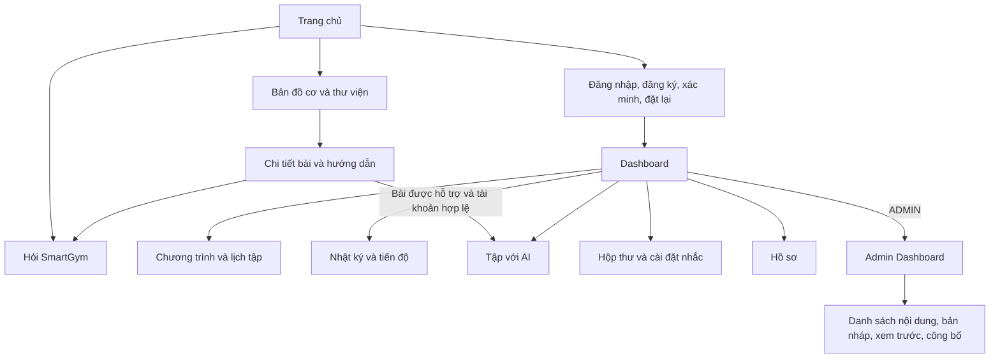

# Thiết kế giao diện và trải nghiệm SmartGym Web

SCR-13/T27 đã có /hoi-dap: task select, textarea tiếng Việt ≤3000 ký tự, hội thoại memory và source title/publisher/page/section/excerpt. Bốn task giữ semantics thiếu quan sát/thiếu bằng chứng/ngoài phạm vi/model unavailable. CTA từ kết quả AI gắn owner result qua URL; không yêu cầu người dùng nhập hash/raw hoặc video thủ công vào chat. Selection lỗi chặn gửi, bỏ kết quả bắt đầu transcript mới. Đang chờ có Dừng chờ/trả focus, không tự cuộn, status live vùng nhỏ, lỗi giữ input; thiếu policy không dựng điểm. Mobile320–1440/keyboard/axe đã kiểm bằng protocol fixture, không phải corpus/LLM thật. [ADR 0023](../adr/0023-rag-web-adapter.md) · [TST-27](../planning/TEST_PLAN.md)

T25 nối SCR-12 với SCR-10 qua nút xác nhận lưu nhật ký. AI chưa có rep hoặc đo 0 vẫn hiển thị phân tích và CTA ghi thủ công, không có nút nhập tự động. Có rep dương thì nói rõ một set gộp tổng rep, không suy ra weight/duration/phân set hoặc khẳng định kỹ thuật đúng. Thời điểm mặc định lúc hoàn tất phân tích cần người dùng xác nhận; có thể sửa và chọn buổi trong lịch trước lưu. 409 có link log đã có, 401/503 giữ input/key để thử lại chủ động. Nhật ký phân biệt AI gốc với set actual có thể sửa; xóa vẫn giữ dấu chống nhập trùng. [ADR 0021](../adr/0021-pose-progress-import.md)

T20 hiện thực SCR-14 tại /app/thong-bao và /app/cai-dat/thong-bao. Inbox có tất cả/chưa đọc, tổng chưa đọc thật, keyset 10 mục/trang, làm mới và read button tách khỏi link buổi hiện hành. Không tự đánh dấu khi mở trang. Thông báo giữ giờ/zone lúc gửi, link dẫn tới trạng thái mới kể cả đã hủy. Dashboard dùng badge server; lỗi không giả số 0. Refresh giữ danh sách cũ kèm lỗi, dừng khi tab ẩn, hủy request lúc unmount. Form kênh/lead 5–1440 giữ input khi 412/401/lỗi mạng, tải bản server cần xác nhận khi có thay đổi. Email xác thực/reset độc lập; thư đã dispatch không thể thu hồi. Controls có nhãn, status/alert tiếng Việt và không tự chuyển focus khi refresh. [ADR 0020](../adr/0020-notification-inbox-web.md) · [TST-20](../planning/TEST_PLAN.md)

[PRD](PRD.md) · [Luồng nghiệp vụ](USER_FLOWS.md) · [Route và kiến trúc frontend](FRONTEND_ARCHITECTURE.md) · [Hợp đồng](../api/API_CONTRACTS.md) · [Kiểm thử](../planning/TEST_PLAN.md) · [Truy vết](../planning/TRACEABILITY.md)

Đây là đặc tả màn hình và tương tác cho toàn hệ thống. Mã SCR xác định một nhóm màn hình hoặc trạng thái được kiểm thử. Cây URL, hợp đồng API và chính sách cache do tài liệu tương ứng sở hữu.

## 1. Cấu trúc điều hướng

- **Public shell.** Logo về trang chủ, Thư viện, Hỏi SmartGym và Đăng nhập. Breadcrumb từ nhóm cơ hoặc thư viện tới bài. Khách mở trang riêng thì thấy thông báo yêu cầu đăng nhập và điều hướng quay lại an toàn.
- **User shell.** Dashboard, Chương trình, Lịch, Tiến độ, Tập với AI, Thông báo, Hồ sơ. Desktop dùng sidebar. Mobile giữ Dashboard, Lịch và Tập AI ở thanh chính, các mục khác nằm trong menu. Nút thông báo có nhãn kèm số chưa đọc.
- **Admin shell.** Nhận diện khu vực quản trị rõ, có đường trở về website. Điều hướng Nội dung, Bản nháp và xem audit liên quan. Chỉ hiện liên kết khi có vai trò phù hợp. Server vẫn kiểm quyền trên mỗi truy cập.

## 2. Màn hình và hành vi cần nghiệm thu

| Mã | Màn hình | Vùng và thao tác chính | Tiêu chí UX và liên kết yêu cầu |
|---|---|---|---|
| SCR-01 | Trang chủ | Tiêu đề ngắn, điểm vào bản đồ, ô tìm, đường vào hỏi đáp. | Nội dung chính đọc được khi SVG lỗi, form tìm có nhãn và điều hướng đúng. CAT-001, CAT-002, WEB-001, FLOW-01. |
| SCR-02 | Bản đồ và thư viện | Chuyển mặt trước/sau, nhóm cơ, bộ lọc, vùng kết quả, phân trang. | Chọn cùng nhóm bằng SVG/danh sách/URL cho cùng kết quả. Xóa bộ lọc, giữ trạng thái khi quay lại, phân biệt lỗi/rỗng. CAT-001, CAT-002, FLOW-01. |
| SCR-03 | Chi tiết bài | Breadcrumb, tên, nhóm cơ, dụng cụ, media, các bước và lỗi thường gặp. Hành động hỏi RAG hoặc tập AI theo capability. | Nội dung chữ là fallback đầy đủ. Slug cũ chuyển đúng. CTA AI có trạng thái chưa hỗ trợ, không khả dụng hoặc cần đăng nhập. CAT-003, POS-001, FLOW-01. |
| SCR-04 | Đăng ký và xác minh | Email, mật khẩu, trạng thái yêu cầu, link xác minh, form gửi lại công khai. | Lỗi trường và lỗi link hết hạn rõ. Gửi lại không cần phiên và giữ phản hồi trung tính. IDN-001, NTF-003, FLOW-02. |
| SCR-05 | Đăng nhập và đặt lại | Form đăng nhập, quên mật khẩu, đặt lại và lối gửi lại xác minh. | Password manager và paste hoạt động. `EMAIL_UNVERIFIED` hiển thị bước xác minh trước khi vào trang riêng. Hết hạn hoặc link đã dùng có thao tác phù hợp. Redirect nội bộ hợp lệ và quyền đúng. IDN-002, IDN-003, IDN-004, FLOW-02. |
| SCR-06 | Dashboard và hồ sơ | Buổi sắp tới, log gần đây, thông báo, lối tập AI, thông tin hồ sơ. | Widget tải và lỗi độc lập. Có trạng thái bắt đầu khi chưa có dữ liệu. Hồ sơ chỉ cho sửa trường được phép. PRG-002, IDN-002, NTF-001, FLOW-03. |
| SCR-07 | Danh sách chương trình | Danh sách, trạng thái lưu, tìm bài và điều hướng vào editor. | Có CTA tạo chương trình đầu tiên. Mục đã thay đổi ở tab khác được tải lại theo hợp đồng. WKT-001, FLOW-04. |
| SCR-08 | Editor chương trình | Tên chương trình, trình chọn bài, hàng set/rep/thời lượng/nghỉ, sắp xếp, lưu. | Sắp xếp qua nút lên/xuống bên cạnh kéo thả nếu có. Giữ input khi lỗi, cảnh báo rời trang khi chưa lưu. WKT-001, FLOW-04. |
| SCR-09 | Lịch và chi tiết buổi | Lịch tuần, danh sách agenda, nút tạo/dời/hủy, múi giờ, phạm vi một buổi hoặc quy tắc. | Danh sách thao tác được trên mobile/bàn phím. Giờ hiển thị kèm zone, xung đột chỉ rõ buổi và giữ bản nháp. WKT-002, WKT-003, NTF-002, FLOW-05. |
| SCR-10 | Nhật ký và trình ghi buổi | Danh sách lọc theo ngày, nhập tay hoặc theo lịch, set, chỉ số và ghi chú. | Số lần gửi lặp mở log đã lưu, không tạo bản sao. Xác nhận xóa và phản ánh thay đổi sau kết quả server. PRG-001, PRG-003, FLOW-06. |
| SCR-11 | Tiến độ | Chọn khoảng thời gian, chỉ số, đồ thị, bảng tương đương và log gần đây. | Đơn vị, khoảng và nguồn rõ. Bảng dữ liệu đọc được khi biểu đồ không render. Thông báo không có dữ liệu khác với lỗi. PRG-002, WEB-001, FLOW-06. |
| SCR-12 | Tập AI và kết quả | Chọn bài hỗ trợ, tùy chọn webcam/video, ghi chú quyền riêng tư, tiến độ, rep, phản hồi và lưu. | Camera dừng khi kết thúc. Upload và xử lý có trạng thái riêng. Phản hồi không bảo đảm chẩn đoán. Nút lưu yêu cầu xác nhận và chống nhập trùng. POS-001, POS-002, POS-003, PRG-003, FLOW-07. |
| SCR-13 | Hỏi SmartGym | Hội thoại, bốn task knowledge/score/summary/practice, kết quả đã chọn và video state. References hiện tên nguồn/trang, notices và trạng thái model lỗi. | Chỉ gắn result thuộc owner, chọn file không đồng nghĩa đã phân tích. Thiếu policy không hiển thị điểm tự suy. Giữ câu hỏi khi timeout và phân biệt thiếu căn cứ với không khả dụng. RAG-001, FLOW-08. |
| SCR-14 | Hộp thư và tùy chọn | Chưa đọc/tất cả, đọc một mục, kênh nhắc, số phút trước buổi. | Tắt nhắc qua email không tắt email xác minh/reset. Liên kết buổi hủy dẫn đến trạng thái thích hợp. NTF-001, NTF-002, NTF-003, FLOW-09. |
| SCR-15 | Admin tổng quan và danh sách | Số lượng theo trạng thái, bộ lọc nội dung, danh sách gần đây, trạng thái Catalog/index nếu có dữ liệu. | Chỉ ADMIN, tổng quan rỗng có CTA tạo bài. Tín hiệu đồng bộ thiếu phải hiển thị là chưa biết. ADM-001, ADM-002, RAG-002, FLOW-10. |
| SCR-16 | Admin soạn và công bố | Editor nội dung, nhóm cơ, nguồn/media, preview, audit, các nút lưu nháp/công bố/gỡ. | Nội dung preview riêng, lỗi quyền hoặc phiên bản giữ bản nháp. Xác nhận công bố/gỡ mô tả tác động. ADM-001, ADM-002, IDN-004, FLOW-10. |

## 3. Bố cục và design system

**Ngôn ngữ thiết kế đề xuất.** Giao diện tiếng Việt, nền trung tính, màu nhấn xanh ngọc cho hành động chính và vùng cơ đang chọn, đường viền sáng rõ. Dùng token ngữ nghĩa để thay palette khi kiểm tra tương phản. Chữ có bộ ký tự tiếng Việt. Chỉ báo tải, lỗi, chọn và cảnh báo phải có chữ hoặc biểu tượng kèm nhãn.

| Token | Đề xuất và cách dùng |
|---|---|
| Màu | `surface`, `surface-subtle`, `text`, `text-muted`, `border`, `action`, `focus`, `success`, `warning`, `danger`, `map-selected`. Kiểm tra tương phản trên cặp màu sử dụng thật. |
| Chữ | Body 16 px, tiêu đề trang 28–36 px, tiêu đề vùng 20–24 px, dòng thông tin hỗ trợ tối thiểu 14 px. Co giãn theo zoom và tránh cắt dấu tiếng Việt. |
| Khoảng cách | Nhịp 4/8/12/16/24/32/48 px, card cùng cấu trúc, khu vực chính có gutter 16–32 px. |
| Chuyển động | Ưu tiên chuyển trạng thái ngắn. Khi bật reduced motion, bỏ hiệu ứng trang trí và duy trì phản hồi trạng thái. |
| Kích thước đích | Mục tiêu vùng chạm 44 × 44 CSS px cho nút độc lập. SVG có vùng nhỏ cần đường thay thế tương đương trong danh sách. |

| Thành phần dùng lại | Trách nhiệm |
|---|---|
| AppShell, PublicNav, UserNav, AdminShell, Breadcrumb | Giữ điều hướng và skip link nhất quán. |
| Button, Link, IconButton, Badge, Tabs, ToggleGroup | Dùng semantics chuẩn, nhãn rõ, disabled có lý do phù hợp. |
| Field, FormErrorSummary, Select, DateTimeField | Liên kết nhãn, lỗi và hướng dẫn. Giữ giá trị qua lỗi máy chủ. |
| ResultList, ExerciseCard, FilterBar, MediaPanel | Quản lý skeleton, empty, lỗi, fallback media và trạng thái phân trang. |
| MuscleMap, MuscleGroupList, RegionLegend | Dùng cùng nhóm cơ và trạng thái lựa chọn. Mục 4 mô tả tương tác. |
| Dialog, ConfirmAction, Toast, LiveStatus | Quản lý focus, trở về phần tử kích hoạt, phản hồi thành công/lỗi. Các lỗi cần sửa luôn có bản hiển thị tĩnh cạnh form. |
| WorkoutEditor, AgendaList, SessionCard, SetEditor | Cho thao tác bàn phím, nhãn đơn vị, tóm tắt thay đổi và xử lý xung đột. |
| ProgressChart, ProgressDataTable | Cùng dữ liệu, tooltip có thể lấy bằng focus, bảng thay thế biểu đồ. |
| PoseInputPanel, PoseSessionStatus, RepSummary, CitationList | Rõ nguồn dữ liệu, trạng thái xử lý, ngừng camera và đường dẫn bằng chứng. |
| AdminContentTable, ContentEditor, PublishPreview, AuditSummary | Chế độ chỉ đọc/đang sửa, hiển thị version và hành động có xác nhận. |

| Màn hình | Bố cục |
|---|---|
| 320–639 px | Một cột. Bộ lọc mở bằng dialog hoặc nhóm mở rộng. Muscle Map đứng trước danh sách, danh sách nhóm cơ truy cập ngay. Agenda là mặc định. Nút chính không che nội dung hoặc focus. |
| 640–1023 px | Một hoặc hai cột theo vùng. Map và lọc có thể đứng cạnh danh sách trên vùng đủ rộng. Điều hướng riêng có thể thu gọn. |
| Từ 1024 px | Sidebar ổn định cho luồng riêng. Catalog dùng cột lọc và vùng kết quả. Chi tiết bài có thể đặt media cạnh hướng dẫn. Admin table có header và điều hướng phù hợp. |

Kiểm tra 320, 640, 1024 và 1440 px, zoom 200% và bố cục lại ở 320 CSS px. Bảng rộng có vùng cuộn có nhãn hoặc chuyển thành danh sách. Không dựa vào hover để lộ thông tin cần thao tác.

## 4. Interactive Muscle Map bằng SVG

1. Mỗi vùng hình học ánh xạ tới `muscleGroupId` từ Catalog. Vùng cơ trái/phải có thể chia cùng ID. Hai mặt front/back dùng chung lựa chọn. Chuyển mặt không xóa nhóm đã chọn. Chỉ tô highlight khi vùng tồn tại ở mặt đang xem, đồng thời giữ chip lựa chọn.
2. Khung SVG gốc có nguồn quyền sử dụng, `viewBox` và kích thước đáp ứng màn hình. Vùng động dùng ID nội bộ ổn định, trạng thái thường, hover, focus và selected. Không nhận SVG tùy ý từ API vào DOM. Hình minh họa và hotspot được kiểm tra trước khi đóng gói.
3. Cung cấp danh sách nút HTML luôn hiện hoặc dễ mở, mỗi nhóm có nhãn tiếng Việt. Khi SVG tương tác bằng bàn phím, quản lý một điểm Tab vào cụm, phím mũi tên di chuyển focus giữa nhóm theo thứ tự định sẵn, Enter/Space chọn, Tab thoát. Dùng cùng handler cho click, chạm và nút danh sách. Kiểm tra với trình duyệt và đọc màn hình; nếu hành vi focus SVG không tương thích, danh sách HTML giữ toàn bộ thao tác.
4. Mỗi chọn cập nhật URL và bộ lọc, reset phân trang theo hợp đồng, hiển thị tên nhóm đang chọn và số kết quả khi tải xong. Giữ focus tại điều khiển sau cập nhật. Đường dẫn “Đến kết quả” cho phép chủ động chuyển focus tới tiêu đề danh sách.
5. Không phân biệt nhóm chỉ bằng màu. Dùng stroke/outline, tên và trạng thái chọn. Trạng thái loading của danh sách không khóa thao tác đổi mặt. Khi SVG hỏng hoặc thiếu mapping cho một nhóm, danh sách vẫn truy cập được và không tạo vùng chết có thể click.

Ca kiểm thử bắt buộc bao gồm click/chạm, chỉ dùng bàn phím, dữ liệu nhóm thiếu, đổi mặt, quay lại trang và URL chia sẻ. Xem yêu cầu CAT-001, WEB-001 và [ma trận](../planning/TRACEABILITY.md).

T05 đặt bản đồ tại `/`, cùng form lọc và danh sách bài hiện có. SVG sơ đồ được vẽ riêng cho SmartGym trong frontend. Geometry tĩnh chỉ đọc mã vùng `front_<id>` và `back_<id>` đã khai báo. Khi Catalog trả `svgRegions` trống, dùng ID ổn định để ánh xạ bộ nhóm cũ. Khi đã có mã vùng thì chỉ dùng geometry khớp mã. Nhóm chưa ánh xạ vẫn có liên kết HTML. Không nạp SVG từ dữ liệu CMS. Lựa chọn nhóm nằm trong URL, đổi mặt giữ nguyên kết quả và chỉ tô vùng ở mặt có geometry. Số kết quả phản ánh trang hiện tại theo hợp đồng phân trang. [Hướng dẫn bàn phím W3C](https://www.w3.org/WAI/ARIA/apg/practices/keyboard-interface/)

## 5. Trạng thái giao diện và khả năng tiếp cận

T10 đồng bộ `/app` và `/app/ho-so` với giao diện thư viện. Biểu tượng Tài khoản mở tổng quan; nếu chưa đăng nhập, tuyến riêng chuyển đến màn hình đăng nhập. Tổng quan nhóm các lối tắt tập luyện và giữ ba khối dữ liệu tiến độ, nhật ký và lịch tải độc lập. Hồ sơ hiển thị email cùng trạng thái xác minh, cho phép chỉnh tên và múi giờ, và báo kết quả ngay dưới biểu mẫu. Hai trang xếp thành một cột trên điện thoại. [TST-10](../planning/TEST_PLAN.md)

T18 áp dụng SCR-06/10/11: nhật ký có set rep/thời lượng/kg/RPE và ghi chú, có CTA từ buổi tập để điền kế hoạch rồi xác nhận thực tế. Source/occurrence không được sửa sau lưu. Xung đột 412 giữ draft, duplicate mở log đã liên kết, delete nêu dấu chống trùng. Tiến độ có bộ lọc inclusive date/zone, chỉ số đơn vị rõ, SVG số buổi và bảng HTML cùng dữ liệu, kể cả ngày 0. Dashboard chia ba vùng summary/recent log/upcoming và lỗi riêng từng vùng. Trạng thái thông báo chưa có không được hiển thị thành số 0 giả. [TST-18](../planning/TEST_PLAN.md) · [ADR 0018](../adr/0018-progress-summary-ui.md)

T16 áp dụng SCR-07–09: danh sách ACTIVE/ARCHIVED, picker Catalog có tìm kiếm/phân trang, editor có nút sắp xếp bàn phím và hai kiểu mục tiêu. Agenda mặc định, chế độ tuần và múi giờ xem không sửa zone gốc. Chi tiết buổi giữ snapshot và cho dời/hủy riêng. PUT rule giữ override, hủy cả lịch nêu rõ mọi buổi chưa bắt đầu, gồm buổi đã dời riêng. Conflict projection hiện ngày/giờ và hướng dẫn xử lý, không hiển thị đã gửi nhắc. Dialog xác nhận ưu tiên Quay lại, trả focus khi đóng. Khi có draft, cảnh báo trước khi rời trang và xác nhận khi tải bản mới. Trạng thái riêng có noindex/no-store. [TST-16](../planning/TEST_PLAN.md) · [ADR 0016](../adr/0016-workout-planner-bff.md)

| Trạng thái | Hành vi nhất quán |
|---|---|
| Loading | Skeleton có kích thước gần dữ liệu thật, thông báo ngắn khi chờ dài, không reset focus. Với refresh giữ dữ liệu cũ nếu còn hợp lệ. |
| Empty | Phân biệt chưa có dữ liệu, bộ lọc không khớp và tính năng chưa có kết quả. Có CTA cụ thể như xóa lọc, tạo buổi hoặc ghi log đầu tiên. |
| Error | Hiển thị nội dung có thể hành động và thử lại khi an toàn. Phân biệt lỗi quyền, hết phiên, giới hạn tần suất, xung đột, thiếu mạng và lỗi riêng từng widget. Không in stack trace hoặc nội dung nội bộ. |
| Success | Hiển thị kết quả từ service, giữ liên kết tới đối tượng đã tạo và công bố qua live region nếu cần. Toast phụ trợ, trạng thái chính vẫn hiện khi toast biến mất. |
| Destructive | Dialog ghi tác động, ưu tiên focus vào lựa chọn an toàn, quay lại nút kích hoạt khi đóng. Chỉ báo thành công sau xác nhận server. |

- Dùng cấu trúc landmark, heading có thứ tự, skip link và thứ tự focus khớp trình bày. Dialog có cơ chế đóng phù hợp và không bẫy người dùng khi lỗi.
- Form báo lỗi tổng hợp ở đầu và cạnh trường, gắn bằng mô tả có thể đọc. Có nhãn đơn vị, múi giờ và định dạng ví dụ. Không dùng placeholder thay nhãn.
- Media có mô tả và hướng dẫn chữ. Video phát do người dùng điều khiển, có phụ đề khi nội dung lời nói cần để hiểu. Pose giữ chỉ báo camera đang hoạt động và đường dừng bằng bàn phím.
- Không tự cuộn khi từng frame Pose hoặc từng mục chat đến. Chỉ công bố thay đổi có ý nghĩa, thí dụ số rep cập nhật theo nhịp phù hợp. Cung cấp văn bản tương đương cho đồ thị, vùng cơ và tín hiệu màu.
- Kiểm tra tương phản, zoom, bàn phím và đọc màn hình trên các luồng chính. Mục tiêu tham chiếu WCAG 2.2 AA, với kết quả do [kế hoạch kiểm thử](../planning/TEST_PLAN.md) ghi lại. [WCAG 2.2](https://www.w3.org/TR/WCAG22/)

## 6. Admin Dashboard CMS

Bảy mẫu trong [frontend/design/cms](../../frontend/design/cms/) định hướng giao diện CMS. Dùng thanh điều hướng riêng, bảng cho bài tập, nhóm cơ, dụng cụ và nhật ký; media hiển thị dạng lưới với xem trước có quyền. Form bài tập chia hai cột trên màn hình rộng, xếp dọc trên màn hình nhỏ và đưa thao tác lưu/công bố xuống thanh cuối. Chỉ hàng bài tập đã gỡ có nút thùng rác. Hộp xác nhận nêu rõ bài sẽ biến mất khỏi kho và không thể khôi phục, còn lịch sử vẫn được giữ. Thẻ tổng quan lấy số liệu từ Catalog; các số đếm ghi “trên trang” chỉ áp dụng cho kết quả phân trang đang hiển thị.

| Khu vực | Màn hình và trạng thái cần có |
|---|---|
| Exercise Management | Danh sách q/status/sort/cursor, editor nhóm cơ, dụng cụ và media, preview private, draft vs public revision, publish/archive/restore và hộp thoại nêu ảnh hưởng. |
| MuscleGroup và Equipment | Danh sách + create/edit, slug và thứ tự, SVG key/side cho nhóm cơ, publish/archive/restore. Nếu 409 hiển thị bài public phụ thuộc hoặc chỉ dẫn xử lý theo lỗi API. |
| Biến thể cũ | Không có màn hình quản lý riêng trong CMS. Lối vào cũ chuyển về kho bài tập; nhật ký vẫn nhận diện các bản ghi lịch sử. |
| Media | Upload progress, trạng thái scan/verify, preview private, metadata, provenance và quyền. Thay tệp tạo revision, archive chỉ khi bỏ tham chiếu public. |
| Publishing và revision history | So sánh hai bản, actor/thời điểm/lý do, public revision, restore về nháp. Cảnh báo lỗi quyền, validation và 412 giữ giá trị đang nhập. |
| Import/export và Audit Log Viewer | Báo cáo trước apply, lựa chọn snapshot, tiến độ, lỗi theo bản ghi, nút apply có xác nhận, export revision, lọc audit theo actor/type/id/thời gian. |
 
Mọi màn hình có loading/empty/error/success, validation theo API, quyền theo role, tương tác bàn phím và focus sau dialog. Danh sách chưa có dữ liệu hiển thị CTA theo quyền. Dữ liệu lấy từ Catalog API, chỉ fixture ở UI cô lập và test. User Management nếu có dùng Identity API. Truy vết ADM-001–007, FLOW-10 và TST-11/12/31–37.

T12 đưa vào sử dụng tổng quan bài cập nhật gần đây, danh sách có bộ lọc, editor, preview bản nháp và nhật ký. CMS mở `/admin/noi-dung/[type]` cho nhóm cơ, dụng cụ và media, `/admin/nhap-xuat` và `/admin/nhat-ky`. Lịch sử mở theo yêu cầu, cho so sánh hai bản trên cùng trang và khôi phục thành nháp kèm lý do. Khi nhận 412, editor giữ nguyên các trường đang nhập và để người dùng chọn tải phiên bản mới. Form bài tập tự sinh ID, gợi ý slug từ tên tiếng Việt và yêu cầu chọn loại hình, trọng tâm và độ khó khi công bố. Số hiệp và thời gian nghỉ thuộc mục gợi ý tùy chọn. Thư viện chỉ hiện các thông số đã nhập. Biên tập viên có thể tải ảnh hoặc video trực tiếp từ form bài tập hoặc chọn tệp đã có trong kho. Tệp mới được kiểm tra trước khi gắn. Lưu bản nháp bài tập để giữ liên kết. Mô tả và ghi công là tùy chọn khi tải từ form. Thẻ bài tập trong thư viện dùng ảnh đầu tiên làm ảnh đại diện. Trang chi tiết phát video minh họa. Bản xem trước có media đã công bố để biên tập viên kiểm tra trước khi công bố bài tập. Kho media hiển thị tiến độ tải và trạng thái xác minh tệp. Phần nhập KB hiển thị báo cáo trước khi áp dụng và giữ bản công khai. [Kiến trúc frontend](FRONTEND_ARCHITECTURE.md) · [Ca TST-12 và TST-35](../planning/TEST_PLAN.md)
