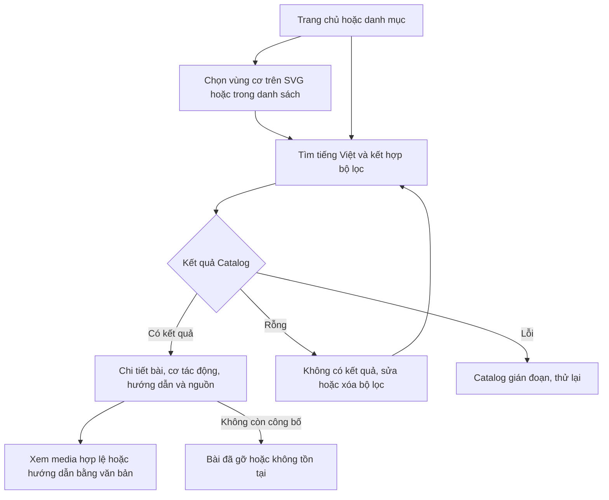
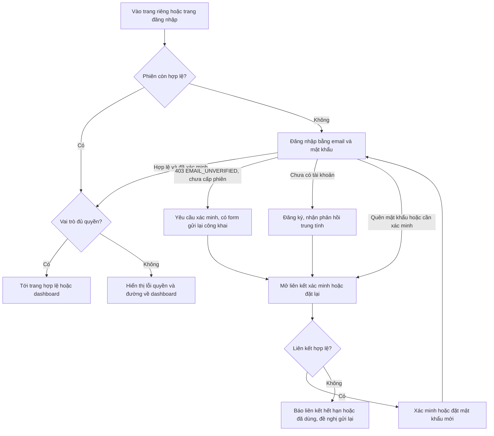
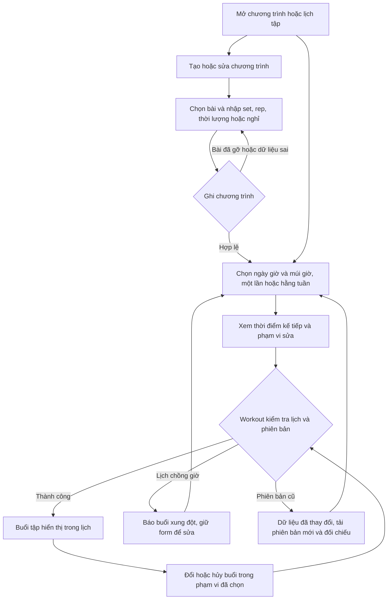
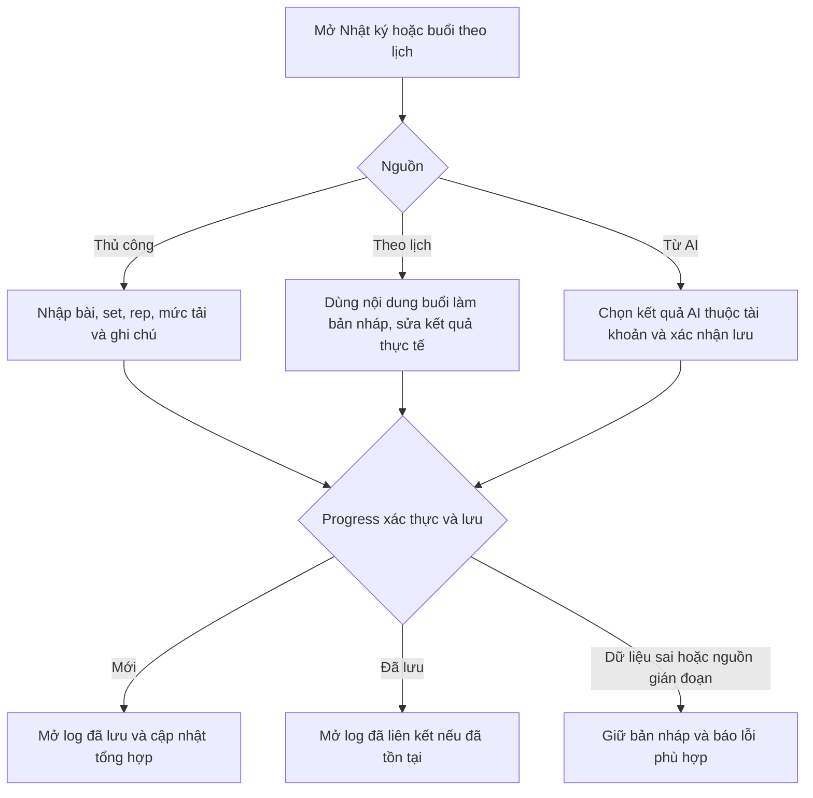
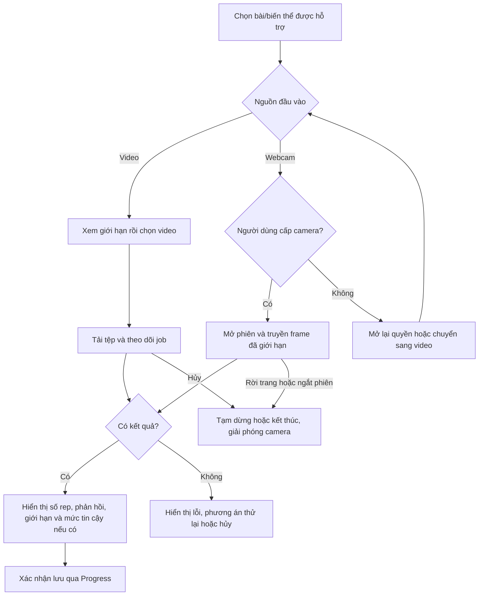
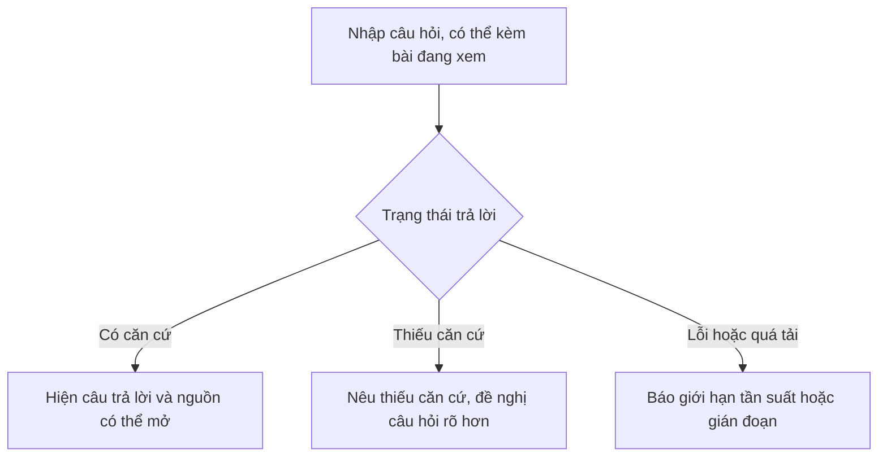
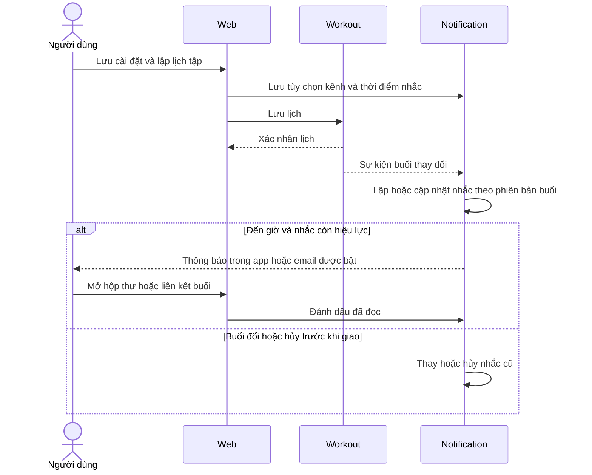
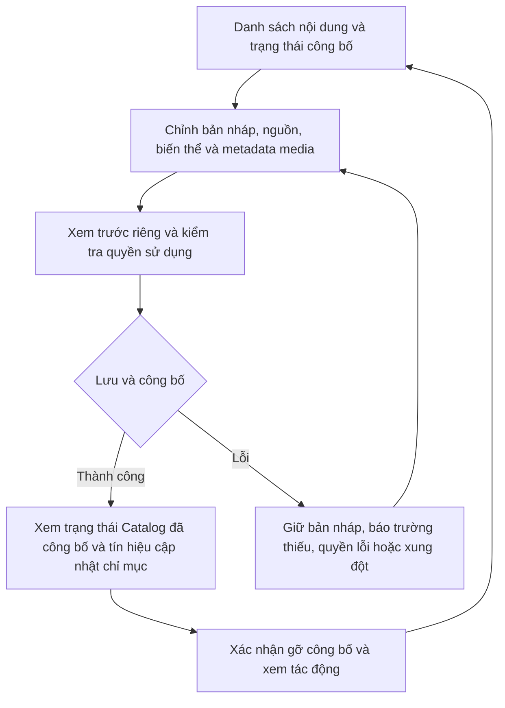
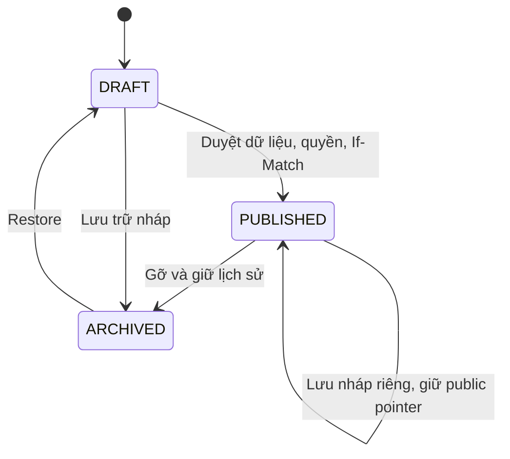

# Luồng nghiệp vụ SmartGym Web

FLOW-08/T27 hiện thực public knowledge và bốn task /v1/chatbot qua Web BFF theo [sequence ADR0023](../adr/0023-rag-web-adapter.md). Kết quả được chọn từ Pose → kiểm owner/expiry/provenance → gửi nhãn vào private RAG → giữ status/references/session. Thiếu session cần đăng nhập, selection lỗi phải bỏ/chọn lại, chưa ingest báo chưa sẵn sàng, timeout giữ câu hỏi và không tự retry; cancel/clear bỏ response cũ. Transcript không ghi DB, không tạo lịch/nhật ký. Nguồn full-text và generation corpus thật chưa được nghiệm thu, giữ gate T26/T27.

Luồng và trạng thái dưới đây áp dụng cho toàn bộ hệ thống. Xem [PRD](PRD.md) để biết yêu cầu, [UI/UX](UI_UX.md) để biết hành vi màn hình, [kiến trúc frontend](FRONTEND_ARCHITECTURE.md) để biết route và ranh giới kỹ thuật, [hợp đồng](../api/API_CONTRACTS.md) để biết thao tác và lỗi chính xác, [ma trận](../planning/TRACEABILITY.md) để đối chiếu task và test.

## Chỉ mục

| ID | Điểm vào | Đích và điều kiện |
|---|---|---|
| FLOW-01 | Trang chủ, danh mục, liên kết chi tiết | Chọn nhóm cơ → tìm/lọc → xem hướng dẫn. Khách truy cập được. |
| FLOW-02 | Đăng nhập hoặc luồng riêng được bảo vệ | Đăng ký, xác minh, đăng nhập, đặt lại mật khẩu và quay lại trang được phép. |
| FLOW-03 | Dashboard cá nhân | Mở buổi tập sắp tới, log gần đây, tập với AI hoặc lịch tập. Dữ liệu hỏng từng phần có trạng thái riêng. |
| FLOW-04 | Chương trình tập của tôi | Tạo và sửa chương trình, bài tập, số set, số lần và thứ tự. |
| FLOW-05 | Lịch tập | Lập lịch một lần hoặc hằng tuần, đổi hoặc hủy buổi, xử lý xung đột. |
| FLOW-06 | Nhật ký hoặc chi tiết buổi | Ghi buổi tay hoặc từ lịch, sửa, xóa và theo dõi tiến độ. |
| FLOW-07 | Trang tập AI | Chọn bài được hỗ trợ, tải video hoặc bật camera, nhận kết quả và lưu theo lựa chọn. |
| FLOW-08 | Hỏi SmartGym | Hỏi đáp với bằng chứng, xem nguồn hoặc nhận trạng thái thiếu căn cứ. |
| FLOW-09 | Hộp thư và cài đặt | Chọn kênh nhắc lịch, xem thông báo, mở buổi liên quan. |
| FLOW-10 | Admin Dashboard | Soạn, kiểm tra, xuất bản, gỡ bài tập và đối chiếu trạng thái đồng bộ. |

## FLOW-01 — Khám phá bài tập

- Liên kết danh mục lưu các bộ lọc đã chọn. Quay lại từ chi tiết khôi phục bộ lọc. Slug cũ của bài đang công bố chuyển tới slug hiện hành. Bài đã gỡ dùng trang lỗi thân thiện và đường về danh mục.
- Hai cách chọn nhóm cơ dùng cùng ID và cùng trạng thái. Nếu SVG không sẵn sàng, danh sách thao tác được ngay. Thiếu media dùng hướng dẫn văn bản và ảnh thay thế được cấp phép nếu có.
- Đường tập AI chỉ xuất hiện với biến thể đã xác nhận khả năng, kèm trạng thái cần đăng nhập nếu khách chọn. Catalog tiếp tục hiển thị khi dịch vụ AI gián đoạn.

## FLOW-02 — Tài khoản và quyền truy cập

- UI đăng ký và gửi lại email giữ phản hồi trung tính, kể cả khi địa chỉ không tồn tại. Gửi lại qua form công khai không cần phiên. Chỉ sau khi mật khẩu hợp lệ, Identity trả `403 EMAIL_UNVERIFIED` cho địa chỉ chưa xác minh. UI giải thích bước xác minh và cung cấp nút gửi lại. Chỉ lần đăng nhập sau xác minh mới cấp cookie phiên.
- Redirect sau đăng nhập chỉ nhận đường dẫn nội bộ hợp lệ và vẫn chạy kiểm tra quyền. Email token dùng một lần. Nếu hết hạn, không tự động gửi lặp.
- Khi phiên hết hạn trong lúc sửa chương trình hoặc log, UI giữ bản nháp trong bộ nhớ của tab khi an toàn, yêu cầu đăng nhập lại và không tự phát lệnh ghi. Đăng xuất dọn cache và kết nối riêng của trình duyệt.

## FLOW-03 — Dashboard cá nhân

| Bước | Hành vi |
|---|---|
| 1 | Sau đăng nhập, hiển thị lời chào, buổi tập sắp tới, bản tóm tắt nhật ký, số thông báo chưa đọc và lối vào tập AI. |
| 2 | Dữ liệu lấy theo từng vùng từ Workout, Progress và Notification. Widget rỗng hiển thị hành động phù hợp như tạo chương trình hoặc ghi buổi đầu tiên. |
| 3 | Nếu một nguồn lỗi, chỉ widget đó báo lỗi và có nút tải lại. Tài khoản không mất phiên do lỗi widget. |
| 4 | Chọn buổi → FLOW-05 hoặc FLOW-06. Chọn tập AI → FLOW-07. Chọn thông báo → FLOW-09. |

## FLOW-04 và FLOW-05 — Chương trình và lịch

- Mỗi màn hình lịch hiển thị múi giờ đã chọn và thời điểm địa phương. Chuyển múi giờ để xem không sửa lịch. Tạo lịch dùng múi giờ IANA của quy tắc. Khi DST làm giờ địa phương không tồn tại, materializer dùng instant hợp lệ đầu tiên. Khi giờ lặp, dùng instant sớm hơn. UI nêu quy tắc và hiển thị thời điểm đã được máy chủ vật hóa.
- Lịch hằng tuần hiển thị các buổi được vật hóa trong cửa sổ 35 ngày. Người dùng thấy lần nhắc dự kiến theo cài đặt, cùng trạng thái nếu kênh email không khả dụng. Khoảng thời gian liền kề hợp lệ, khoảng chồng giờ đang hoạt động phải được máy chủ kiểm tra kể cả khi hai tab lưu đồng thời.
- Chỉnh một buổi tạo ngoại lệ phù hợp. Chỉnh hoặc hủy chuỗi ảnh hưởng các buổi tương lai theo quy tắc [API](../api/API_CONTRACTS.md) và giữ lịch sử cùng dữ liệu log đã có. PUT rule giữ buổi đã sửa riêng. Hủy cả chuỗi hủy mọi buổi chưa bắt đầu, gồm buổi đã dời riêng, giữ lịch sử buổi đã bắt đầu. Hiển thị phạm vi tác động trước khi xác nhận. Khi Catalog gỡ bài đã có trong chương trình, hiển thị tên đã lưu và yêu cầu chọn bài còn dùng được khi thêm mới.
- Trạng thái ghi lịch do Workout xác nhận. Nhắc lịch đồng bộ bất đồng bộ và chưa được coi là đã giao khi thao tác lịch vừa thành công.

## FLOW-06 — Nhật ký và tiến độ

- Log theo lịch lưu kết quả thực tế độc lập với kế hoạch. Log từ AI lưu số liệu mà người dùng đã xem và xác nhận. Không lưu video thô vào Progress. Mở log đã nhập nếu yêu cầu lưu được gửi lại.
- T25 chỉ nhập tự động số rep AVAILABLE dương thành một set gộp. VIDEO chưa có số rep hoặc LIVE đo 0 giữ màn hình phân tích và hướng ghi thủ công. Chọn thời điểm/occurrence trước khi xác nhận, source liên kết bất biến; AI snapshot gốc không đổi khi chỉnh actual sets. [ADR 0021](../adr/0021-pose-progress-import.md)
- Người dùng sửa hoặc xóa log của mình và thấy đồ thị cập nhật theo khoảng thời gian, đơn vị và loại chỉ số. Bản ghi tay chưa có lịch vẫn xuất hiện. Xóa buổi trong lịch không xóa log cũ.
- Nếu log chưa tồn tại, hiển thị hướng dẫn bắt đầu. Nếu chỉ tổng hợp lỗi, danh sách log có thể tiếp tục hiển thị, đồ thị báo lỗi riêng.

## FLOW-07 — Huấn luyện AI

- Trước khi mở camera hoặc tải video, nêu rõ dữ liệu truyền đi, vòng đời dữ liệu và mục đích xử lý. Nút dừng phải thao tác bằng bàn phím. Mất kết nối hiển thị trạng thái rõ và theo hợp đồng, dọn MediaStream khi đóng hoặc điều hướng.
- Tiến độ tải và trạng thái xử lý là hai giai đoạn khác nhau. Timeout khi tạo job dẫn đến tra lại hoặc gửi cùng idempotency key. Khi bắt đầu phiên mới thực sự, tạo khóa mới.
- UI biểu diễn chất lượng đầu vào yếu, kết quả từng rep và giới hạn nhận định. Chỉ hiển thị giá trị được server gửi. Một lần xác nhận lưu đích danh kết quả hoàn tất; lỗi hoặc hết hạn chỉ ảnh hưởng lần lưu đó.

## FLOW-08 — Hỏi đáp RAG

Nguồn liên kết tới bài hoặc trích dẫn được phép. Nếu nguồn đã gỡ, hiển thị trạng thái nguồn không còn truy cập, không hiển thị lại bản nội dung đã bị rút. Phản hồi lỗi giữ câu hỏi trong ô nhập của tab. Luồng chat không được thực hiện thay đổi tài khoản, lịch hay nhật ký.

Theo [nguồn AI hiện hành](AI_INTEGRATION.md), khách có thể hỏi knowledge. Người đã đăng nhập chọn Pose result của mình để summary/practice/score, hệ thống xác minh kết quả trước khi gửi chatbot. UI phân biệt video selected/analyzing/analyzed/attached. Score thiếu policy phải giải thích chưa có quy tắc. Video không có rep count vẫn có thể hỏi nhãn kỹ thuật, còn nhập chỉ số Progress cần dữ liệu phù hợp.

## FLOW-09 — Nhắc lịch và hộp thư

Hiển thị cài đặt nhắc lịch và email hệ thống ở hai mục riêng. Khi buổi đã hủy, liên kết trong thông báo dẫn đến trạng thái đã hủy hoặc lịch thay thế, không tạo phiên mới. Lỗi đánh dấu đã đọc có thể thử lại. Hộp thư rỗng và lỗi tải có nội dung khác nhau.

## FLOW-10 — Quản trị nội dung

- Chỉ ADMIN truy cập. Preview và bản nháp không xuất hiện trong URL công khai, sitemap hoặc RAG. Kiểm tra nguồn và quyền media trước khi công bố. Nội dung hướng dẫn hợp lệ có thể dùng fallback theo chính sách công bố.
- Thao tác công bố hoặc gỡ hiển thị phiên bản, thời điểm và kết quả thực tế. Ghi audit tại service sở hữu. RAG đồng bộ theo revision riêng, do đó UI quản trị phân biệt trạng thái công bố Catalog với trạng thái cập nhật chỉ mục nếu có tín hiệu.
- Khi hai admin cùng chỉnh một bản, giữ dữ liệu đang nhập khi server báo xung đột. Tải phiên bản mới và cho phép đối chiếu trước khi gửi lại. Người dùng bị thu hồi quyền nhận trạng thái từ chối, kể cả khi tab admin đã mở.

### FLOW-10 — Các nhánh CMS

- ADMIN chọn loại nội dung → lọc và phân trang → sửa/preview → xác nhận publish hoặc archive. Nếu tham chiếu chặn archive, hiển thị hướng xử lý trước khi thử lại. Nếu 412 giữ form và tải phiên bản mới để đối chiếu. Restore lịch sử tạo nháp mới. Với item PUBLISHED, revision cũ vẫn public tới lúc publish nháp.
- Media → xin grant → PUT private → complete → xem scan/verify → gắn source/license và duyệt quyền → publish Media → chọn ID trong bài. File lỗi hiển thị lý do và hành động thử lại, không xuất hiện public.
- Import → chọn manifest KB → xem báo cáo validate → apply nháp → duyệt/publish riêng. Hash sai, ID trùng hoặc thay đổi base version chặn apply. Export chọn publication revision còn hiệu lực, lấy kèm checksum. Audit có bộ lọc actor/type/id/thời gian.
