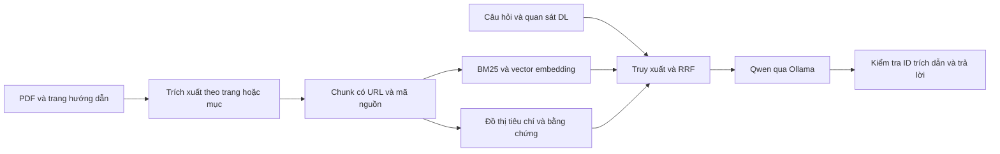

# SmartGym KB và RAG

**Bản hội thoại mới:** [RAG_HOI_THOAI_VA_DO_PHU.md](docs/RAG_HOI_THOAI_VA_DO_PHU.md). Nhánh hỏi đáp đã bỏ các view trả lời mẫu, dùng hiểu câu hỏi/ngữ cảnh → truy xuất → LLM tổng hợp → kiểm tra bằng chứng. Model chat local hiện là `qwen3:8b`; xem báo cáo độ phủ mới, không dùng bộ smoke nguồn trước đây làm độ chính xác chatbot.

Cập nhật 06/11/2026: đã tích hợp chatbot bốn nhóm chức năng trên web V4 và kiểm chứng Neo4j thật. Hướng dẫn hiện hành, mức đáp ứng và bộ minh chứng Chương 4: [CHUONG_4_CHATBOT_KG_RAG.md](docs/CHUONG_4_CHATBOT_KG_RAG.md). API `POST /v1/chatbot`; web đi qua `/api/chatbot`. File `.env` local chọn `KB_GRAPH_BACKEND=neo4j`; nếu cần chạy riêng không có Neo4j, đặt `KB_GRAPH_BACKEND=local`.

Service độc lập để thu thập tri thức, truy xuất bằng chứng và giải thích kết quả phân tích động tác. Chạy được riêng với API docs ở `http://127.0.0.1:8010/docs`, chưa cần dataset, trọng số DL hoặc PostgreSQL.

## Chạy trên Windows

Từ thư mục `D:\Đồ án\smart-gym-ai`:

```powershell
# Chỉ cần chạy khi máy/project chưa có môi trường Python
powershell -ExecutionPolicy Bypass -File .\services\kb_rag\scripts\bootstrap.ps1
```

Cài [Ollama Windows](https://ollama.com/download/windows), sau đó:

```powershell
ollama pull qwen3:4b
ollama pull qwen3-embedding:0.6b

# Dừng service trước khi cập nhật dữ liệu. Chuẩn bị lại khi thêm tài liệu.
powershell -ExecutionPolicy Bypass -File .\services\kb_rag\scripts\prepare.ps1

# Giữ cửa sổ này mở khi dùng service
powershell -ExecutionPolicy Bypass -File .\services\kb_rag\scripts\run.ps1
```

Mở `http://127.0.0.1:8010/docs`. Dùng `POST /v1/chat` với mẫu trong `examples/chat_request.json`; hoặc mở cửa sổ PowerShell khác và chạy `scripts/demo.ps1`.

Không có Ollama vẫn chạy được `prepare.ps1 -SkipEmbeddings`, `/v1/retrieve` và `/v1/chat` với `generate:false`. Đầu ra sẽ là `evidence_only`, `generation_used:false`. Đây là kiểm tra truy xuất, không được mô tả là đã thử mô hình sinh câu trả lời. Khi `generate:true`, nếu LLM lỗi thì cũng trả bằng chứng và cảnh báo rõ ràng.

## Tài liệu cần bổ sung

1. Bản PDF **Anatomy and Physiology 2e** đã được thêm tại `data/raw/anatomy-and-physiology-2e_-_WEB.pdf`. Đã kiểm tra tiêu đề, trang bản quyền 2026, giấy phép CC BY-NC-SA 4.0 và mục lục của file 1347 trang. `sources.json` chọn 84 trang: 353–369, 385–408, 425–429 và 433–470, gồm chuyển động khớp, mô cơ và các nhóm cơ. Mỗi chunk lưu tên mục và vị trí trang PDF. Cần đối chiếu lại nếu thay bản sách; không tự áp số trang của bản khác. Nguồn: [OpenStax](https://openstax.org/details/books/anatomy-and-physiology-2e). Access for free at openstax.org.
2. `data/raw/nsca_foundations.pdf` là nguồn bổ sung tùy chọn. Chỉ thêm khi có quyền truy cập; trang tải tự động có thể yêu cầu đăng nhập. Không bắt buộc mua sách để chạy service.
3. Ba trang ACE đã tải được. Nguồn Queensland dùng file ghi chú có dẫn nguồn trong `source_notes`, gồm trích đoạn ngắn và diễn giải tiếng Việt, do yêu cầu tải HTML nhận 403. Metadata ghi rõ đây là ghi chú của người phát triển, không phải bản HTML gốc. Nhóm cần duyệt lại nội dung chuyên môn.

`sources.json` là danh mục nguồn. Thêm PDF mới bằng cách đặt file trong `data/raw`, thêm một mục vào danh mục (ID duy nhất, tiêu đề, nhà xuất bản, URL, tên file, `format:pdf`, các khoảng trang cần dùng), rồi chạy lại `prepare.ps1`. Script không đọc các báo cáo SmartGym thành tri thức chuyên môn.

Các tài liệu gốc nằm trong `.gitignore`. Giữ bản sách và thông tin quyền sử dụng; không đẩy toàn văn sách có bản quyền lên repository công khai.

## Luồng xử lý



- `kb_service/ingest.py`: tải nguồn, đọc PDF/HTML, chia đoạn, gắn vị trí trang/mục, hash tài liệu, tạo snapshot.
- `claims.json`: tiêu chí kỹ thuật diễn giải có anchor đối chiếu với nguồn; tiêu chí không tìm thấy anchor sẽ không xuất bản. Anchor chỉ kiểm tra liên kết bằng chứng, không thay thế duyệt chuyên môn.
- `kb_service/retrieval.py`: BM25, truy xuất đồ thị, cosine trên embedding khi đã tạo; hợp nhất RRF. Có mở rộng thuật ngữ Việt–Anh bằng từ điển, không phải mô hình dịch đã train.
- `kb_service/providers.py`: gọi `/api/embed`, `/api/chat` của Ollama, có adapter API tương thích; yêu cầu đầu ra JSON và kiểm tra ID trích dẫn/URL.
- `kb_service/engine.py`: phân biệt dữ liệu giả lập, quan sát yếu, thiếu bằng chứng và lỗi LLM.
- `kb_service/app.py`: service HTTP độc lập; backend chính gọi qua `backend/modules/kb_rag/client.py`.

Vector lưu trong `data/index/embeddings.json`, cosine được tính trên tập ứng viên; phù hợp bản KB nhỏ để kiểm chứng. Không tuyên bố đây là ANN hoặc đang dùng ChromaDB. Khi corpus lớn cần đánh giá lại bộ lưu vector và hiệu năng. Snapshot có phiên bản; embedding cũ hoặc khác model không được dùng.

## Knowledge Graph và Neo4j

Đồ thị cục bộ được lưu cùng snapshot để chạy khi chưa có Docker. Có năm loại node: `Source`, `Chunk`, `Exercise`, `TechniqueCriterion`, `ModelLabel`. Ngoài quan hệ nguồn/tiêu chí, V4 có `Exercise → HAS_LABEL → ModelLabel → RETRIEVES_CRITERION → TechniqueCriterion`. Đây là quan hệ tìm tiêu chí, không phải khẳng định nhãn gây bệnh hoặc nguyên nhân. Danh mục V4 đối chiếu 83 nhãn với contract và hash trọng số; các mã cũ ngoài V4 vẫn chỉ là ánh xạ tạm thời.

Nếu muốn trình diễn Neo4j:

```powershell
docker compose -f docker-compose.kb.yml up -d neo4j
.\.tools\python\python.exe -X utf8 -m kb_service.cli sync-neo4j
```

Mở `http://127.0.0.1:7474` và dùng `examples/neo4j_queries.cypher`, thay phiên bản bằng giá trị thật từ `/health`. Import chỉ ghi node `SmartGymKB` có namespace theo phiên bản, không xóa đồ thị khác. Để RAG truy vấn Neo4j thật, tạo `.env` từ `.env.example`, đặt `KB_GRAPH_BACKEND=neo4j`, rồi khởi động lại service. Nếu Neo4j không truy cập được, trace ghi rõ việc dùng snapshot cục bộ dự phòng.

## Tích hợp với thành viên làm DL

Ví dụ cũ trong `examples` được đánh dấu `simulated:true`. Bản V4 đã nhập bốn contract và đối chiếu 83 nhãn với trọng số; `/v1/chat/from-model` chuẩn hóa phạm vi video/window/rep, phân loại nhãn và kiểm tra điểm/ngưỡng. Bản web video gọi service này qua HTTP sau suy luận thật. Xem [hướng dẫn cập nhật V4](docs/V4_KB_RAG_UPDATE.md). Với bộ model khác, vẫn cần thống nhất ý nghĩa nhãn và nhập lại contract trước khi dùng; không cần đưa dataset huấn luyện vào KB.

Gateway backend giữ xác thực người dùng và kiểm tra quyền sở hữu session. Endpoint cũ `/coach/explain-rep` nhận nhãn do client chọn nên vẫn ghi cảnh báo chưa xác minh với ErrorLog; không được gọi đó là kết quả DL đã xác thực. Endpoint `/coach/chat` nhận thêm `exercise_code` và `observation`.

## Kiểm tra và bằng chứng Chương 4

```powershell
.\.tools\python\python.exe -X utf8 -m kb_service.cli doctor
.\.tools\python\python.exe -X utf8 -m unittest discover -s services/kb_rag/tests -v
.\.tools\python\python.exe -X utf8 -m kb_service.cli evaluate
.\.tools\python\python.exe -X utf8 -m kb_service.cli export-evidence
```

Các file trong `artifacts` gồm báo cáo phân bố corpus, kết quả kiểm tra truy xuất, mẫu KB, đồ thị và mẫu IN–OUT. Bộ câu hỏi hiện có là kiểm tra nhỏ do người phát triển soạn ở mức nguồn, không phải benchmark độc lập. Điểm truy xuất không phải độ chính xác tư vấn. Phải đánh giá riêng chất lượng câu trả lời, tính đúng của trích dẫn và khả năng thiếu căn cứ bằng một bộ câu hỏi được duyệt, độc lập với quá trình chỉnh sửa.

`dense_status` và `channels_used` cho biết phép đo nào thực sự dùng embedding. Kiểm thử provider dùng mock không chứng minh model thật đã chạy. `doctor` kiểm tra model đã cài; cần chạy truy vấn thật và lưu kết quả trước khi đưa kết luận vào báo cáo.

Bản cập nhật V4 có 194 đoạn từ 7 nguồn và 23 tiêu chí có anchor đối chiếu, cùng danh mục 83 nhãn. `artifacts/v4_live/` lưu luồng HTTP thật từ video đến model và RAG; `artifacts/v4_browser/` lưu kiểm tra giao diện không dùng camera. Các file `book_rag_live.json`, `exercise_rag_live.json` và `live_verification.json` là thử nghiệm của bản trước; ví dụ chống đẩy trong đó là giả lập. Không dùng chúng để mô tả như lần chạy V4 mới. Đối chiếu đoạn sách với PDF gốc được lưu riêng trong `artifacts/book_import_verification.json`.

Trong một lần thử, model nhỏ đã dịch sai thuật ngữ giải phẫu khi tự thêm ví dụ, dù ID nguồn hợp lệ. Đầu ra đó và nhận xét được giữ ở `artifacts/book_answer_review_before.json`; prompt sau đó giới hạn việc thêm ví dụ, bổ sung quy ước dịch thuật và yêu cầu giữ nguyên thuật ngữ nếu không chắc bản dịch. Mặc định tắt chế độ suy luận (`OLLAMA_THINK=false`); bật chế độ này từng làm model hết ngân sách token trước khi hoàn thành JSON, nên không mặc định coi đó là cấu hình tốt hơn. Đây là những lỗi thực tế cần đưa vào phân tích giới hạn; thay đổi prompt và hai ví dụ chạy được chưa đủ để kết luận đã khắc phục mọi lỗi nội dung.

Từ thư mục gốc project, có thể chạy lại các kiểm tra này khi service đang hoạt động:

```powershell
.\.tools\python\python.exe -X utf8 services/kb_rag/scripts/verify_book.py
.\.tools\python\python.exe -X utf8 services/kb_rag/scripts/verify_live.py
```

## Cấu hình và vận hành

`.env.example` không chứa khóa thật. Mặc định service bind `127.0.0.1:8010`. Đặt cùng giá trị `KB_INTERNAL_TOKEN` ở service và `KB_RAG_INTERNAL_TOKEN` ở backend khi cần xác thực kết nối nội bộ. Không gửi API key trong chat.

Mỗi engine đọc snapshot một lần khi khởi động. Dừng và khởi động lại service sau khi ingest/embed. Trên Windows có ACL chỉ cho ghi nhưng không cho thay thế file, bộ ghi dùng cập nhật tại chỗ làm phương án dự phòng; tránh vừa nạp lại dữ liệu vừa khởi động service.

Docker độc lập: `docker compose -f docker-compose.kb.yml up -d --build`. Docker Desktop cần đang chạy; Ollama trên Windows cần cho phép kết nối từ Docker. Chạy native là đường ngắn nhất để kiểm thử trên một máy. Các model không tự tải trong lúc build container.
