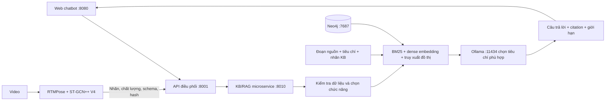

# SmartGym: kiểm tra bốn chức năng chatbot và minh chứng Chương 4

**Hồ sơ chuẩn bị báo cáo cập nhật 07/11/2026:** [mở bộ Chương 4](../../../../CHUONG_4_BAO_CAO/index.html), gồm nội dung đã đối chiếu Chương 3 mới, sơ đồ SVG/PNG, 12 truy vấn Neo4j và IN–OUT có phân loại nguồn gốc. Tài liệu bên dưới giữ vai trò hồ sơ trước đó, không thay thế kết quả kiểm thử cuối hoặc quy tắc chuẩn.

**Cập nhật sau phản hồi về chatbot trả lời theo mẫu:** nhánh hỏi đáp và cách kiểm tra độ phủ bên dưới đã có bản thay thế: [RAG hội thoại và độ phủ](RAG_HOI_THOAI_VA_DO_PHU.md). Hiện dùng sinh lời giải thích từ nguồn (`grounded_synthesis`), không còn `BOOK_VIEWS` hay ghép đáp án theo câu hỏi. Các bộ minh chứng `artifacts/chatbot/` là hồ sơ bản trước; bộ kiểm tra mới nằm trong `artifacts/coverage_audit/`.

Cập nhật ngày 06/11/2026. KB `kb_a3a9fc4465797bf3`. Đây là hướng dẫn và hồ sơ minh chứng từ code đang chạy; chưa phải bản Word báo cáo.

## 1. Kết luận mức đáp ứng

| Chức năng | Hiện thực đã có | Điều kiện, giới hạn cần ghi trong báo cáo |
|---|---|---|
| Hỏi đáp tri thức thể hình | Hỏi kỹ thuật bốn bài; đối chiếu biến thể chống đẩy; giải thích các vai trò cơ từ sách PDF; câu trả lời kèm đoạn nguồn | Phạm vi KB tập trung bốn bài và một phần giải phẫu. Chưa phải trợ lý biết toàn bộ thể hình. Câu hỏi kỹ thuật phổ biến dùng tiêu chí đã đối chiếu nguồn; câu ngoài các mẫu này có thể dùng LLM tự viết và vẫn cần kiểm tra ngữ nghĩa. |
| Giải thích lý do bị trừ điểm | Tách nhãn lỗi khỏi thuộc tính; tạo nhật ký mỗi khoản trừ từ nhãn đủ điều kiện và bảng quy tắc do ứng dụng cung cấp; dẫn tiêu chí liên quan | Model V4 đang trả điểm dự đoán của từng nhãn, không trả thang điểm kỹ thuật đã kiểm định. Nếu chưa nhập quy tắc thì chatbot không tự bịa điểm. Quy tắc DEMO chỉ phục vụ kiểm thử. |
| Tóm tắt và đánh giá buổi tập | Gom nhiều kết quả video, thống kê lỗi dự đoán theo đơn vị độc lập, nhận xét tiêu chí cần xem lại; bỏ video trùng hash | Tổng hợp trong tab hiện tại. Không coi một video là một rep; chưa suy ra tổng rep, thời gian tập thực, mức tiến bộ hoặc xu hướng qua nhiều ngày. |
| Gợi ý bài tập sửa lỗi thói quen | Ưu tiên nhãn lỗi xuất hiện ở ít nhất hai nguồn video độc lập; gợi ý tập lại bài tương ứng với cue có nguồn và citation | Đáp ứng ở mức luyện lại kỹ thuật. Chưa đủ để tự kê bài bổ trợ cá nhân hóa, chẩn đoán nguyên nhân, số hiệp/lần hoặc bảo đảm sửa được lỗi. Hai video cùng buổi chỉ cho thấy lỗi lặp lại, chưa xác lập thói quen dài hạn. |

Vì vậy không nên viết “đã hoàn thiện 100% bốn chức năng”. Có thể viết: “Đã triển khai chatbot hỗ trợ bốn nhóm chức năng, trong phạm vi tri thức và dữ liệu quan sát được công bố; chức năng gợi ý hiện tập trung luyện lại kỹ thuật, chức năng điểm trừ phụ thuộc quy tắc của hệ thống.”

## 2. Cách dùng chatbot không cần camera

1. Mở `http://localhost:8080`. Cuộn đến **Chat cùng SmartGym**.
2. Chọn **Hỏi đáp tri thức thể hình**, nhập câu hỏi và bấm **Gửi câu hỏi**. Không cần video cho chế độ này.
3. Muốn đánh giá buổi tập: chọn video ở phần trên, bấm **Phân tích video**, sau đó bấm **Thêm kết quả video hiện tại** trong chatbot. Có thể phân tích và thêm các video khác, kể cả bài khác.
4. Chọn chế độ tóm tắt, điểm trừ hoặc luyện sửa lỗi. Các bản ghi đã thêm được giữ khi đổi bài ở phần phân tích.
5. Nếu hệ thống đã có công thức điểm trừ, mở **Quy tắc điểm trừ** và nhập JSON. Nếu chưa có, để trống.
6. Bấm **Xuất input/output JSON** để lưu cả request và response, gồm nhãn, quy tắc, tiêu chí, citation và phiên bản KB.

Ví dụ quy tắc kiểm thử, không phải kết quả nghiên cứu hay thang điểm đã được duyệt:

```json
{"policy":"DEMO do nhóm tự đặt, chưa kiểm định","rules":[{"exercise_code":"SQUAT","label_key":"back_not_straight","points":5}]}
```

Mỗi quy tắc áp dụng một lần cho nhãn lỗi tương ứng trên mỗi đơn vị quan sát độc lập. Không tự trừ điểm cho thuộc tính như khoảng cách chân. Tổng trong nhật ký là tổng mức trừ trước điểm sàn; chưa tự tạo điểm cuối trên thang 100. Các JSON nhập từ file được ghi rõ là giả lập/phát lại, không xác minh là suy luận trực tiếp.

## 3. KB thực sự được xây từ đâu?

KB có **7 tài liệu nguồn**, **194 đoạn**, **23 tiêu chí**, **83 nhãn mô hình** và **311 nút/380 quan hệ KB**. Bảy tài liệu đến từ bốn đơn vị xuất bản: ACE, Queensland Health, NASM và OpenStax. Không gọi đây là bảy tổ chức độc lập.

| Tài liệu | Vai trò | File trong `data/raw` |
|---|---|---|
| ACE Bodyweight Squat | Tư thế bắt đầu, thân/lưng, hướng gối, pha hạ/đứng | `ace_squat.html` |
| ACE Push-up | Chống đẩy chuẩn, thân/hông, pha hạ/đẩy | `ace_pushup.html` |
| ACE Bent Knee Push-up | Phân biệt biến thể chống đẩy gối | Xem file chính xác trong `sources.json` |
| ACE Reverse Ab Crunch | Pha nâng hông/cuộn chậu, gối và pha hạ | `ace_reverse_crunch.html` |
| Queensland Jumping Jacks | Phối hợp tay/chân, tiếp đất | Bản ghi chú trích nguồn; không phải HTML gốc, cần duyệt lại chuyên môn |
| NASM Jumping Jacks | Phối hợp tay/chân, bắt đầu/trở về, biến thể step-out | Xem `sources.json` |
| OpenStax Anatomy and Physiology 2e | Kiến thức giải phẫu, vận động và vai trò cơ | `anatomy-and-physiology-2e_-_WEB.pdf` |

URL, tên file, đơn vị xuất bản và SHA-256 đầy đủ nằm trong `sources.json`, `artifacts/kb_sample.md`, API `/v1/kb/sources` và các nút `Source` trong Neo4j. File NSCA tùy chọn chưa tải thành công nên không tính là nguồn đã sử dụng.

Sách PDF có 1.347 trang; đã chọn 84 trang phù hợp để tạo 171 đoạn. Không phải đã đọc/đưa toàn bộ 1.347 trang vào RAG. `pdf_page` là thứ tự trang trong file, bắt đầu từ 1, có thể khác số in trên trang. Giữ attribution “Access for free at openstax.org.” và giấy phép ghi trong manifest. Mẫu in gọn: `artifacts/chatbot/kb_one_page.html`.

Fit3D và các video train/test không được dùng làm sách hướng dẫn kỹ thuật. Chúng phục vụ thực nghiệm DL và kiểm thử kết nối video → chatbot. Không cần train lại model hình ảnh để hỏi KB. RAG hiện dùng truy xuất tài liệu + embedding và LLM đã có; chưa fine-tune LLM.

## 4. KG và RAG nối với nhau như thế nào?



Mô hình DL quan sát động tác; KG lưu liên kết tri thức và nguồn. Neo4j là nơi lưu/truy vấn đồ thị, không phải LLM. RAG truy xuất bằng chứng rồi dùng chúng để trả lời. Các kênh lexical, dense và graph được hợp nhất bằng Reciprocal Rank Fusion. Với câu hỏi giải phẫu, đoạn sách được truy xuất bằng văn bản/vector; không ép gắn một tiêu chí bài tập không liên quan.

Đồ thị KB:

```text
Exercise -HAS_LABEL-> ModelLabel -RETRIEVES_CRITERION-> TechniqueCriterion
Exercise -HAS_CRITERION-> TechniqueCriterion -SUPPORTED_BY-> Chunk
Source -HAS_CHUNK-> Chunk
```

Đường `ModelLabel → TechniqueCriterion` nghĩa là tiêu chí liên quan để giải thích, không chứng minh nguyên nhân lỗi. Trong 23 nhãn lỗi có 8 liên kết trực tiếp, 13 liên kết một phần, 2 chưa có liên kết; vẫn chờ duyệt chuyên môn. Không diễn giải thành độ chính xác model hay độ phủ 100%.

Nhật ký trình diễn được lưu riêng bằng nhãn `SmartGymTrace`, gồm `ChatInput`, `ChatOutput`, `Observation`. Câu trả lời không được thêm thành nguồn sự thật của KB. Chỉ những đoạn có trong response và thực sự được trích dẫn mới có cạnh `CITES`. Neo4j chứa input/output đã nhập phục vụ kiểm tra; không tự sinh lời trả lời.

## 5. Chỉ ra code nào khi giảng viên hỏi?

| Việc cần giải thích | File |
|---|---|
| Manifest nhiều nguồn và tiêu chí đối chiếu anchor | `sources.json`, `claims.json` |
| Trích xuất, chia đoạn, kiểm tra anchor, tạo snapshot/graph | `kb_service/ingest.py` |
| Nhận đầy đủ nhãn V4, kiểm tra schema/hash/ngưỡng, loại quan sát thiếu | `kb_service/v4.py` |
| BM25, dense, đồ thị và fusion; trace kênh truy xuất | `kb_service/retrieval.py` |
| Đồng bộ/truy vấn Neo4j và fallback snapshot cùng phiên bản | `kb_service/graph.py` |
| Bốn nhiệm vụ, gom buổi tập, chống trùng, nhật ký điểm, gợi ý luyện lại | `kb_service/chatbot.py` |
| Hỏi kỹ thuật bằng tiêu chí đã có nguồn, các định nghĩa PDF được đối chiếu anchor | `kb_service/knowledge.py` |
| Gọi Ollama chọn ID tiêu chí hợp lệ; chế độ sinh văn bản tổng quát | `kb_service/providers.py` |
| API chatbot | `kb_service/app.py`: `POST /v1/chatbot` |
| HTTP bridge giữa web/model và KB/RAG | `SmartGym-Model/smart_gym_web_v4/server/coach.py`, `server/app.py`: `/api/chatbot` |
| Giao diện chat, lưu video buổi tập và xuất JSON | `SmartGym-Model/smart_gym_web_v4/web/app.js`, `web/index.html` |
| Đưa request/response thực vào Neo4j | `scripts/export_chatbot_neo4j.py` |

Ở các nhánh kỹ thuật/nhãn V4, `generation_mode=claim_selection` nghĩa là LLM chọn/sắp xếp ID tiêu chí; câu hướng dẫn dùng văn bản đã đối chiếu nguồn. Định nghĩa PDF phổ biến dùng view có anchor nên có thể `generation_used=false`. Một câu trả lời đúng cấu trúc không đồng nghĩa nội dung khoa học đã được chuyên gia duyệt. Không mô tả mọi nhánh là LLM tự sáng tác câu trả lời.

## 6. Input/output cần show cụ thể

**Ví dụ hỏi đáp:** Input “Gập bụng ngược có cần nâng hông khỏi thảm không?” → Output “Pha nâng của gập bụng ngược có chuyển động nâng hông khỏi thảm và cuộn xương chậu về phía lồng ngực.” kèm `ace_reverse_crunch_f5e40f92abac94fd`.

**Ví dụ điểm trừ:** Input = kết quả squat + quy tắc DEMO `back_not_straight: 5` + câu hỏi → Output có khoản trừ 5 điểm và tiêu chí lưng/cơ lõi có nguồn. Bỏ bảng quy tắc → Output nói chưa biết điểm trừ, không lấy xác suất model làm số điểm.

**Ví dụ buổi tập:** Input = bốn kết quả video khác bài → Output thống kê 4 đơn vị quan sát và lỗi cần xem lại. Không biến thành 4 reps, không bịa tổng thời gian buổi tập.

**Ví dụ luyện lại:** Input = hai video squat độc lập cùng dự đoán `back_not_straight` → Output ưu tiên lỗi dự đoán lặp lại và gợi ý tập lại squat với cue KB; không kết luận yếu cơ hay tự kê plank/rehab khi chưa có căn cứ.

Input/output nguyên vẹn của 10 ví dụ nằm trong `artifacts/chatbot/live_cases.json`; bản dễ đọc là `artifacts/chatbot/answers_for_review.md`. Đây là các lời gọi HTTP/Ollama thật; model output trong bộ 10 ví dụ được phát lại từ lần chạy video trước và ghi `simulated=true`. Bài kiểm tra trình duyệt riêng có video được suy luận mới, không dùng camera: `artifacts/chatbot/browser/exported_in_out.json`.

## 7. Show input/output bằng Neo4j Browser

Neo4j đã chạy bằng `docker compose -f docker-compose.kb.yml up -d neo4j`. Mở `http://localhost:7474/browser/`, kết nối `neo4j://localhost:7687`, chọn database `neo4j`. Tài khoản local xem `docker-compose.kb.yml` và biến môi trường; không đưa mật khẩu vào báo cáo.

**Ảnh đồ thị thực đã chụp:** `artifacts/chatbot/browser/neo4j_graph.png`. Dữ liệu được kiểm chứng bằng driver trong `artifacts/chatbot/neo4j_verification.json`.

Dán truy vấn này, chạy rồi chọn tab **Graph**:

```cypher
MATCH p=(q:SmartGymTrace:ChatInput)-[:PRODUCED]->(a:ChatOutput)
        -[:CITES]->(c:SmartGymKB:Chunk)<-[:HAS_CHUNK]-(s:Source)
WHERE q.suite='smartgym-chatbot-v1'
  AND q.case='score_explicit_demo_policy'
RETURN p LIMIT 12;
```

Bấm nút `ChatInput` để xem `message`, `task`, `input_json`; bấm `ChatOutput` để xem `reply`, `status`, `generation_mode`, `output_json`; bấm `Chunk` để xem đoạn nguồn; bấm `Source` để xem URL, file và SHA-256. Đồ thị này cho biết câu hỏi đã tạo câu trả lời nào, câu trả lời dẫn đoạn nào và đoạn ấy thuộc tài liệu nào.

Muốn đọc rõ chữ, chọn **Table** sau truy vấn:

```cypher
MATCH (q:SmartGymTrace:ChatInput)-[:PRODUCED]->(a:ChatOutput)
WHERE q.suite='smartgym-chatbot-v1'
RETURN q.case AS vi_du, q.task AS chuc_nang,
       q.message AS input, a.reply AS output,
       a.generation_mode AS cach_sinh;
```

Các truy vấn để show nhãn → tiêu chí → nguồn, trang PDF và danh sách tài liệu nằm trong `examples/chatbot_neo4j_queries.cypher`. Chụp ít nhất: (1) tổng quan KG có nguồn, (2) đường nhãn → tiêu chí → nguồn, (3) bảng input/output, (4) đoạn sách có `pdf_page` và output trích đoạn đó. Nên show đoạn sách gốc cùng trang PDF để đối chiếu.

**Lưu hội thoại bạn vừa thử lên Neo4j:** xuất JSON ở chatbot rồi chạy từ thư mục service:

```powershell
& 'D:/Đồ án/smart-gym-ai/.tools/python/python.exe' -X utf8 scripts/export_chatbot_neo4j.py --input 'ĐƯỜNG_DẪN_JSON_VỪA_XUẤT' --apply
```

Hội thoại nhập từ web dùng `suite='smartgym-chatbot-user'`; thay giá trị suite tương ứng trong truy vấn. Đây là bước nhập minh chứng chủ động, chưa có tự động lưu mọi cuộc trò chuyện lên Neo4j. Script dùng `MERGE`, không xóa dữ liệu khác; lưu lịch sử riêng với tri thức KB. Nếu sửa snapshot, phải đồng bộ đúng phiên bản trước khi trình diễn. Khi Neo4j thiếu phiên bản hoặc không kết nối được, RAG có fallback snapshot và ghi rõ trong retrieval trace; không coi fallback là đã truy vấn Neo4j.

## 8. Kiểm thử và độ tự nhiên

- 55 kiểm thử KB, gồm tính nhất quán V4, nhãn/nguồn, bốn nhiệm vụ, quy tắc điểm, dữ liệu thiếu và chống trùng.
- 26 kiểm thử web/API, gồm proxy chatbot và xử lý khi KB mất kết nối.
- 10 ví dụ HTTP thực: hỏi kỹ thuật 4 bài, hỏi sách, ngoài phạm vi, điểm thiếu quy tắc, điểm có quy tắc, tóm tắt và lỗi lặp lại.
- Trình duyệt Chrome thật: video suy luận mới, 5 lượt chat, mở nguồn, xuất JSON, màn hình di động, không gọi camera và không lỗi JavaScript.
- Neo4j thật: 311 nút KB, 10 cặp input/output minh chứng, đủ liên kết tiêu chí cho bốn bài và citation tới sách PDF. Kênh truy xuất đồ thị thực trả `graph_backend=neo4j`.

Kiểm tra thủ công đã phát hiện và sửa cách LLM diễn đạt sai biến thể chống đẩy gối và vị trí bắt đầu reverse crunch. Bộ phản hồi trước sửa trong `before_fix_answers_REJECTED.md` chỉ là hồ sơ lỗi, không dùng làm kết quả demo. Sau sửa, các câu trả lời kỹ thuật phổ biến ngắn hơn, có nguồn và không thêm nhận xét ngoài dữ liệu. Đánh giá này do người phát triển thực hiện trên số ví dụ nhỏ; chưa phải khảo sát người dùng hoặc chấm điểm độ tự nhiên độc lập. Tổng hợp nhiều video vẫn có thể dài; mở JSON/citation để kiểm tra từng ý.

## 9. Việc nhóm nên bổ sung tiếp

1. Cung cấp thang điểm thật của nhóm nếu muốn giải thích chính xác điểm kỹ thuật đang hiển thị trên app. Chưa có thì giữ chức năng điểm ở trạng thái có điều kiện như trên.
2. Bổ sung mô tả gốc `fine_grained_labels.json` và duyệt hai nhãn `child_pose_cheat`, `puppet_dance`, các mức ROM và nhãn `knees_over_toes` còn mơ hồ. Không đoán từ tên nhãn.
3. Muốn gợi ý bài bổ trợ riêng: cần tài liệu có hướng dẫn bài/biến thể và điều kiện áp dụng, liên kết lỗi → lựa chọn luyện tập do người có chuyên môn duyệt. Thêm sách bất kỳ không tự giải quyết khoảng trống này. Chưa cần tải thêm PDF để chạy chatbot hiện tại.
4. Muốn đánh giá tiến bộ/thói quen lâu dài: cần lịch sử buổi tập có thời gian, đơn vị rep được xác minh, quy tắc chấm ổn định và dữ liệu so sánh. Hiện chưa có kết luận qua nhiều ngày.

### Kết luận chương đề xuất

Chương này xây dựng KB có truy xuất nguồn từ các hướng dẫn kỹ thuật và sách giải phẫu PDF, biểu diễn các liên kết bài tập–nhãn–tiêu chí–bằng chứng bằng Neo4j, đồng thời triển khai RAG thành microservice độc lập. Chatbot hỗ trợ hỏi đáp, giải thích tiêu chí và điểm trừ theo quy tắc cung cấp, tổng hợp quan sát buổi tập và gợi ý luyện lại kỹ thuật. Các ví dụ input/output, code và truy vấn đồ thị giúp kiểm tra đường đi từ dữ liệu vào tới nội dung trả lời. Giới hạn hiện tại là liên kết nhãn chưa đầy đủ, chưa có thang điểm được kiểm định và chưa đủ bằng chứng để kê bài bổ trợ cá nhân hóa hoặc đánh giá tiến bộ dài hạn.
